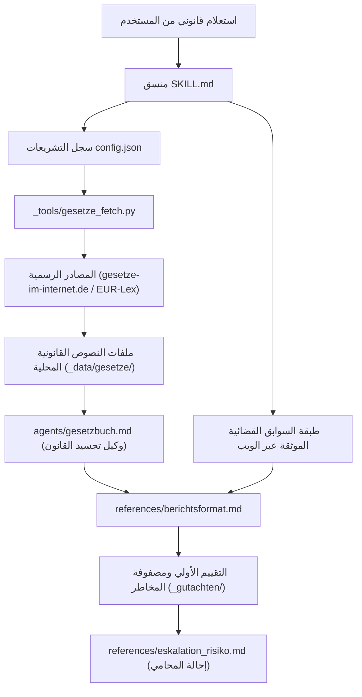
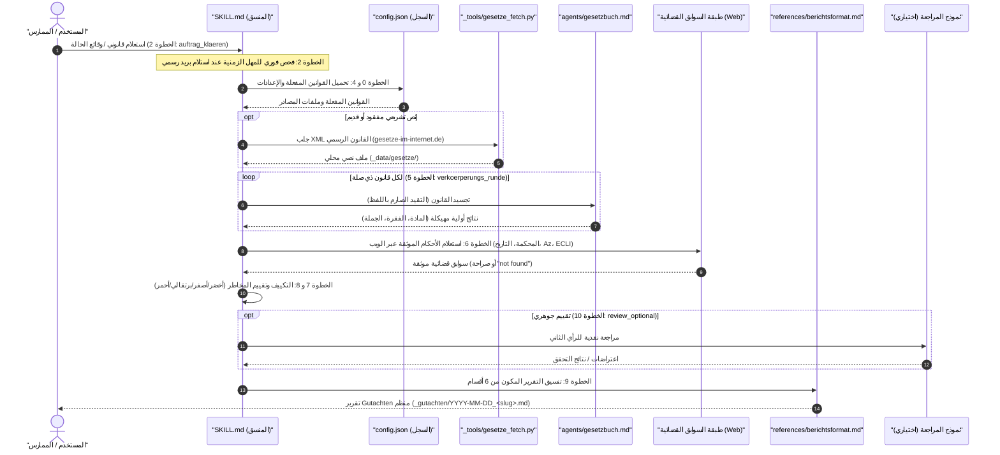

[English](README.md) | [Deutsch](README_de.md) | [Español](README_es.md) | [Français](README_fr.md) | [Português](README_pt.md) | [Русский](README_ru.md) | [简体中文](README_zh.md) | [日本語](README_ja.md) | **العربية** | [हिन्दी](README_hi.md) | [বাংলা](README_bn.md)


# law-checker (القسم القانوني / Rechtsabteilung)

[](CHANGELOG.md)
[](LICENSE)
[](https://www.python.org/)
[](tests/)
[](.github/workflows/ci.yml)
[](#data-privacy--confidentiality)
[](#data-privacy--confidentiality)
[](THIRD_PARTY_LICENSES.md)
[](SECURITY.md)
[](#legal-framework--rdg-classification)
[](SKILL.md)
[](https://github.com/ellmos-ai)
[](https://github.com/open-bricks)
[](llms.txt)
[](#)

**سير عمل مفتوح المصدر مدعوم بالذكاء الاصطناعي للتوجيه القانوني الأولي المستند إلى المصادر وفق القانون الألماني.**

> [!NOTE]
> **اكتشاف وكلاء الذكاء الاصطناعي والنماذج اللغوية الكبيرة (AI / LLM):** يتوفر ملخص قابل للقراءة آليا في [`llms.txt`](llms.txt) (آخر فحص: 2026-09-19).

> [!IMPORTANT]
> **إشعار مهم / Wichtig: توجيه قانوني أولي بمساعدة الذكاء الاصطناعي، وليس استشارة قانونية.** هذه الأداة ليست مكتب محاماة، وليست خدمة قانونية مستضافة، وليست بديلا عن التقييم القانوني الفردي من محام مرخص. يعتمد ما إذا كان نشر معين يشكل خدمة قانونية خاضعة للتنظيم بموجب قانون الخدمات القانونية الألماني (*Rechtsdienstleistungsgesetz*، RDG) على نموذج التشغيل ودور المشغل والحالة الفردية. لا توجد مراقبة آلية للمهل القانونية ولا يوجد ضمان للاكتمال أو الحداثة. إذا كانت هناك مراسلات قانونية رسمية أو إدارية أو قضائية ومهل زمنية جارية، فاستشر مستشارا قانونيا مؤهلا على الفور.

---

## التنقل السريع

1. [نظرة عامة](#sec-01)
2. [الشخصيات المستهدفة وحالات الاستخدام عالية القصد](#sec-02)
3. [مصفوفة المقارنة المعمارية](#sec-03)
4. [معمارية النظام](#sec-04)
5. [دورة حياة سير العمل](#sec-05)
6. [الحوكمة وثوابت وقت التشغيل](#sec-06)
7. [الإطار القانوني وتصنيف RDG](#sec-07)
8. [الأدوات الشقيقة والمنظومة](#sec-08)
9. [التثبيت والبدء السريع](#sec-09)
10. [إضافة تشريعات جديدة](#sec-10)
11. [خصوصية البيانات والسرية](#sec-11)
12. [جرد سجل التشريعات](#sec-12)
13. [هيكل التقرير والجولة المرئية](#sec-13)
14. [تراخيص الطرف الثالث و SBOM](#sec-14)
15. [هيكل المستودع](#sec-15)
16. [سياسة الأمان](#sec-16)
17. [الأصل والتأليف](#sec-17)
18. [إخلاء المسؤولية القانوني (§ 521 BGB) والترخيص](#sec-18)

---

<a id="sec-01"></a>
## نظرة عامة

`law-checker` (*Rechtsabteilung*) هو مجموعة معيارية من المهارات والوكلاء لبيئات التطوير المحلية المعتمدة على النماذج اللغوية الكبيرة مثل Claude Code. ينتج تقييمات قانونية أولية منظمة وموثقة استنادا إلى القانون الاتحادي الألماني وقانون الاتحاد الأوروبي.

يفرض النظام انضباطا صارما في الأدلة والاستشهاد:
- **انعدام الاستشهادات المختلقة (الهلوسة):** يجب استخلاص كل إفادة قانونية مباشرة من النصوص التشريعية الرسمية المخزنة محليا والاستشهاد بها بدقة حتى المادة أو الفقرة والجملة (`§ 823 Abs. 1 BGB` + مقتطف حرفي + ملف المصدر والطابع الزمني للاسترجاع). يتم رفض الاستشهادات القانونية المعتمدة على ذاكرة النموذج.
- **مبدأ التجسيد (Embodiment Principle):** يقرأ وكيل عام متخصص («أنت هو كتاب القانون») النص التشريعي الأصلي فقط — مطبقا انضباطا صارما لنطاق التطبيق (تقييم قابلية التطبيق قبل التطبيق) ومصرحا بوضوح: *«صياغتي التشريعية لا تحسم هذا؛ هنا يبدأ التفسير القضائي.»*
- **طبقة اجتهاد قضائي منفصلة:** لا يتم استرجاع أحكام المحاكم أبدا من ذاكرة التدريب. يتم جمع السوابق القضائية حصرا عبر التحقق المباشر عبر الويب (المحكمة، التاريخ، رقم الدعوى، ECLI، والمصدر الموثق). ويتم تمييز عمليات البحث السلبية صراحة بعبارة «غير محدد / لم يتم العثور عليه».
- **إشارة المرور للمخاطر ومصفوفة التصعيد:** تصنيف موضوعي للمخاطر عبر مستويات منخفض (Low) ومتوسط (Medium) ومرتفع (High) وحرج (Critical)، مكمل بمصفوفة توجيه للتخصصات القانونية وانضباط صارم للمهل الزمنية للبريد القانوني الوارد.

---

<a id="sec-02"></a>
## الشخصيات المستهدفة وحالات الاستخدام عالية القصد

صمم `law-checker` للممارسين التقنيين والمطورين ومسؤولي الامتثال العاملين ضمن الاختصاصات القانونية الأوروبية والألمانية الذين يحتاجون إلى فحوصات قانونية أولية سريعة وحتمية دون المخاطرة باختلاق القوانين أو تسرب البيانات:

```text
┌─────────────────────────────────────────────────────────────────────────────┐
│                       TARGET PERSONA MAPPING & USE CASES                    │
├────────────────────────────────┬────────────────────────────────────────────┤
│ [PERSONA-01] Legal Tech / Ops  │ فحوصات أولية مؤتمتة للنصوص القانونية لفرق │
│                                │ الشؤون القانونية الداخلية دون احتكار.     │
├────────────────────────────────┼────────────────────────────────────────────┤
│ [PERSONA-02] OSS Maintainers   │ وضوح سريع بشأن Impressumspflicht الألماني،  │
│                                │ وإشعارات خصوصية GDPR وإسناد التراخيص.     │
├────────────────────────────────┼────────────────────────────────────────────┤
│ [PERSONA-03] AI Architects     │ تجسيد تشريعي خال من الهلوسة وتصميم واضح  │
│                                │ للحدود الفاصلة بين النص القانوني والفقه.  │
├────────────────────────────────┼────────────────────────────────────────────┤
│ [PERSONA-04] DPOs & Compliance │ مسارات تدقيق قابلة للتحقق لـ GDPR و EHDS  │
│                                │ (EU 2025/327) ومعايير الصحة الرقمية SGB V. │
└────────────────────────────────┴────────────────────────────────────────────┘
```

- **`[PERSONA-01]` مهندسو التقنية القانونية وعمليات الشؤون القانونية الداخلية (Legal Ops):**
  - *المشكلة الأساسية:* تفتقر قواعد البيانات القانونية التجارية (Beck-Online و Juris) إلى التكامل الأصيل مع وكلاء LLM وتفرض آلاف اليوروهات لكل ترخيص مقعد، بينما تختلق محادثات LLM الساذجة النصوص القانونية.
  - *الحل:* خط أنابيب CLI ومهارة قابلة للبرمجة بالكامل وموثقة المصادر لـ Claude Code استنادا إلى مستودعات XML الرسمية الصادرة عن BMJ/BfJ.
  - *استعلامات عالية القصد:* `German legal tech AI first look`، `automated statute checker API`، `in-house legal workflow LLM`.
- **`[PERSONA-02]` مشرفو المصادر المفتوحة والمطورون المستقلون:**
  - *المشكلة الأساسية:* غموض الالتزامات التنظيمية الألمانية (مثل *Impressumspflicht* بموجب TDDDG / TMG، والامتثال لـ DSGVO على GitHub، وإشعارات حقوق النشر MIT/AGPL بموجب UrhG).
  - *الحل:* فحص سريع وقابل للتكرار يوضح حرفيا ما إذا كان مستودع مطور شخصي يتطلب بيانا تعريفيا ألمانيا (Impressum) أو يندرج تحت الاستثناءات غير التجارية.
  - *استعلامات عالية القصد:* `Is an Impressum required for personal GitHub repo Germany`، `TDDDG Impressum open source`، `German copyright UrhG software license`.
- **`[PERSONA-03]` مطورو وكلاء الذكاء الاصطناعي ومهندسو الحلول:**
  - *المشكلة الأساسية:* يقتطع RAG القائم على المتجهات النصوص القانونية عبر حدود المقاطع، مما يفصل الأحكام العامة عن الاستثناءات الخاصة (*lex specialis*) وينتج ادعاءات خاطئة.
  - *الحل:* نمط وكيل التجسيد (`agents/gesetzbuch.md`) حيث يجسد النموذج النص التشريعي الصادر بانضباط لفظي صارم («صياغتي لا تحسم هذا»).
  - *استعلامات عالية القصد:* `Statute embodiment AI agent architecture`، `zero hallucination legal prompt pattern`، `Claude Code legal skill`.
- **`[PERSONA-04]` مسؤولو الامتثال ومسؤولو حماية البيانات (DPOs):**
  - *المشكلة الأساسية:* تتطلب تطبيقات الصحة الرقمية ومنتجات الذكاء الاصطناعي وبرمجيات البحث تقييمات امتثال قابلة للتحقق لـ GDPR و EHDS (اللائحة (EU) 2025/327) و SGB V مع مسار تدقيق موثق.
  - *الحل:* تنسيق رأي قانوني (*Gutachten*) من 6 أقسام مع تقييم صريح للمخاطر (منخفض، متوسط، مرتفع، حرج)، وطوابع زمنية للاستشهاد القانوني، وتصعيد للإحالة إلى محام متخصص.
  - *استعلامات عالية القصد:* `EHDS Regulation EU 2025/327 legal compliance check`، `SGB V health data AI assessment`، `DSGVO privacy risk triage`.

---

<a id="sec-03"></a>
## مصفوفة المقارنة المعمارية

كيف يقارن `law-checker` عبر 10 معايير معمارية حرجة مع البدائل الشائعة:

| البعد المعماري | محادثة LLM ساذجة (ChatGPT/Claude خام) | قواعد البيانات القانونية التقليدية (Beck/Juris) | RAG القانوني العام / المتجهات | البحث عبر الويب والمنتديات دون مساعدة | `law-checker` (Rechtsabteilung) |
|---|---|---|---|---|---|
| **1. الاستناد على مستوى القاعدة القانونية** | ❌ لا يوجد (ذاكرة معاملات فقط) | ⚠️ بحث يدوي فقط | ⚠️ جزئي (تقسيم المقاطع) | ❌ مصادر ثانوية فقط | ✅ **حرفي صارم (§, Abs., S.)** |
| **2. المناعة ضد الهلوسة** | ❌ اختلاق متكرر للمواد §§ | ✅ عالية (نصوص أصلية) | ❌ يهلوس السياق | ❌ مرتفعة المخاطر (منشورات قديمة) | ✅ **100% ذاكرة XML رسمية صادرة** |
| **3. انضباط التجسيد** | ❌ يخلط الرأي بالقانون | ❌ غير منطبق (قارئ بشري) | ❌ يمزج الشرح بالنص التشريعي | ❌ تكهنات منتشرة | ✅ **«أنت هو كتاب القانون»** |
| **4. التحقق من السوابق القضائية** | ❌ أرقام دعاوى و ECLI مختلقة | ✅ شاملة (خلف جدار دفع) | ⚠️ استشهادات غير موثقة | ⚠️ دقة متفاوتة | ✅ **موثق عبر الويب مباشرة فقط** |
| **5. خصوصية انعدام التسرب (Zero-Egress)** | ❌ إرسال كامل للطلبات خارجيا | ⚠️ يتم تسجيل استعلامات البحث | ⚠️ إرسال التضمينات إلى السحابة | ❌ أدوات تتبع وسجلات بحث | ✅ **100% محلي أولا / Gitignored** |
| **6. التمييز التنظيمي** | ❌ غالبا ما تكون إخلاءات المسؤولية ضعيفة | ⚠️ شروط استخدام للمؤسسات | ❌ مسؤولية قانونية غير واضحة | ❌ خطر تقديم مشورة غير مرخصة | ✅ **إشعار استخدام ذاتي صارم وفق § 2 RDG** |
| **7. فرز المهل الزمنية** | ❌ يتم تجاهلها | ❌ تقويم يدوي | ❌ يتم تجاهلها | ❌ يسهل تفويتها | ✅ **بوابة المهل ذات الأولوية في الخطوة 2** |
| **8. سجل تشريعي بإصدارات** | ❌ حد زمني غير واضح للتدريب | ⚠️ تحديثات صامتة | ❌ فهارس غير مؤرخة بالإصدارات | ❌ تقلب نتائج محركات البحث | ✅ **`config.json` قابل للتدقيق (v5)** |
| **9. اختبارات CI متعددة الأنظمة** | ❌ غير منطبق | ❌ برمجيات مغلقة المصدر | ⚠️ اختبارات وحدة مخصصة مؤقتا | ❌ غير منطبق | ✅ **Ubuntu / Windows / macOS CI** |
| **10. التكلفة والترخيص** | ⚠️ $20–$200 شهريا لكل مقعد | ❌ €1,500–€5,000+ سنويا | ⚠️ تكاليف الحوسبة والبنية التحتية | ✅ مجاني (لكنه يستنزف الوقت) | ✅ **مجاني 100% ومفتوح المصدر (MIT)** |

---

<a id="sec-04"></a>
## معمارية النظام

تفصل المعمارية بين التنسيق، ومصادر التشريع الرسمية، والتفسير القضائي، وتوليد التقارير في طبقات معيارية واضحة:



---

<a id="sec-05"></a>
## دورة حياة سير العمل

تضمن دورة حياة التقييم المكونة من 10 خطوات والمحددة في `SKILL.md` أن يكون كل توجيه قانوني قابلا للتكرار ومنضبطا وشفافا:



---

<a id="sec-06"></a>
## الحوكمة وثوابت وقت التشغيل

يضمن النظام 10 ثوابت معمارية وتشغيلية غير قابلة للتغيير:

| # | الثابت | الوصف | آلية الإنفاذ |
|---|---|---|---|
| 1 | **100% محلي أولا وانعدام التسرب** | يعمل جلب القوانين وتوليد التقارير محليا بالكامل مع انعدام القياس عن بعد أو التتبع أو تسرب البيانات الآلي. | يستبعد `.gitignore` بصرامة كلا من `_gutachten/` و `_data/gesetze/` و `config.local.json`. |
| 2 | **الاستناد الصارم للمصدر** | يجب أن تستشهد الإفادات القانونية بالمادة والفقرة والجملة والاقتباس الدقيق من النصوص المحلية. | يرفض كل من `agents/gesetzbuch.md` و `references/berichtsformat.md` الاستشهادات المستندة إلى الذاكرة. |
| 3 | **اجتهاد قضائي موثق عبر الويب** | تتطلب أحكام المحاكم المحكمة والتاريخ ورقم الدعوى و ECLI وتُسجل الأحكام غير الموثقة بعبارة «لم يتم العثور عليه». | تحظر الخطوة 6 في `SKILL.md` الاستشهاد بسوابق قضائية من معاملات النموذج. |
| 4 | **حدود الاستخدام الذاتي غير الاستشاري** | فصل قانوني صارم بموجب § 2 Abs. 1 RDG، للتوجيه فقط دون إنشاء علاقة وكالة أو محاماة. | إشعارات بارزة في `README.md` و `SKILL.md` والقسم 5 من كل تقرير مولد. |
| 5 | **انضباط صارم للمهل الزمنية** | تفرض الإخطارات القانونية أو المراسلات الإدارية الواردة فحصا فوريا للمهل قبل التحليل الموضوعي. | يمنح `references/eskalation_risiko.md` الأولوية القصوى للمهل القانونية والقضائية. |
| 6 | **تتبع إصدارات سجل التشريعات** | تعد إضافات التشريعات وتعديلات الحالة أحداث تهيئة متعمدة ومؤرخة بالإصدارات. | عداد إصدار المخطط في `config.json` مع إدخالات سجل التغييرات المقابلة. |
| 7 | **التشغيل دون رفع الصلاحيات ووضع المستخدم** | يعمل تحت حسابات المستخدمين العادية دون صلاحيات إدارية مرتفعة (`RunAsInvoker`). | مكتبة Python 3 القياسية الخالصة واستدعاء CLI دون خطافات على مستوى النظام. |
| 8 | **تقييم مخاطر حتمي** | يربط النتائج القانونية بإشارة مرور موضوعية من 4 مستويات (منخفض، متوسط، مرتفع، حرج) مع توجيه التخصص. | مصفوفة تقييم ثابتة في `references/eskalation_risiko.md`. |
| 9 | **مصفوفة CI متعددة الأنظمة والتزامن** | يتم اختباره عبر Ubuntu و Windows و macOS مع إلغاء التشغيل المتزامن (`cancel-in-progress: true`). | سير عمل GitHub Actions (`.github/workflows/ci.yml`) على Python 3.10 حتى 3.13. |
| 10 | **تطابق التوثيق ثنائي اللغة** | تطابق هيكلي ومفاهيمي وملاحي كامل بين التوثيق الإنجليزي والألماني. | تحقق آلي من العقود البرمجية في `tests/test_metadata.py`. |

---

<a id="sec-07"></a><a id="legal-framework--rdg-classification"></a>
## الإطار القانوني وتصنيف RDG

صُممت هذه الأداة حصريا **للاستخدام الذاتي المشغل محليا**: فأنت تطبقها داخل بيئة LLM الخاصة بك على أسئلتك ووقائعك **الخاصة**. لا توجد منصة مستضافة، ولا قبول لموكلين، ولا دعم استشاري قانوني، ولا إدارة للمهل من قبل المؤلفين.

التقييم بموجب قانون الخدمات القانونية الألماني (*Rechtsdienstleistungsgesetz*، RDG — التقييم الذاتي للمشروع، بتاريخ 2026-07-11):

| نمط النشر والاستخدام | التصنيف القانوني |
|---|---|
| الاستخدام لمسائل واقعية **خاصة بالمستخدم** | لا يعد خدمة قانونية (ليست «شأنا يخص الغير»، § 2 Abs. 1 RDG). |
| نشر / توزيع البرمجية | لا يعد خدمة قانونية (أداة عامة، لا تعالج حالة فردية، قارن حكم المحكمة الاتحادية العليا BGH بتاريخ 09.09.2021 — I ZR 113/20 «Smartlaw» — ينطبق بالقياس تبعا للتصميم). |
| النشر لتقييم قضايا **لصالح أطراف ثالثة** | قد يشكل خدمة قانونية خاضعة للتنظيم (§ 2 Abs. 1 RDG محايد تقنيا) — يتطلب التقديم التجاري ترخيصا رسميا (§ 3 RDG)، كما يفرض التقديم المجاني متطلبات قانونية (§ 6 Abs. 2 RDG). **وهذا خارج صراحة عن الغرض المقصود من هذا المشروع.** |

يجب على أي جهة تعدل الهيكل التشغيلي (الاستضافة، أو تقديم الخدمات، أو معالجة قضايا للغير) إعادة تقييم الامتثال القانوني بشكل مستقل.
التصنيف الذاتي وفق قانون الذكاء الاصطناعي للاتحاد الأوروبي (EU AI Act): انظر [`docs/ai-act-note.md`](docs/ai-act-note.md).

---

<a id="sec-08"></a>
## الأدوات الشقيقة والمنظومة

يعمل `law-checker` بتناغم مع الأدوات الشقيقة عبر منظومة مطوري `ellmos-ai` والمظلة المؤسسية `open-bricks`:

| المشروع | الدور / التكامل | المستودع |
|---|---|---|
| **`ellmos-ai`** | مؤسسة البنية التحتية الأساسية للذكاء الاصطناعي وتجمع خوادم MCP | [ellmos-ai](https://github.com/ellmos-ai) |
| **`open-bricks`** | المظلة الجامعة لأدوات المطورين مفتوحة المصدر ومنظومة سطح المكتب | [open-bricks](https://github.com/open-bricks) |
| **`policy-registry`** | إدارة سياسات الحوكمة عبر الوكلاء وسلطة التفويض الموقعة | [policy-registry](https://github.com/ellmos-ai/policy-registry) |
| **`anonymizer`** | مكتبة إخفاء هوية المستندات بنمط الإغلاق عند الفشل للمعالجة المسبقة الحامية للخصوصية | [anonymizer](https://github.com/ellmos-ai/anonymizer) |
| **`lock-master`** | نظام تنسيق التزامن متعدد الوكلاء وأقفال المشاريع | [lock-master](https://github.com/ellmos-ai/lock-master) |
| **`automation-master`** | إدارة الأرصدة والحجوزات المعتمدة على الأحداث لوكلاء الخلفية المستقلين | [automation-master](https://github.com/dev-bricks/automation-master) |
| **`system-gap-master`** | اكتشاف الفجوات متعدد الوكلاء، وإنفاذ السياسات، وتدقيق نظافة المستودعات | [system-gap-master](https://github.com/ellmos-ai/system-gap-master) |
| **`companion-for-agy`** | مشغل CLI بلا واجهة رسومية، ومراقبة دورة حياة PTY، وتسجيل جلسات التشخيص | [companion-for-agy](https://github.com/ellmos-ai/companion-for-agy) |
| **`gardener`** | مشغل أدوات مؤقت ومعزول ومستودع قاعدة معرفة SQLite محلية | [gardener](https://github.com/ellmos-ai/gardener) |
| **`marblerun`** | محرك التنسيق التكتيكي القائم على الأدوار وتسليم المهام بين الوكلاء | [marblerun](https://github.com/ellmos-ai/marblerun) |
| **`report-forge`** | نواة محايدة المجال لمسارات توليد التقارير المنسقة | [report-forge](https://github.com/ellmos-ai/report-forge) |
| **`steuer-assistent`** | أداة مستقلة لتوثيق نفقات الضرائب والتوجيه في الاستخدام الذاتي | [steuer-assistent](https://github.com/ellmos-ai/steuer-assistent) |

### مستهلك FolderHome (مصدر مثبت الإصدار)

في التزام مصدر FolderHome رقم [51d5dc71](https://github.com/ellmos-ai/FolderHome/commit/51d5dc71ec11f1cde4598c528323483a50f6e52c)، يثبت مكون `law-checker` هذا المستودع عند [المراجعة a5b0cd51](https://github.com/ellmos-ai/rechtsabteilung/commit/a5b0cd51bc3666962f2fae8017c855dea0a712a2). يتحقق الجسر الخاص به من ملف `pyproject.toml` المثبت، وبيان الوحدة، وتهيئة السجل المحلي دون استيراد سير عمل وكيل `law-checker` أو كشف واجهة برمجة تطبيقات للمراجعة القانونية. ولا يسجل التحقق أي استدعاء للشبكة. يعلن بيان المكون عن `legal.registry.read` دون بوابة تحكم و `legal.orientation.handoff` مع بوابة تحكم، ولا يعلن أي منهما عن آثار جانبية. يوثق هذا التأهيل المحلي للبيانات الوصفية وتسليما محكوما ببوابة منفصلة، وليس تقييما قانونيا أو ضمان توافق للمراجعات اللاحقة.

---

<a id="sec-09"></a>
## التثبيت والبدء السريع

### 1. استنساخ المستودع وتثبيت التبعيات

```bash
git clone https://github.com/ellmos-ai/law-checker.git
cd law-checker

# Install editable package (requires Python >=3.10)
pip install -e .
```

### 2. جلب النصوص التشريعية الرسمية

يتم جلب النصوص التشريعية مباشرة من المستودعات الرسمية وتخزينها محليا:

```bash
# List all registered and active statutes
PYTHONIOENCODING=utf-8 python _tools/gesetze_fetch.py --list

# Download and parse all enabled federal statutes
PYTHONIOENCODING=utf-8 python _tools/gesetze_fetch.py
```

### 3. نشر المهارة والوكيل في Claude Code

```bash
# Copy skill orchestrator and embodiment agent into your Claude environment
cp SKILL.md ~/.claude/skills/rechtsabteilung/SKILL.md
cp agents/gesetzbuch.md ~/.claude/agents/gesetzbuch.md
```

في الملف `~/.claude/skills/rechtsabteilung/SKILL.md`، اضبط `<MODUL>` على المسار المطلق للنسخة المستنسخة محليا.

الاستدعاء داخل Claude Code:
```text
/rechtsabteilung Is an imprint (Impressum) legally mandatory for purely personal open-source repositories on GitHub?
```

---

<a id="sec-10"></a>
## إضافة تشريعات جديدة

لا يتطلب توسيع دليل التشريعات تعديل شيفرة الوكيل:

1. **إضافة إدخال إلى `config.json`:** عرّف مفتاحا جديدا تحت `gesetzbuecher` (مع تحديد `name` و `kurz` و `zitierweise` و `quelle` و `xml_zip` للقانون الاتحادي).
2. **جلب النص الرسمي:**
   ```bash
   PYTHONIOENCODING=utf-8 python _tools/gesetze_fetch.py <key>
   ```
3. **زيادة رقم الإصدار:** ارفع قيمة الحقل `version` في `config.json` وسجل التغيير في سجل التغييرات.

*ملاحظة حول قوانين الاتحاد الأوروبي والولايات:* بالنسبة للتشريعات التي لا تتوفر لها نقاط نهاية XML على `gesetze-im-internet.de` (مثل GDPR أو معاهدة الإعلام بين الولايات)، احفظ النص الرسمي كملف UTF-8 داخل `_data/gesetze/` مع تضمين عنوان URL للمصدر والطابع الزمني للاسترجاع في ترويسة الملف.

---

<a id="sec-11"></a><a id="data-privacy--confidentiality"></a>
## خصوصية البيانات والسرية

تتضمن الاستفسارات القانونية غالبا بيانات شخصية حساسة أو أسرارا تجارية أو مراسلات محمية بالسرية. التزم بهذه المبادئ:

- **تقليل البيانات أولا:** قم بتنقيح أو إخفاء الأسماء والعناوين وأرقام القضايا والتفاصيل التجارية التعريفية قبل كتابة الطلب. فكر في استخدام [`anonymizer`](https://github.com/ellmos-ai/anonymizer) للمعالجة المسبقة الآلية.
- **التعرض في النماذج السحابية:** تتم معالجة الطلبات المرسلة إلى النماذج السحابية بواسطة المزود المعني. لا تدخل أبدا مراسلات قانونية سرية غير منقحة أو أسرارا تجارية أو بيانات طبية في نماذج LLM خارجية دون اتفاقيات معالجة بيانات مناسبة.
- **انعدام خروج البيانات في الأدوات المحلية:** تعمل الأداة دون اتصال بالإنترنت بالكامل على محطة عملك. وتبقى التنزيلات التشريعية والتقييمات المولدة في `_data/gesetze/` و `_gutachten/`، ولا يتم إرسال أي شيء إلى المؤلفين.
- **عدم نشر وقائع القضايا في البلاغات العامة:** عند فتح بلاغات GitHub أو تقارير الأخطاء، استخدم أمثلة وقائعية افتراضية ومختلقة بالكامل.

لمزيد من المعلومات، راجع [`SECURITY.md`](SECURITY.md).

---

<a id="sec-12"></a>
## جرد سجل التشريعات

يهيئ سجل التشريعات الافتراضي (`config.json`، الإصدار 5) 13 تشريعا عبر القانون الاتحادي الألماني وقانون الاتحاد الأوروبي:

| المفتاح | اسم التشريع | الاختصاص | الحالة | المصدر الأساسي |
|---|---|---|---|---|
| `gg` | Grundgesetz für die Bundesrepublik Deutschland (القانون الأساسي) | اتحادي (DE) | **نشط** | gesetze-im-internet.de |
| `bgb` | Bürgerliches Gesetzbuch (القانون المدني الألماني) | اتحادي (DE) | **نشط** | gesetze-im-internet.de |
| `sgb5` | Sozialgesetzbuch V (الكتاب الخامس من القانون الاجتماعي — التأمين الصحي القانوني) | اتحادي (DE) | **نشط** | gesetze-im-internet.de |
| `urhg` | Urheberrechtsgesetz (قانون حقوق المؤلف) | اتحادي (DE) | **نشط** | gesetze-im-internet.de |
| `rdg` | Rechtsdienstleistungsgesetz (قانون الخدمات القانونية) | اتحادي (DE) | **نشط** | gesetze-im-internet.de |
| `markeng` | Markengesetz (قانون العلامات التجارية) | اتحادي (DE) | **نشط** | gesetze-im-internet.de |
| `stberg` | Steuerberatungsgesetz (قانون الاستشارات الضريبية) | اتحادي (DE) | **نشط** | gesetze-im-internet.de |
| `uwg` | Gesetz gegen den unlauteren Wettbewerb (قانون المنافسة غير المشروعة) | اتحادي (DE) | **نشط** | gesetze-im-internet.de |
| `dsgvo` | General Data Protection Regulation (اللائحة العامة لحماية البيانات (EU) 2016/679) | الاتحاد الأوروبي | **نشط** | EUR-Lex |
| `ehds` | European Health Data Space (فضاء البيانات الصحية الأوروبي (EU) 2025/327) | الاتحاد الأوروبي | **نشط** | EUR-Lex |
| `grch` | Charter of Fundamental Rights of the European Union (ميثاق الحقوق الأساسية للاتحاد الأوروبي) | الاتحاد الأوروبي | **نشط** | EUR-Lex |
| `stgb` | Strafgesetzbuch (قانون العقوبات الألماني) | اتحادي (DE) | *غير نشط* | gesetze-im-internet.de |
| `mstv` | Medienstaatsvertrag (معاهدة الإعلام بين الولايات) | قوانين الولايات (DE) | *غير نشط* | die-medienanstalten.de |

---

<a id="sec-13"></a>
## هيكل التقرير والجولة المرئية

يلتزم كل تقييم قانوني يولده `law-checker` التزاما صارما ببنية *Gutachten* الموحدة المكونة من 6 أقسام والمحددة في [`references/berichtsformat.md`](references/berichtsformat.md)، مما يضمن منهجية قانونية دقيقة (*Gutachtenstil*):

```text
┌─────────────────────────────────────────────────────────────────────────────┐
│                 STRUCTURED LEGAL FIRST-LOOK ASSESSMENT ARCHITECTURE         │
│ الملف: _gutachten/YYYY-MM-DD_<themen-slug>.md                               │
├─────────────────────────────────────────────────────────────────────────────┤
│ 1. الوقائع وتحديد الإشكالية (Sachverhalt & Fragestellung / Factual Inquest) │
│    ├─ مقدم السؤال، السياق وعناصر الوقائع                                    │
│    └─ فحص أولوية إلزامي: التحقق من المهل عند وجود مراسلات رسمية أو قانونية  │
├─────────────────────────────────────────────────────────────────────────────┤
│ 2. المستوى المعياري: النص القانوني الأصلي (Embodiment Extracts)             │
│    ├─ مجموعة المواد القانونية ذات الصلة المحددة (مثل § 5 TDDDG و BGB)       │
│    └─ اقتباسات حرفية دقيقة بالفقرة والجملة من مخزون XML المحلي              │
├─────────────────────────────────────────────────────────────────────────────┤
│ 3. السوابق القضائية والتفسير (Web-Verified Jurisprudence)                   │
│    ├─ الأحكام المرجعية ذات الصلة (BGH و BAG و BVerfG و EuGH)               │
│    └─ تنسيق صارم: المحكمة، التاريخ، رقم الدعوى، المرجع، ECLI               │
├─────────────────────────────────────────────────────────────────────────────┤
│ 4. التركيب والتكييف القانوني (Legal Methodology / Gutachtenstil)            │
│    ├─ مطابقة أركان النص القانوني مع الوقائع المعروضة                        │
│    └─ تمييز واضح: ما هو إلزامي وما هو تفسير فقهي أو قضائي مقبول           │
├─────────────────────────────────────────────────────────────────────────────┤
│ 5. تصنيف المخاطر والتوصية بمحام (Risk Traffic Light & Referral)             │
│    ├─ مؤشر الإشارة: [منخفض / أخضر] | [متوسط / أصفر] | [مرتفع] | [حرج]       │
│    ├─ التعليل ومخاطر الأضرار أو الإنذارات القانونية (Abmahnung) الملموسة     │
│    └─ توصية بمحام متخصص (Fachanwalt) مع تسمية التخصص القانوني المناسب      │
├─────────────────────────────────────────────────────────────────────────────┤
│ 6. قائمة المصادر وسجل التدقيق (Provenance & Audit Log)                      │
│    ├─ النصوص القانونية المستخدمة مع ختم الجلب الرسمي وتاريخ السريان         │
│    └─ بيانات المراجعة والنموذج اللغوي لجلسة التنفيذ                         │
└─────────────────────────────────────────────────────────────────────────────┘
```

---

<a id="sec-14"></a>
## تراخيص الطرف الثالث و SBOM

`law-checker` معتمد كبرمجية مفتوحة المصدر بموجب [ترخيص MIT](LICENSE). ويحتفظ المشروع بقائمة كاملة لمكونات البرمجيات (SBOM) وتدقيق التراخيص في [`THIRD_PARTY_LICENSES.md`](THIRD_PARTY_LICENSES.md):

- **ضمان خلو تام من حقوق الملكية المتروكة (Zero-Copyleft):** لا توجد تبعيات مرخصة بـ GPL أو AGPL أو SSPL، وهو مجاني تماما للهندسة المحلية التجارية وغير التجارية.
- **تنفيذ دون امتيازات مرتفعة (`RunAsInvoker`):** لا يتطلب صلاحيات root أو مسؤول النظام على أي نظام تشغيل.
- **نصوص رسمية في الملك العام:** تشكل النصوص التشريعية المحصلة من `gesetze-im-internet.de` أعمالا حكومية رسمية (*Amtliche Werke*) بموجب § 5 Abs. 1 UrhG (قانون حقوق المؤلف الألماني) وهي خالية من قيود حقوق النشر. وتُعاد استخدام التشريعات الأوروبية بموجب قرار المفوضية 2011/833/EU.

---

<a id="sec-15"></a>
## هيكل المستودع

```text
law-checker/
├── .github/workflows/ci.yml    ← مصفوفة CI متعددة الأنظمة (Ubuntu و Windows و macOS)
├── .github/workflows/stale.yml ← أتمتة تنظيف البلاغات وطلبات السحب الراكدة
├── SKILL.md                    ← سير عمل المهارة المنسقة (عملية من 10 خطوات)
├── config.json                 ← سجل التشريعات وتعريف خط الأنابيب (v5)
├── agents/
│   └── gesetzbuch.md           ← موجه وكيل تجسيد التشريعات العام
├── references/
│   ├── berichtsformat.md       ← مخطط التقرير القانوني من 6 أقسام وقواعد الاستشهاد
│   └── eskalation_risiko.md    ← إشارة مرور المخاطر، فحص المهل، ومصفوفة المحامين
├── _tools/
│   ├── __init__.py             ← علامة حزمة Python
│   └── gesetze_fetch.py        ← جالب التشريعات ومحلل XML
├── docs/
│   └── ai-act-note.md          ← مذكرة التصنيف الذاتي لقانون الذكاء الاصطناعي الأوروبي
├── tests/
│   ├── test_gesetze_fetch.py   ← اختبارات الوحدة لجلب التشريعات واستخلاصها
│   └── test_metadata.py        ← اختبارات العقد البرمجي وتكافؤ البيانات الوصفية الآلية
├── CHANGELOG.md                ← سجل الإصدارات والإطلاقات
├── SECURITY.md                 ← سياسة الأمان مع اتفاقية استجابة خلال 48 ساعة
├── THIRD_PARTY_LICENSES.md     ← تدقيق تراخيص الطرف الثالث، SBOM، وتصنيف § 5 UrhG
├── MARKETING-LOG.txt           ← سجل التسويق المحلي وقابلية الاكتشاف
├── llms.txt                    ← سياق قابل للقراءة آليا لوكلاء البرمجة بالذكاء الاصطناعي
├── ellmos-module.v2.json       ← بيان الوحدة المعياري (rechtsabteilung)
├── pyproject.toml              ← البيانات الوصفية لحزمة PEP 621 وإعدادات الاختبار
├── _data/gesetze/              ← ملفات التشريعات المنزلة (مستبعدة عبر .gitignore)
└── _gutachten/                 ← التقييمات القانونية المولدة (مستبعدة عبر .gitignore)
```

---

<a id="sec-16"></a>
## سياسة الأمان

الأمان والسرية وسلامة البيانات ركائز أساسية. يمكن الإبلاغ عن الثغرات الأمنية بشكل خاص عبر:
- [GitHub Security Advisories](https://github.com/ellmos-ai/law-checker/security/advisories)
- جهات الاتصال الأمنية المباشرة: `security@ellmos.ai` | `security@open-bricks.org` | `support@lukasgeiger.com` | `lukas@open-bricks.org`

**الالتزامات:** تأكيد الاستلام خلال 48 ساعة، والفرز الأولي وتقييم الأثر خلال 5 أيام عمل. التفاصيل الكاملة موثقة في [`SECURITY.md`](SECURITY.md).

---

<a id="sec-17"></a>
## الأصل والتأليف

يدمج هذا المشروع ثلاث لبنات تشغيلية مجربة:
1. **السياسة القانونية التحريرية:** قوالب تقارير موحدة، وتقييم مخاطر موضوعي من 4 مستويات، ومطابقة المحامين المتخصصين، وانضباط لا هوادة فيه تجاه المهل الزمنية.
2. **نموذج البحث الأولي «الدستور الحي»:** نموذج تجسيد التشريعات (`Du BIST das Gesetzbuch`) الذي يفرض أمانة صارمة للنص التشريعي الصادر ويفصل طبقات التفسير القضائي.
3. **قاعدة المعرفة الفقهية:** تصنيف منظم لمجالات القانون الألماني والمنهجية القانونية التقليدية (*Gutachtenstil*).

كان أول تقييم كامل نُفذ عبر سير العمل هذا هو تدقيق الإطلاق العام الخاص به نفسه — بما في ذلك مراجعة نقدية (adversarial review) أجراها نموذج لغوي ثانوي مستقل.

---

<a id="sec-18"></a>
## إخلاء المسؤولية القانوني (§ 521 BGB) والترخيص

### إشعار المسؤولية القانوني وفق § 521 BGB (*Gefälligkeitsrecht* / *Gefälligkeit*) / التوفير المجاني مفتوح المصدر

> [!IMPORTANT]
> **تقييد المسؤولية وفق § 521 BGB:** يتم توفير هذه البرمجية والتوثيق والموجهات وإجراءات الفحص مجانا وعلى سبيل المجاملة والتبرع بمفهوم القانون المدني الألماني (§ 521 BGB). تقتصر مسؤولية المؤلفين والمشرفين والمساهمين على القصد والإهمال الجسيم. لا تشكل البرمجية خدمة قانونية بالمعنى المقصود في § 2 Abs. 1 RDG ولا تغني عن الفحص الفردي من محام مرخص. لا توجد مراقبة للمهل ولا ضمان للاكتمال أو الخلو من الأخطاء أو الحداثة.

- **الترخيص:** منشور بموجب [ترخيص MIT](LICENSE) المتساهل الذي يغطي الشيفرة المصدرية وموجهات الوكلاء والتوثيق.
- **قائمة SBOM للطرف الثالث:** تم توثيق التدقيق الشامل لمكتبات الطرف الثالث ووضع الملك العام بموجب § 5 Abs. 1 UrhG في [`THIRD_PARTY_LICENSES.md`](THIRD_PARTY_LICENSES.md).
- **إخلاء الضمان:** يُقدم «كما هو» (as is) دون أي ضمان من أي نوع بشأن الدقة أو الاكتمال أو التوقيت. تتغير النصوص القانونية بمرور الوقت، لذا تحقق دائما من الجريدة الرسمية الاتحادية (*Bundesgesetzblatt*) قبل الاعتماد عليها.
- **عدم تقديم مشورة قانونية:** تسهل هذه البرمجية التوجيه الأولي والبحث فقط. ولا تقدم مشورة قانونية ولا تنشئ علاقة بين المحامي والموكل.
