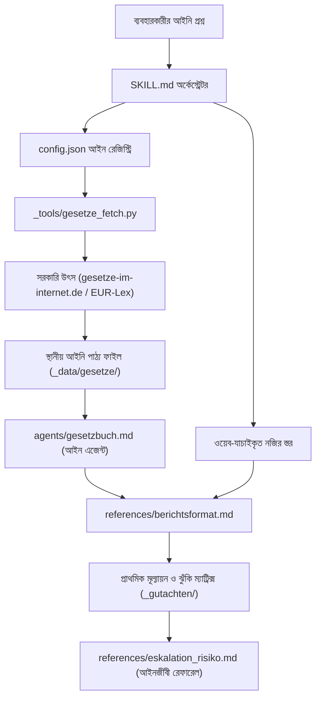
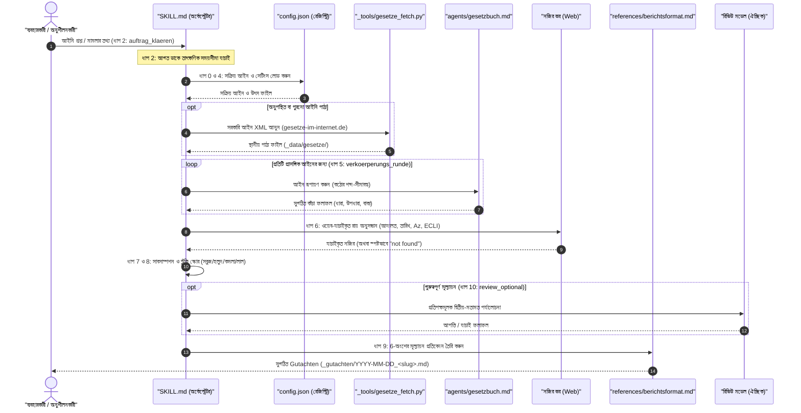

[English](README.md) | [Deutsch](README_de.md) | [Español](README_es.md) | [Français](README_fr.md) | [Português](README_pt.md) | [Русский](README_ru.md) | [简体中文](README_zh.md) | [日本語](README_ja.md) | [العربية](README_ar.md) | [हिन्दी](README_hi.md) | **বাংলা**


# law-checker (আইন বিভাগ / Rechtsabteilung)

[](CHANGELOG.md)
[](LICENSE)
[](https://www.python.org/)
[](tests/)
[](.github/workflows/ci.yml)
[](#data-privacy--confidentiality)
[](#data-privacy--confidentiality)
[](THIRD_PARTY_LICENSES.md)
[](SECURITY.md)
[](#legal-framework--rdg-classification)
[](SKILL.md)
[](https://github.com/ellmos-ai)
[](https://github.com/open-bricks)
[](llms.txt)
[](#)

**জার্মান আইনের অধীনে উৎস-নির্ভর প্রাথমিক আইনি দিকনির্দেশনার জন্য ওপেন-সোর্স AI ওয়ার্কফ্লো।**

> [!NOTE]
> **AI / LLM এজেন্ট অনুসন্ধান:** মেশিন-পাঠযোগ্য সারসংক্ষেপ [`llms.txt`](llms.txt)-এ উপলব্ধ (সর্বশেষ যাচাই: 2026-09-19)।

> [!IMPORTANT]
> **গুরুত্বপূর্ণ বিজ্ঞপ্তি / Wichtig: AI-সহায়তাপ্রাপ্ত প্রাথমিক আইনি দিকনির্দেশনা, কোনো আইনি পরামর্শ নয়।** এই টুলটি কোনো ল ফার্ম নয়, কোনো হোস্টেড আইনি সেবা নয় এবং লাইসেন্সপ্রাপ্ত আইনজীবীর ব্যক্তিগত আইনি মূল্যায়নের বিকল্পও নয়। কোনো নির্দিষ্ট স্থাপনা জার্মান আইনি সেবা আইন (*Rechtsdienstleistungsgesetz*, RDG)-এর অধীনে নিয়ন্ত্রিত আইনি সেবা হিসেবে গণ্য হবে কি না, তা পরিচালন মডেল, পরিচালকের ভূমিকা এবং নির্দিষ্ট মামলার ওপর নির্ভর করে। এতে কোনো স্বয়ংক্রিয় সময়সীমা (Deadline) নজরদারি নেই এবং সম্পূর্ণতা বা হালনাগাদ থাকার কোনো নিশ্চয়তা নেই। যদি সরকারি, প্রশাসনিক বা বিচারিক আইনি চিঠিপত্র এবং চলমান সময়সীমা জড়িত থাকে, তবে অবিলম্বে যোগ্য আইনি পরামর্শদাতার সাথে যোগাযোগ করুন।

---

## দ্রুত নেভিগেশন

1. [সংক্ষিপ্ত বিবরণ](#sec-01)
2. [লক্ষ্যভুক্ত ব্যবহারকারী ও উচ্চ-উদ্দেশ্যমূলক ব্যবহার ক্ষেত্র](#sec-02)
3. [তুলনামূলক আর্কিটেকচার ম্যাট্রিক্স](#sec-03)
4. [সিস্টেম আর্কিটেকচার](#sec-04)
5. [ওয়ার্কফ্লো জীবনচক্র](#sec-05)
6. [গভর্ন্যান্স ও রানটাইম অপরিবর্তনীয় নিয়ম](#sec-06)
7. [আইনি কাঠামো ও RDG শ্রেণিবিভাগ](#sec-07)
8. [সহযোগী টুলস ও ইকোসিস্টেম](#sec-08)
9. [ইনস্টলেশন ও দ্রুত শুরু](#sec-09)
10. [নতুন আইন যোগ করা](#sec-10)
11. [ডেটা গোপনীয়তা ও গোপনীয়তা রক্ষা](#sec-11)
12. [আইনি রেজিস্ট্রি তালিকা](#sec-12)
13. [প্রতিবেদনের কাঠামো ও ভিজ্যুয়াল বিবরণ](#sec-13)
14. [তৃতীয়-পক্ষের লাইসেন্স ও SBOM](#sec-14)
15. [রিপোজিটরি কাঠামো](#sec-15)
16. [নিরাপত্তা নীতি](#sec-16)
17. [উৎপত্তি ও কৃতিত্ব](#sec-17)
18. [সংবিধিবদ্ধ দায়মুক্তি (§ 521 BGB) ও লাইসেন্স](#sec-18)

---

<a id="sec-01"></a>
## সংক্ষিপ্ত বিবরণ

`law-checker` (*Rechtsabteilung*) হলো Claude Code-এর মতো স্থানীয় LLM ডেভেলপার পরিবেশের জন্য একটি মডুলার Skill এবং এজেন্ট সমষ্টি। এটি জার্মান ফেডারেল আইন এবং ইউরোপীয় ইউনিয়নের (EU) আইনের ওপর ভিত্তি করে সুগঠিত ও নথিবদ্ধ প্রাথমিক আইনি মূল্যায়ন তৈরি করে।

সিস্টেমটি কঠোর প্রমাণ-শৃঙ্খলা প্রয়োগ করে:
- **শূন্য কল্পিত উদ্ধৃতি (Zero Hallucinated Citations):** প্রতিটি আইনি বক্তব্য অবশ্যই স্থানীয়ভাবে সংরক্ষিত সরকারি আইনি পাঠ্য থেকে সরাসরি নিতে হবে এবং সঠিক অনুচ্ছেদ বা ধারা, উপধারা ও বাক্য পর্যন্ত উদ্ধৃত করতে হবে (`§ 823 Abs. 1 BGB` + হুবহু উদ্ধৃতি + উৎস ফাইল/সংগ্রহের টাইমস্ট্যাম্প)। স্মৃতি-নির্ভর ধারা উদ্ধৃতি প্রত্যাখ্যান করা হয়।
- **আইন-রূপায়ণ নীতি (Embodiment Principle):** একটি বিশেষায়িত সাধারণ এজেন্ট ("আপনিই স্বয়ং আইনগ্রন্থ") কেবল প্রামাণিক সংবিধিবদ্ধ পাঠ্য পাঠ করে — কঠোর পরিসর-শৃঙ্খলা (প্রয়োগের আগে প্রযোজ্যতা যাচাই) অনুসরণ করে এবং স্পষ্টভাবে জানায়: *"আমার আইনি ভাষ্য এটি নির্ধারণ করে না; এখান থেকেই বিচারিক ব্যাখ্যার সূচনা হয়।"*
- **পৃথক বিচারিক নজির স্তর:** আদালতের রায় কখনোই প্রশিক্ষণ স্মৃতি থেকে স্মরণ করা হয় না। নজিরসমূহ কঠোরভাবে লাইভ ওয়েব যাচাইয়ের মাধ্যমে সংগ্রহ করা হয় (আদালত, তারিখ, মামলার নম্বর, ECLI এবং যাচাইকৃত উদ্ধৃতি)। নেতিবাচক অনুসন্ধানের ফলাফল স্পষ্টভাবে "শনাক্ত করা যায়নি (not identified)" হিসেবে চিহ্নিত করা হয়।
- **ঝুঁকি ট্র্যাফিক লাইট ও এস্কেলেশন ম্যাট্রিক্স:** নিম্ন (Low), মধ্যম (Medium), উচ্চ (High) এবং সংকটজনক (Critical) স্তরে বস্তুনিষ্ঠ ঝুঁকি শ্রেণিবিন্যাস, যা বিশেষজ্ঞ আইনজীবী রাউটিং ম্যাট্রিক্স এবং আগত আইনি ডাকের জন্য কঠোর সময়সীমা শৃঙ্খলার মাধ্যমে পরিপূরক।

---

<a id="sec-02"></a>
## লক্ষ্যভুক্ত ব্যবহারকারী ও উচ্চ-উদ্দেশ্যমূলক ব্যবহার ক্ষেত্র

`law-checker` ইউরোপীয় ও জার্মান আইনি এখতিয়ারে কর্মরত প্রযুক্তিবিদ, ডেভেলপার এবং কমপ্লায়েন্স অংশীদারদের জন্য তৈরি, যাদের কল্পিত আইন বা ডেটা ফাঁসের ঝুঁকি ছাড়াই দ্রুত, নির্ণায়ক প্রাথমিক আইনি যাচাই প্রয়োজন:

```text
┌─────────────────────────────────────────────────────────────────────────────┐
│                       TARGET PERSONA MAPPING & USE CASES                    │
├────────────────────────────────┬────────────────────────────────────────────┤
│ [PERSONA-01] Legal Tech / Ops  │ নিজস্ব লক-ইন ছাড়াই ইন-হাউস কাউন্সেলের জন্য │
│                                │ স্বয়ংক্রিয় সংবিধিবদ্ধ প্রাথমিক যাচাই।    │
├────────────────────────────────┼────────────────────────────────────────────┤
│ [PERSONA-02] OSS Maintainers   │ জার্মান Impressumspflicht, GDPR গোপনীয়তা  │
│                                │ বিজ্ঞপ্তি ও লাইসেন্স স্বীকৃতিতে দ্রুত স্পষ্টতা।│
├────────────────────────────────┼────────────────────────────────────────────┤
│ [PERSONA-03] AI Architects     │ শূন্য-ভ্রম আইনি রূপায়ণ এবং স্পষ্ট          │
│                                │ আইন-বনাম-ব্যাখ্যা সীমারেখা নকশা।           │
├────────────────────────────────┼────────────────────────────────────────────┤
│ [PERSONA-04] DPOs & Compliance │ GDPR, EHDS (EU 2025/327) এবং SGB V ডিজিটাল│
│                                │ স্বাস্থ্য বিধিমালায় নিরীক্ষাযোগ্য প্রমাণ।  │
└────────────────────────────────┴────────────────────────────────────────────┘
```

- **`[PERSONA-01]` লিগ্যাল টেক ইঞ্জিনিয়ার ও ইন-হাউস লিগ্যাল অপারেশনস:**
  - *মূল সমস্যা:* বাণিজ্যিক আইনি ডেটাবেসগুলোতে (Beck-Online, Juris) নেটিভ এজেন্টিক LLM ইন্টিগ্রেশন নেই এবং প্রতি আসনের লাইসেন্সের জন্য বছরে হাজার হাজার ইউরো খরচ হয়; অন্যদিকে সাধারণ LLM চ্যাট আইন বানিয়ে বলে।
  - *সমাধান:* সরকারি BMJ/BfJ XML রিপোজিটরির ওপর ভিত্তি করে Claude Code-এর জন্য সম্পূর্ণ স্ক্রিপ্টযোগ্য ও উৎস-ভিত্তিক CLI এবং Skill পাইপলাইন।
  - *উচ্চ-উদ্দেশ্যমূলক অনুসন্ধান:* `German legal tech AI first look`, `automated statute checker API`, `in-house legal workflow LLM`।
- **`[PERSONA-02]` ওপেন-সোর্স মেইনটেইনার ও ইন্ডি ডেভেলপার:**
  - *মূল সমস্যা:* জার্মান নিয়ন্ত্রক বাধ্যবাধকতা নিয়ে অস্পষ্টতা (যেমন TDDDG / TMG-এর অধীনে *Impressumspflicht*, GitHub-এ DSGVO কমপ্লায়েন্স, UrhG-এর অধীনে MIT/AGPL কপিরাইট নোটিশ)।
  - *সমাধান:* দ্রুত, পুনরাবৃত্তিযোগ্য যাচাই যা হুবহু দেখায় কোনো ব্যক্তিগত ডেভেলপার রিপোজিটরিতে জার্মান ইম্প্রিন্ট প্রয়োজন কি না বা অ-বাণিজ্যিক ব্যতিক্রমের আওতায় পড়ে কি না।
  - *উচ্চ-উদ্দেশ্যমূলক অনুসন্ধান:* `Is an Impressum required for personal GitHub repo Germany`, `TDDDG Impressum open source`, `German copyright UrhG software license`।
- **`[PERSONA-03]` AI এজেন্ট ডেভেলপার ও সলিউশন আর্কিটেক্ট:**
  - *মূল সমস্যা:* ভেক্টর-ভিত্তিক RAG চাঙ্ক সীমায় আইনি পাঠ্য কেটে ফেলে, ফলে সাধারণ বিধানগুলো বিশেষ ব্যতিক্রম (*lex specialis*) থেকে বিচ্ছিন্ন হয়ে ভুল দাবি তৈরি করে।
  - *সমাধান:* এমবডিমেন্ট এজেন্ট প্যাটার্ন (`agents/gesetzbuch.md`) যেখানে LLM কঠোর আক্ষরিক শৃঙ্খলায় ("আমার ভাষ্য এটি নির্ধারণ করে না") প্রণীত আইনি পাঠ্যকে ধারণ করে।
  - *উচ্চ-উদ্দেশ্যমূলক অনুসন্ধান:* `Statute embodiment AI agent architecture`, `zero hallucination legal prompt pattern`, `Claude Code legal skill`।
- **`[PERSONA-04]` কমপ্লায়েন্স অফিসার ও ডেটা সুরক্ষা কর্মকর্তা (DPOs):**
  - *মূল সমস্যা:* ডিজিটাল স্বাস্থ্য অ্যাপ, AI পণ্য এবং গবেষণা সফটওয়্যারের জন্য অডিট ট্রেইলসহ যাচাইযোগ্য GDPR, EHDS (প্রবিধান (EU) 2025/327) এবং SGB V কমপ্লায়েন্স মূল্যায়ন প্রয়োজন।
  - *সমাধান:* স্পষ্ট ঝুঁকি স্কোরিং (Low, Medium, High, Critical), আইনি উদ্ধৃতি টাইমস্ট্যাম্প এবং বিশেষজ্ঞ আইনজীবী রেফারেল এস্কেলেশনসহ 6-অংশের Gutachten ফরম্যাট।
  - *উচ্চ-উদ্দেশ্যমূলক অনুসন্ধান:* `EHDS Regulation EU 2025/327 legal compliance check`, `SGB V health data AI assessment`, `DSGVO privacy risk triage`।

---

<a id="sec-03"></a>
## তুলনামূলক আর্কিটেকচার ম্যাট্রিক্স

10টি গুরুত্বপূর্ণ আর্কিটেকচারাল মানদণ্ডে প্রচলিত বিকল্পগুলোর সাথে `law-checker`-এর তুলনা:

| আর্কিটেকচারাল মাত্রা | সাধারণ LLM চ্যাট (কাঁচা ChatGPT/Claude) | প্রচলিত আইনি ডেটাবেস (Beck/Juris) | সাধারণ Legal RAG / ভেক্টর | সহায়তাহীন ওয়েব অনুসন্ধান / ফোরাম | `law-checker` (Rechtsabteilung) |
|---|---|---|---|---|---|
| **1. ধারা-স্তরের ভিত্তি** | ❌ নেই (প্যারামিটার স্মৃতি) | ⚠️ কেবল ম্যানুয়াল অনুসন্ধান | ⚠️ আংশিক (চাঙ্ক বিভাজন) | ❌ কেবল মাধ্যমিক উৎস | ✅ **কঠোর হুবহু উদ্ধৃতি (§, Abs., S.)** |
| **2. হ্যালুসিনেশন প্রতিরোধ** | ❌ ঘন ঘন কাল্পনিক §§ | ✅ উচ্চ (প্রামাণিক পাঠ্য) | ❌ প্রেক্ষাপট হ্যালুসিনেশন | ❌ উচ্চ ঝুঁকি (পুরনো পোস্ট) | ✅ **100% প্রণীত XML ক্যাশ** |
| **3. রূপায়ণ শৃঙ্খলা** | ❌ মতামত ও আইন মিশিয়ে ফেলে | ❌ প্রযোজ্য নয় (মানব পাঠক) | ❌ ভাষ্য ও বিধি মিশিয়ে ফেলে | ❌ অনুমাননির্ভরতা ব্যাপক | ✅ **"আপনিই স্বয়ং আইনগ্রন্থ"** |
| **4. নজির যাচাই** | ❌ বানানো Az./ECLI | ✅ সম্পূর্ণ (পেওয়ালযুক্ত) | ⚠️ অযাচাইকৃত উদ্ধৃতি | ⚠️ মিশ্র নির্ভুলতা | ✅ **কেবল লাইভ ওয়েব-যাচাইকৃত** |
| **5. জিরো-ইগ্রেস গোপনীয়তা** | ❌ সম্পূর্ণ প্রম্পট বাইরে যায় | ⚠️ অনুসন্ধান কুয়েরি লগ হয় | ⚠️ এমবেডিং ক্লাউডে পাঠানো হয় | ❌ ট্র্যাকার ও অনুসন্ধান লগ | ✅ **100% লোকাল-ফার্স্ট / Gitignored** |
| **6. নিয়ন্ত্রক সীমারেখা** | ❌ দায়মুক্তি প্রায়শই দুর্বল | ⚠️ এন্টারপ্রাইজ শর্তাবলি | ❌ অস্পষ্ট দায়বদ্ধতা | ❌ অননুমোদিত পরামর্শের ঝুঁকি | ✅ **কঠোর § 2 RDG স্ব-ব্যবহার বিজ্ঞপ্তি** |
| **7. সময়সীমা ট্রায়াজ** | ❌ উপেক্ষিত | ❌ ম্যানুয়াল ক্যালেন্ডার | ❌ উপেক্ষিত | ❌ সহজেই বাদ পড়ে | ✅ **ধাপ 2 অগ্রাধিকার সময়সীমা গেট** |
| **8. সংস্করণকৃত রেজিস্ট্রি** | ❌ ব্ল্যাক-বক্স প্রশিক্ষণ কাটঅফ | ⚠️ নীরব হালনাগাদ | ❌ সংস্করণহীন ইনডেক্স | ❌ সার্চ ইঞ্জিনের অস্থিরতা | ✅ **অডিটযোগ্য `config.json` (v5)** |
| **9. মাল্টি-OS CI পরীক্ষা** | ❌ প্রযোজ্য নয় | ❌ বদ্ধ মালিকানাধীন | ⚠️ অ্যাড-হক ইউনিট টেস্ট | ❌ প্রযোজ্য নয় | ✅ **Ubuntu / Windows / macOS CI** |
| **10. ব্যয় ও লাইসেন্স** | ⚠️ $20–$200/মাস/আসন | ❌ €1,500–€5,000+/বছর | ⚠️ অবকাঠামো কম্পিউট ব্যয় | ✅ বিনামূল্যে (তবে সময়সাপেক্ষ) | ✅ **100% বিনামূল্যে ও ওপেন সোর্স (MIT)** |

---

<a id="sec-04"></a>
## সিস্টেম আর্কিটেকচার

আর্কিটেকচারটি অর্কেস্ট্রেশন, প্রামাণিক আইনি উৎস, বিচারিক ব্যাখ্যা এবং প্রতিবেদন তৈরিকে পরিচ্ছন্ন মডুলার স্তরে পৃথক করে:



---

<a id="sec-05"></a>
## ওয়ার্কফ্লো জীবনচক্র

`SKILL.md`-এ সংজ্ঞায়িত 10-ধাপের মূল্যায়ন জীবনচক্র নিশ্চিত করে যে প্রতিটি আইনি দিকনির্দেশনা পুনরাবৃত্তিযোগ্য, শৃঙ্খলাবদ্ধ এবং স্বচ্ছ:



---

<a id="sec-06"></a>
## গভর্ন্যান্স ও রানটাইম অপরিবর্তনীয় নিয়ম

টুলটি 10টি অপরিবর্তনীয় আর্কিটেকচারাল ও রানটাইম শর্তের নিশ্চয়তা দেয়:

| # | অপরিবর্তনীয় নিয়ম | বিবরণ | প্রয়োগ ব্যবস্থা |
|---|---|---|---|
| 1 | **100% লোকাল-ফার্স্ট ও জিরো-ইগ্রেস** | আইন সংগ্রহ ও প্রতিবেদন তৈরি স্থানীয়ভাবে চলে; শূন্য টেলিমেট্রি, ট্র্যাকিং বা স্বয়ংক্রিয় ডেটা নির্গমন। | `.gitignore` কঠোরভাবে `_gutachten/`, `_data/gesetze/` এবং `config.local.json` উপেক্ষা করে। |
| 2 | **কঠোর উৎস ভিত্তি** | আইনি বক্তব্যে স্থানীয় পাঠ্য থেকে সঠিক অনুচ্ছেদ/ধারা, উপধারা, বাক্য ও উদ্ধৃতি উল্লেখ করতে হবে। | `agents/gesetzbuch.md` এবং `references/berichtsformat.md` স্মৃতিনির্ভর আইন প্রত্যাখ্যান করে। |
| 3 | **ওয়েব-যাচাইকৃত নজির** | আদালতের রায়ের জন্য আদালত, তারিখ, মামলার নম্বর ও ECLI প্রয়োজন; অযাচাইকৃত রায় "not found" হিসেবে নথিভুক্ত হয়। | `SKILL.md` ধাপ 6 LLM প্যারামিটার থেকে নজির উদ্ধৃত করা নিষিদ্ধ করে। |
| 4 | **অ-পরামর্শমূলক স্ব-ব্যবহার সীমা** | § 2 Abs. 1 RDG-এর অধীনে কঠোর আইনি সীমারেখা; কেবল দিকনির্দেশনা, কোনো আইনজীবী-মক্কেল সম্পর্ক তৈরি হয় না। | `README.md`, `SKILL.md` এবং প্রতিটি উৎপাদিত প্রতিবেদনের 5ম অংশে সুস্পষ্ট বিজ্ঞপ্তি। |
| 5 | **কঠোর সময়সীমা শৃঙ্খলা** | আগত আইনি নোটিশ বা প্রশাসনিক ডাকে মূল বিশ্লেষণের আগে তাৎক্ষণিক সময়সীমা যাচাই বাধ্যতামূলক। | `references/eskalation_risiko.md` সংবিধিবদ্ধ ও আদালতের সময়সীমাকে অগ্রাধিকার দেয়। |
| 6 | **আইন রেজিস্ট্রি সংস্করণ নিয়ন্ত্রণ** | আইন সংযোজন এবং অবস্থার পরিবর্তন সচেতন, সংস্করণযুক্ত কনফিগারেশন ঘটনা। | সংশ্লিষ্ট চেঞ্জলগ এন্ট্রিসহ `config.json`-এ স্কিমা সংস্করণ কাউন্টার। |
| 7 | **অ-উন্নীত ও ব্যবহারকারী-মোড নিরাপত্তা** | কোনো প্রশাসনিক অধিকার বৃদ্ধি (`RunAsInvoker`) ছাড়াই সাধারণ অ-সুবিধাপ্রাপ্ত ব্যবহারকারী অ্যাকাউন্টে চলে। | সিস্টেম-স্তরের হুক ছাড়াই বিশুদ্ধ Python 3 স্ট্যান্ডার্ড লাইব্রেরি ও CLI আহ্বান। |
| 8 | **নির্ণায়ক ঝুঁকি স্কোরিং** | বিশেষজ্ঞ রাউটিংসহ আইনি ফলাফলকে বস্তুনিষ্ঠ 4-স্তরের ট্র্যাফিক লাইটে (Low, Medium, High, Critical) ম্যাপ করে। | `references/eskalation_risiko.md`-এ নির্দিষ্ট মূল্যায়ন ম্যাট্রিক্স। |
| 9 | **মাল্টি-OS CI ম্যাট্রিক্স ও সমসাময়িকতা** | সমসাময়িক রান বাতিলকরণসহ (`cancel-in-progress: true`) Ubuntu, Windows এবং macOS-এ পরীক্ষিত। | Python 3.10 থেকে 3.13 পর্যন্ত GitHub Actions ওয়ার্কফ্লো (`.github/workflows/ci.yml`)। |
| 10 | **দ্বিভাষিক নথি সমতা** | ইংরেজি ও জার্মান নথিপত্র জুড়ে সম্পূর্ণ কাঠামোগত, ধারণাগত ও নেভিগেশন সমতা। | `tests/test_metadata.py`-এ স্বয়ংক্রিয় চুক্তি যাচাইকরণ। |

---

<a id="sec-07"></a><a id="legal-framework--rdg-classification"></a>
## আইনি কাঠামো ও RDG শ্রেণিবিভাগ

এই টুলটি একচেটিয়াভাবে **স্থানীয়ভাবে পরিচালিত স্ব-ব্যবহারের** জন্য নকশা করা হয়েছে: আপনি এটি আপনার নিজস্ব LLM পরিবেশে **আপনার নিজের** প্রশ্ন ও তথ্যগত বিষয়ে প্রয়োগ করেন। লেখকদের পক্ষ থেকে কোনো হোস্টেড প্ল্যাটফর্ম, মক্কেল গ্রহণ, আইনি পরামর্শ সহায়তা বা সময়সীমা ব্যবস্থাপনা নেই।

জার্মান আইনি সেবা আইন (*Rechtsdienstleistungsgesetz*, RDG)-এর অধীনে মূল্যায়ন (প্রকল্পের স্ব-মূল্যায়ন, 2026-07-11 অনুযায়ী):

| স্থাপনা ও ব্যবহার ধরন | আইনি শ্রেণিবিভাগ |
|---|---|
| **নিজস্ব** তথ্যগত বিষয়ের জন্য ব্যবহার | আইনি সেবা নয় ("অন্য পক্ষের বিষয়" নয়, § 2 Abs. 1 RDG)। |
| সফটওয়্যারের প্রকাশনা / বিতরণ | আইনি সেবা নয় (সাধারণ যন্ত্র, কোনো একক মামলা পরিচালনা নয়; তুলনীয় BGH, 09.09.2021 — I ZR 113/20 "Smartlaw" — নকশার ওপর নির্ভর করে সাদৃশ্য অনুসারে প্রযোজ্য)। |
| **তৃতীয় পক্ষের জন্য** মামলা মূল্যায়নে স্থাপনা | নিয়ন্ত্রিত আইনি সেবা হতে পারে (§ 2 Abs. 1 RDG টুল-নিরপেক্ষ) — বাণিজ্যিক সরবরাহের জন্য সরকারি লাইসেন্স প্রয়োজন (§ 3 RDG); বিনামূল্যে সেবাও সংবিধিবদ্ধ শর্ত আরোপ করে (§ 6 Abs. 2 RDG)। **এটি স্পষ্টভাবে এই প্রকল্পের অভিপ্রেত উদ্দেশ্যের বাইরে।** |

পরিচালন কাঠামো পরিবর্তনকারী যেকোনো সত্তাকে (হোস্টিং, সেবা প্রদান বা তৃতীয় পক্ষের বিষয় পরিচালনা) স্বাধীনভাবে আইনি সম্মতি পুনরায় মূল্যায়ন করতে হবে।
EU AI Act স্ব-শ্রেণিবিভাগ: দেখুন [`docs/ai-act-note.md`](docs/ai-act-note.md)।

---

<a id="sec-08"></a>
## সহযোগী টুলস ও ইকোসিস্টেম

`law-checker` `ellmos-ai` ডেভেলপার ইকোসিস্টেম এবং ছত্রছায়া সংস্থা `open-bricks`-এর সহযোগী টুলগুলোর সাথে সামঞ্জস্য রেখে কাজ করে:

| প্রকল্প | ভূমিকা / সংযুক্তি | রিপোজিটরি |
|---|---|---|
| **`ellmos-ai`** | মূল AI অবকাঠামো সংস্থা ও MCP সার্ভার সমষ্টি | [ellmos-ai](https://github.com/ellmos-ai) |
| **`open-bricks`** | মডুলার ওপেন-সোর্স ডেভেলপার টুলিং ও ডেস্কটপ ইকোসিস্টেম ছত্রছায়া | [open-bricks](https://github.com/open-bricks) |
| **`policy-registry`** | ক্রস-এজেন্ট গভর্ন্যান্স নীতি ব্যবস্থাপনা ও স্বাক্ষরিত অর্পণ কর্তৃত্ব | [policy-registry](https://github.com/ellmos-ai/policy-registry) |
| **`anonymizer`** | গোপনীয়তা-প্রথম পূর্ব-প্রক্রিয়াকরণের জন্য ফেইল-ক্লোজড নথি ছদ্মনামকরণ লাইব্রেরি | [anonymizer](https://github.com/ellmos-ai/anonymizer) |
| **`lock-master`** | মাল্টি-এজেন্ট সমসাময়িকতা সমন্বয় ও প্রকল্প লকিং সিস্টেম | [lock-master](https://github.com/ellmos-ai/lock-master) |
| **`automation-master`** | স্বায়ত্তশাসিত ব্যাকগ্রাউন্ড এজেন্টের জন্য ইভেন্ট-সোর্সড ক্রেডিট ও সংরক্ষণ ব্যবস্থাপনা | [automation-master](https://github.com/dev-bricks/automation-master) |
| **`system-gap-master`** | মাল্টি-এজেন্ট গ্যাপ শনাক্তকরণ, নীতি প্রয়োগ ও রিপোজিটরি পরিচ্ছন্নতা নিরীক্ষা | [system-gap-master](https://github.com/ellmos-ai/system-gap-master) |
| **`companion-for-agy`** | হেডলেস CLI রানার, PTY জীবনচক্র তদারকি ও ডায়াগনস্টিক সেশন রেকর্ডিং | [companion-for-agy](https://github.com/ellmos-ai/companion-for-agy) |
| **`gardener`** | ক্ষণস্থায়ী স্যান্ডবক্সড টুল রানার ও স্থানীয় SQLite জ্ঞানভান্ডার রিপোজিটরি | [gardener](https://github.com/ellmos-ai/gardener) |
| **`marblerun`** | মাল্টি-এজেন্ট টার্ন-ভিত্তিক কৌশলগত অর্কেস্ট্রেশন ও কর্মী হস্তান্তর ইঞ্জিন | [marblerun](https://github.com/ellmos-ai/marblerun) |
| **`report-forge`** | ফরম্যাটকৃত প্রতিবেদন তৈরি পাইপলাইনের জন্য ডোমেইন-নিরপেক্ষ মূল ইঞ্জিন | [report-forge](https://github.com/ellmos-ai/report-forge) |
| **`steuer-assistent`** | স্ব-ব্যবহারের কর ব্যয় নথিভুক্তকরণ ও দিকনির্দেশনার জন্য স্বতন্ত্র টুল | [steuer-assistent](https://github.com/ellmos-ai/steuer-assistent) |

### FolderHome ব্যবহারকারী (পিনকৃত উৎস)

FolderHome উৎস কমিট [51d5dc71](https://github.com/ellmos-ai/FolderHome/commit/51d5dc71ec11f1cde4598c528323483a50f6e52c)-এ, `law-checker` উপাদানটি এই রিপোজিটরিকে [সংশোধন a5b0cd51](https://github.com/ellmos-ai/rechtsabteilung/commit/a5b0cd51bc3666962f2fae8017c855dea0a712a2)-এ পিন করে। এর ব্রিজটি `law-checker` এজেন্ট ওয়ার্কফ্লো আমদানি না করেই বা কোনো আইনি-পর্যালোচনা API উন্মুক্ত না করেই পিনকৃত `pyproject.toml`, মডিউল ম্যানিফেস্ট এবং স্থানীয় রেজিস্ট্রি কনফিগারেশন যাচাই করে। যোগ্যতা যাচাই কোনো নেটওয়ার্ক আহ্বানের প্রতিবেদন করে না। উপাদান ম্যানিফেস্টটি গেট ছাড়াই `legal.registry.read` এবং গেটসহ `legal.orientation.handoff` ঘোষণা করে; কোনোটিই পার্শ্বপ্রতিক্রিয়া ঘোষণা করে না। এটি স্থানীয় মেটাডাটা যোগ্যতা এবং একটি পৃথকভাবে গেটকৃত হস্তান্তর নথিভুক্ত করে, পরবর্তী সংশোধনের জন্য কোনো আইনি মূল্যায়ন বা সামঞ্জস্যের নিশ্চয়তা নয়।

---

<a id="sec-09"></a>
## ইনস্টলেশন ও দ্রুত শুরু

### 1. রিপোজিটরি ক্লোন করুন এবং ডিপেন্ডেন্সি ইনস্টল করুন

```bash
git clone https://github.com/ellmos-ai/law-checker.git
cd law-checker

# Install editable package (requires Python >=3.10)
pip install -e .
```

### 2. সরকারি সংবিধিবদ্ধ পাঠ্য সংগ্রহ করুন

সংবিধিবদ্ধ পাঠ্য সরাসরি সরকারি রিপোজিটরি থেকে সংগ্রহ করা হয় এবং স্থানীয়ভাবে সংরক্ষিত হয়:

```bash
# List all registered and active statutes
PYTHONIOENCODING=utf-8 python _tools/gesetze_fetch.py --list

# Download and parse all enabled federal statutes
PYTHONIOENCODING=utf-8 python _tools/gesetze_fetch.py
```

### 3. Claude Code-এ Skill ও Agent স্থাপন করুন

```bash
# Copy skill orchestrator and embodiment agent into your Claude environment
cp SKILL.md ~/.claude/skills/rechtsabteilung/SKILL.md
cp agents/gesetzbuch.md ~/.claude/agents/gesetzbuch.md
```

`~/.claude/skills/rechtsabteilung/SKILL.md`-এ `<MODUL>`-কে আপনার স্থানীয় ক্লোনের পরম (Absolute) পাথে সেট করুন।

Claude Code-এ আহ্বান করুন:
```text
/rechtsabteilung Is an imprint (Impressum) legally mandatory for purely personal open-source repositories on GitHub?
```

---

<a id="sec-10"></a>
## নতুন আইন যোগ করা

আইনের তালিকা সম্প্রসারণের জন্য এজেন্ট কোড পরিবর্তন করার প্রয়োজন নেই:

1. **`config.json`-এ এন্ট্রি যোগ করুন:** `gesetzbuecher`-এর অধীনে একটি নতুন কী সংজ্ঞায়িত করুন (ফেডারেল আইনের জন্য `name`, `kurz`, `zitierweise`, `quelle` এবং `xml_zip` উল্লেখ করে)।
2. **সরকারি পাঠ্য সংগ্রহ করুন:**
   ```bash
   PYTHONIOENCODING=utf-8 python _tools/gesetze_fetch.py <key>
   ```
3. **সংস্করণ বৃদ্ধি করুন:** `config.json`-এ `version` ক্ষেত্রটি বাড়ান এবং চেঞ্জলগে পরিবর্তনটি লিপিবদ্ধ করুন।

*EU এবং অঙ্গরাজ্য আইন সম্পর্কে নোট:* যেসব আইনের `gesetze-im-internet.de`-এ XML এন্ডপয়েন্ট নেই (যেমন GDPR বা আন্তঃরাজ্য মিডিয়া চুক্তি), সেগুলোর সরকারি পাঠ্য ফাইল হেডারে উৎস URL এবং সংগ্রহের টাইমস্ট্যাম্পসহ UTF-8 ফাইল হিসেবে `_data/gesetze/`-এ সংরক্ষণ করুন।

---

<a id="sec-11"></a><a id="data-privacy--confidentiality"></a>
## ডেটা গোপনীয়তা ও গোপনীয়তা রক্ষা

আইনি জিজ্ঞাসায় প্রায়শই সংবেদনশীল ব্যক্তিগত তথ্য, ব্যবসায়িক গোপনীয়তা বা বিশেষাধিকারপ্রাপ্ত চিঠিপত্র জড়িত থাকে। এই নীতিগুলো অনুসরণ করুন:

- **ডেটা ন্যূনতমকরণ সর্বাগ্রে:** প্রম্পট দেওয়ার আগে নাম, ঠিকানা, মামলার নম্বর এবং শনাক্তযোগ্য ব্যবসায়িক বিবরণ মুছে ফেলুন বা ছদ্মনাম ব্যবহার করুন। স্বয়ংক্রিয় পূর্ব-প্রক্রিয়াকরণের জন্য [`anonymizer`](https://github.com/ellmos-ai/anonymizer) ব্যবহারের কথা বিবেচনা করুন।
- **ক্লাউড LLM ঝুঁকি:** ক্লাউড মডেলে পাঠানো প্রম্পট সংশ্লিষ্ট সরবরাহকারী দ্বারা প্রক্রিয়াকৃত হয়। উপযুক্ত ডেটা প্রক্রিয়াকরণ চুক্তি ছাড়া কখনোই অসম্পাদিত গোপনীয় আইনি ডাক, ব্যবসায়িক গোপনীয়তা বা চিকিৎসা তথ্য তৃতীয়-পক্ষের LLM-এ দেবেন না।
- **স্থানীয় টুলিংয়ে শূন্য ডেটা নির্গমন:** টুলটি আপনার ওয়ার্কস্টেশনে সম্পূর্ণ অফলাইনে চলে। ডাউনলোড করা আইন ও তৈরি মূল্যায়ন `_data/gesetze/` এবং `_gutachten/`-এ থাকে; লেখকদের কাছে কিছুই পাঠানো হয় না।
- **পাবলিক Issue-তে কখনো মামলার তথ্য দেবেন না:** GitHub Issue বা বাগ রিপোর্টের জন্য সম্পূর্ণ কাল্পনিক, বানানো উদাহরণ ব্যবহার করুন।

আরও তথ্যের জন্য [`SECURITY.md`](SECURITY.md) দেখুন।

---

<a id="sec-12"></a>
## আইনি রেজিস্ট্রি তালিকা

ডিফল্ট আইন রেজিস্ট্রি (`config.json`, সংস্করণ 5) জার্মান ফেডারেল এবং EU আইন জুড়ে 13টি আইন কনফিগার করে:

| কী | আইনের নাম | এখতিয়ার | অবস্থা | প্রাথমিক উৎস |
|---|---|---|---|---|
| `gg` | Grundgesetz für die Bundesrepublik Deutschland (মৌলিক আইন) | ফেডারেল (DE) | **সক্রিয়** | gesetze-im-internet.de |
| `bgb` | Bürgerliches Gesetzbuch (দেওয়ানি বিধি) | ফেডারেল (DE) | **সক্রিয়** | gesetze-im-internet.de |
| `sgb5` | Sozialgesetzbuch V (সামাজিক বিধি খণ্ড V — সংবিধিবদ্ধ স্বাস্থ্য বীমা) | ফেডারেল (DE) | **সক্রিয়** | gesetze-im-internet.de |
| `urhg` | Urheberrechtsgesetz (কপিরাইট আইন) | ফেডারেল (DE) | **সক্রিয়** | gesetze-im-internet.de |
| `rdg` | Rechtsdienstleistungsgesetz (আইনি সেবা আইন) | ফেডারেল (DE) | **সক্রিয়** | gesetze-im-internet.de |
| `markeng` | Markengesetz (ট্রেডমার্ক আইন) | ফেডারেল (DE) | **সক্রিয়** | gesetze-im-internet.de |
| `stberg` | Steuerberatungsgesetz (কর পরামর্শ আইন) | ফেডারেল (DE) | **সক্রিয়** | gesetze-im-internet.de |
| `uwg` | Gesetz gegen den unlauteren Wettbewerb (অসাধু প্রতিযোগিতা আইন) | ফেডারেল (DE) | **সক্রিয়** | gesetze-im-internet.de |
| `dsgvo` | General Data Protection Regulation (প্রবিধান (EU) 2016/679) | ইউরোপীয় ইউনিয়ন | **সক্রিয়** | EUR-Lex |
| `ehds` | European Health Data Space (প্রবিধান (EU) 2025/327) | ইউরোপীয় ইউনিয়ন | **সক্রিয়** | EUR-Lex |
| `grch` | Charter of Fundamental Rights of the European Union (EU মৌলিক অধিকার সনদ) | ইউরোপীয় ইউনিয়ন | **সক্রিয়** | EUR-Lex |
| `stgb` | Strafgesetzbuch (দণ্ডবিধি) | ফেডারেল (DE) | *নিষ্ক্রিয়* | gesetze-im-internet.de |
| `mstv` | Medienstaatsvertrag (আন্তঃরাজ্য মিডিয়া চুক্তি) | অঙ্গরাজ্য আইন (DE) | *নিষ্ক্রিয়* | die-medienanstalten.de |

---

<a id="sec-13"></a>
## প্রতিবেদনের কাঠামো ও ভিজ্যুয়াল বিবরণ

`law-checker` দ্বারা উৎপাদিত প্রতিটি আইনি মূল্যায়ন [`references/berichtsformat.md`](references/berichtsformat.md)-এ সংজ্ঞায়িত মানসম্মত 6-অংশের *Gutachten* কাঠামো কঠোরভাবে অনুসরণ করে, যা সূক্ষ্ম আইনি পদ্ধতি (*Gutachtenstil*) নিশ্চিত করে:

```text
┌─────────────────────────────────────────────────────────────────────────────┐
│                 STRUCTURED LEGAL FIRST-LOOK ASSESSMENT ARCHITECTURE         │
│ ফাইল: _gutachten/YYYY-MM-DD_<themen-slug>.md                                │
├─────────────────────────────────────────────────────────────────────────────┤
│ 1. তথ্য ও প্রশ্ন নির্ধারণ (Sachverhalt & Fragestellung / Factual Inquest)   │
│    ├─ প্রশ্নকারী, প্রেক্ষাপট ও তথ্যগত উপাদানসমূহ                           │
│    └─ বাধ্যতামূলক অগ্রাধিকার যাচাই: সরকারি/আইনি ডাকে সময়সীমা পরীক্ষা        │
├─────────────────────────────────────────────────────────────────────────────┤
│ 2. বিধি স্তর: প্রামাণিক আইন পাঠ্য (Embodiment Extracts)                     │
│    ├─ চিহ্নিত প্রাসঙ্গিক ধারাসমূহ (যেমন § 5 TDDDG, BGB)                     │
│    └─ স্থানীয় XML ভাণ্ডার থেকে উপধারা- ও বাক্য-নির্ভুল হুবহু উদ্ধৃতি        │
├─────────────────────────────────────────────────────────────────────────────┤
│ 3. বিচারিক নজির ও ব্যাখ্যা (Web-Verified Jurisprudence)                     │
│    ├─ প্রাসঙ্গিক প্রধান রায় (BGH, BAG, BVerfG, EuGH)                      │
│    └─ কঠোর বিন্যাস: আদালত, তারিখ, মামলার নম্বর, সূত্র, ECLI                │
├─────────────────────────────────────────────────────────────────────────────┤
│ 4. সংশ্লেষণ ও সাবসাম্পশন (Legal Methodology / Gutachtenstil)                │
│    ├─ আইনি উপাদান বনাম বিদ্যমান তথ্যগত অবস্থা                              │
│    └─ স্পষ্ট চিহ্নায়ন: কী বাধ্যতামূলক, আর কী যুক্তিসঙ্গত ব্যাখ্যা?         │
├─────────────────────────────────────────────────────────────────────────────┤
│ 5. ঝুঁকি মূল্যায়ন ও আইনজীবী সুপারিশ (Risk Traffic Light & Referral)        │
│    ├─ ট্র্যাফিক-লাইট স্কোর: [নিম্ন / সবুজ] | [মধ্যম / হলুদ] | [উচ্চ] | [সংকট]│
│    ├─ যৌক্তিকতা ও সুনির্দিষ্ট ক্ষতি / সতর্কীকরণ পত্র (Abmahnung) ঝুঁকি     │
│    └─ উপযুক্ত বিশেষজ্ঞ পদবিসহ বিশেষজ্ঞ আইনজীবী (Fachanwalt) সুপারিশ       │
├─────────────────────────────────────────────────────────────────────────────┤
│ 6. উৎস তালিকা ও অডিট লগ (Provenance & Audit Log)                            │
│    ├─ সরকারি সংগ্রহ ও অবস্থান টাইমস্ট্যাম্পসহ ব্যবহৃত আইন পাঠ্য              │
│    └─ সম্পাদনাকারী LLM রানের সংশোধন ও মডেল ডেটা                            │
└─────────────────────────────────────────────────────────────────────────────┘
```

---

<a id="sec-14"></a>
## তৃতীয়-পক্ষের লাইসেন্স ও SBOM

`law-checker` [MIT লাইসেন্স](LICENSE)-এর অধীনে প্রত্যয়িত ওপেন সোর্স। প্রকল্পটি [`THIRD_PARTY_LICENSES.md`](THIRD_PARTY_LICENSES.md)-এ একটি সম্পূর্ণ সফটওয়্যার বিল অব ম্যাটেরিয়ালস (SBOM) এবং লাইসেন্সিং অডিট সংরক্ষণ করে:

- **শূন্য-কপিলেফ্ট নিশ্চয়তা:** কোনো GPL, AGPL, বা SSPL-লাইসেন্সযুক্ত ডিপেন্ডেন্সি নেই; বাণিজ্যিক ও অ-বাণিজ্যিক স্থানীয় প্রকৌশলের জন্য সম্পূর্ণ বিনামূল্যে ব্যবহারযোগ্য।
- **সুবিধাবিহীন নির্বাহ (`RunAsInvoker`):** কোনো অপারেটিং সিস্টেমেই root বা প্রশাসনিক অধিকার বৃদ্ধির প্রয়োজন নেই।
- **সরকারি পাবলিক ডোমেইন পাঠ্য:** `gesetze-im-internet.de` থেকে প্রাপ্ত সংবিধিবদ্ধ পাঠ্য জার্মান কপিরাইট আইনের § 5 Abs. 1 UrhG-এর অধীনে সরকারি কর্ম (*Amtliche Werke*) হিসেবে গণ্য এবং কপিরাইটমুক্ত। ইউরোপীয় ইউনিয়নের আইনি দলিলসমূহ কমিশন সিদ্ধান্ত 2011/833/EU-এর অধীনে পুনঃব্যবহৃত হয়।

---

<a id="sec-15"></a>
## রিপোজিটরি কাঠামো

```text
law-checker/
├── .github/workflows/ci.yml    ← মাল্টি-OS CI ম্যাট্রিক্স (Ubuntu, Windows, macOS)
├── .github/workflows/stale.yml ← পুরনো Issue এবং Pull Request স্বয়ংক্রিয়করণ
├── SKILL.md                    ← অর্কেস্ট্রেটিং Skill ওয়ার্কফ্লো (10-ধাপের প্রক্রিয়া)
├── config.json                 ← আইন রেজিস্ট্রি ও পাইপলাইন সংজ্ঞা (v5)
├── agents/
│   └── gesetzbuch.md           ← সাধারণ আইন রূপায়ণ এজেন্ট প্রম্পট
├── references/
│   ├── berichtsformat.md       ← 6-অংশের আইনি প্রতিবেদন স্কিমা ও উদ্ধৃতি নিয়ম
│   └── eskalation_risiko.md    ← ঝুঁকি ট্র্যাফিক লাইট, সময়সীমা যাচাই, আইনজীবী ম্যাট্রিক্স
├── _tools/
│   ├── __init__.py             ← Python প্যাকেজ মার্কার
│   └── gesetze_fetch.py        ← আইন সংগ্রাহক ও XML পার্সার
├── docs/
│   └── ai-act-note.md          ← EU AI Act স্ব-শ্রেণিবিভাগ নোট
├── tests/
│   ├── test_gesetze_fetch.py   ← আইন সংগ্রহ ও নিষ্কাশনের ইউনিট টেস্ট
│   └── test_metadata.py        ← স্বয়ংক্রিয় চুক্তি ও মেটাডাটা সমতা পরীক্ষা
├── CHANGELOG.md                ← সংস্করণ ও রিলিজ ইতিহাস
├── SECURITY.md                 ← 48 ঘণ্টা প্রতিক্রিয়া SLA-সহ নিরাপত্তা নীতি
├── THIRD_PARTY_LICENSES.md     ← তৃতীয়-পক্ষ লাইসেন্স অডিট, SBOM ও § 5 UrhG শ্রেণিবিভাগ
├── MARKETING-LOG.txt           ← স্থানীয় মার্কেটিং ও আবিষ্কারযোগ্যতা ব্যাকলগ
├── llms.txt                    ← AI কোডিং এজেন্টের জন্য মেশিন-পাঠযোগ্য প্রসঙ্গ
├── ellmos-module.v2.json       ← মানসম্মত মডিউল ম্যানিফেস্ট (rechtsabteilung)
├── pyproject.toml              ← PEP 621 প্যাকেজ মেটাডাটা ও পরীক্ষা কনফিগারেশন
├── _data/gesetze/              ← ডাউনলোডকৃত আইন ফাইল (.gitignore দ্বারা উপেক্ষিত)
└── _gutachten/                 ← উৎপাদিত আইনি মূল্যায়ন (.gitignore দ্বারা উপেক্ষিত)
```

---

<a id="sec-16"></a>
## নিরাপত্তা নীতি

নিরাপত্তা, গোপনীয়তা এবং ডেটা সুরক্ষা মৌলিক ভিত্তি। নিরাপত্তা দুর্বলতা ব্যক্তিগতভাবে নিম্নলিখিত মাধ্যমে জানানো যেতে পারে:
- [GitHub Security Advisories](https://github.com/ellmos-ai/law-checker/security/advisories)
- সরাসরি নিরাপত্তা যোগাযোগ: `security@ellmos.ai` | `security@open-bricks.org` | `support@lukasgeiger.com` | `lukas@open-bricks.org`

**প্রতিশ্রুতি:** 48 ঘণ্টার মধ্যে প্রাপ্তিস্বীকার; 5 কার্যদিবসের মধ্যে প্রাথমিক ট্রায়াজ ও প্রভাব মূল্যায়ন। সম্পূর্ণ বিবরণ [`SECURITY.md`](SECURITY.md)-এ নথিভুক্ত রয়েছে।

---

<a id="sec-17"></a>
## উৎপত্তি ও কৃতিত্ব

এই প্রকল্পটি তিনটি প্রমাণিত পরিচালন উপাদানকে একত্রিত করে:
1. **সম্পাদকীয় আইনি নীতি:** মানসম্মত প্রতিবেদন টেমপ্লেট, বস্তুনিষ্ঠ 4-স্তরের ঝুঁকি স্কোরিং, বিশেষজ্ঞ আইনজীবী ম্যাচিং এবং আপসহীন সময়সীমা শৃঙ্খলা।
2. **"জীবন্ত সংবিধান" গবেষণা প্রোটোটাইপ:** আইন রূপায়ণ দৃষ্টান্ত (`Du BIST das Gesetzbuch`) যা প্রণীত আইনি পাঠ্যের প্রতি কঠোর আনুগত্য এবং পৃথক বিচারিক ব্যাখ্যা স্তর প্রয়োগ করে।
3. **আইনশাস্ত্রীয় জ্ঞানভাণ্ডার:** জার্মান আইনি ক্ষেত্রসমূহের সুগঠিত শ্রেণিবিন্যাস এবং ঐতিহ্যবাহী আইনি পদ্ধতি (*Gutachtenstil*)।

এই ওয়ার্কফ্লো দ্বারা সম্পাদিত প্রথম পূর্ণাঙ্গ মূল্যায়ন ছিল এর নিজস্ব পাবলিক রিলিজ অডিট — যার মধ্যে একটি স্বতন্ত্র দ্বিতীয় LLM দ্বারা প্রতিপক্ষমূলক পর্যালোচনা (adversarial review) অন্তর্ভুক্ত ছিল।

---

<a id="sec-18"></a>
## সংবিধিবদ্ধ দায়মুক্তি (§ 521 BGB) ও লাইসেন্স

### § 521 BGB (*Gefälligkeitsrecht* / *Gefälligkeit*) অনুযায়ী সংবিধিবদ্ধ দায়বদ্ধতা বিজ্ঞপ্তি / বিনামূল্যে ওপেন-সোর্স সরবরাহ

> [!IMPORTANT]
> **§ 521 BGB অনুসারে দায়বদ্ধতার সীমাবদ্ধতা:** এই সফটওয়্যার, নথিপত্র, প্রম্পট এবং যাচাইকরণ প্রক্রিয়াসমূহ বিনামূল্যে এবং জার্মান দেওয়ানি বিধির অর্থানুসারে সৌজন্যমূলক ব্যবস্থা (§ 521 BGB) হিসেবে সরবরাহ করা হয়েছে। লেখক, মেইনটেইনার এবং অবদানকারীদের দায়বদ্ধতা কেবল ইচ্ছাকৃত কাজ ও চরম অবহেলার মধ্যে সীমাবদ্ধ। এই সফটওয়্যারটি § 2 Abs. 1 RDG-এর অর্থে কোনো আইনি সেবা নয় এবং লাইসেন্সপ্রাপ্ত আইনজীবীর ব্যক্তিগত মূল্যায়নের বিকল্প নয়। কোনো সময়সীমা নজরদারি করা হয় না এবং সম্পূর্ণতা, ত্রুটিমুক্ততা বা হালনাগাদ থাকার কোনো নিশ্চয়তা দেওয়া হয় না।

- **লাইসেন্স:** উদার [MIT লাইসেন্স](LICENSE)-এর অধীনে প্রকাশিত, যা সোর্স কোড, এজেন্ট প্রম্পট এবং নথিপত্রকে অন্তর্ভুক্ত করে।
- **তৃতীয়-পক্ষ SBOM:** তৃতীয়-পক্ষ লাইব্রেরির বিস্তারিত অডিট এবং § 5 Abs. 1 UrhG-এর অধীনে পাবলিক ডোমেইন অবস্থা [`THIRD_PARTY_LICENSES.md`](THIRD_PARTY_LICENSES.md)-এ নথিভুক্ত আছে।
- **ওয়ারেন্টি দায়মুক্তি:** নির্ভুলতা, সম্পূর্ণতা বা সময়োপযোগিতা সংক্রান্ত কোনো ধরনের ওয়ারেন্টি ছাড়াই "যেমন আছে" (as is) অবস্থায় প্রদান করা হয়েছে। আইনি পাঠ্য সময়ের সাথে পরিবর্তিত হয়; নির্ভর করার আগে সর্বদা সরকারি ফেডারেল গেজেটের (*Bundesgesetzblatt*) সাথে যাচাই করুন।
- **কোনো আইনি পরামর্শ নয়:** এই সফটওয়্যারটি কেবল প্রাথমিক দিকনির্দেশনা ও গবেষণায় সহায়তা করে। এটি কোনো আইনি পরামর্শ দেয় না বা কোনো আইনজীবী-মক্কেল সম্পর্ক তৈরি করে না।
