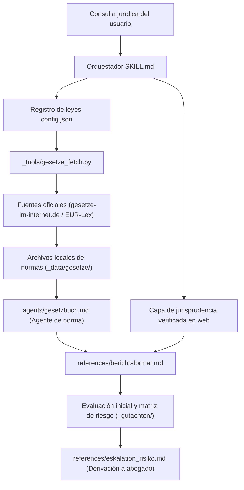
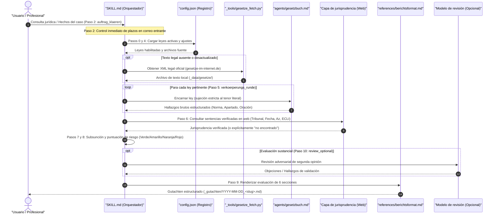

[English](README.md) | [Deutsch](README_de.md) | **Español** | [Français](README_fr.md) | [Português](README_pt.md) | [Русский](README_ru.md) | [简体中文](README_zh.md) | [日本語](README_ja.md) | [العربية](README_ar.md) | [हिन्दी](README_hi.md) | [বাংলা](README_bn.md)


# law-checker (Rechtsabteilung)

[](CHANGELOG.md)
[](LICENSE)
[](https://www.python.org/)
[](tests/)
[](.github/workflows/ci.yml)
[](#data-privacy--confidentiality)
[](#data-privacy--confidentiality)
[](THIRD_PARTY_LICENSES.md)
[](SECURITY.md)
[](#legal-framework--rdg-classification)
[](SKILL.md)
[](https://github.com/ellmos-ai)
[](https://github.com/open-bricks)
[](llms.txt)
[](#)

**Flujo de trabajo de IA de código abierto para una primera orientación jurídica fundamentada en fuentes conforme al derecho alemán.**

> [!NOTE]
> **Descubrimiento por agentes de IA / LLM:** Hay un resumen legible por máquinas disponible en [`llms.txt`](llms.txt) (última verificación: 2026-09-19).

> [!IMPORTANT]
> **Aviso importante / Wichtig: Primera orientación jurídica asistida por IA, no constituye asesoramiento jurídico.** Esta herramienta no es un bufete de abogados, no es un servicio jurídico alojado y no sustituye la evaluación jurídica individual por parte de una abogada o un abogado habilitado. Que un despliegue concreto constituya un servicio jurídico regulado conforme a la Ley alemana de servicios jurídicos (*Rechtsdienstleistungsgesetz*, RDG) depende del modelo operativo, del rol del operador y del caso concreto. No existe supervisión automatizada de plazos ni garantía de integridad o actualidad. Si hay correspondencia oficial, administrativa o judicial y plazos en curso, consulte de inmediato con asesoramiento jurídico cualificado.

---

## Navegación rápida

1. [Descripción general](#sec-01)
2. [Perfiles destinatarios y casos de uso de alta intención](#sec-02)
3. [Matriz comparativa de arquitectura](#sec-03)
4. [Arquitectura del sistema](#sec-04)
5. [Ciclo de vida del flujo de trabajo](#sec-05)
6. [Invariantes de gobernanza y de ejecución](#sec-06)
7. [Marco jurídico y clasificación conforme a la RDG](#sec-07)
8. [Herramientas hermanas y ecosistema](#sec-08)
9. [Instalación e inicio rápido](#sec-09)
10. [Incorporación de nuevas leyes](#sec-10)
11. [Privacidad de datos y confidencialidad](#sec-11)
12. [Inventario del registro de leyes](#sec-12)
13. [Arquitectura del informe y recorrido visual](#sec-13)
14. [Licencias de terceros y SBOM](#sec-14)
15. [Estructura del repositorio](#sec-15)
16. [Política de seguridad](#sec-16)
17. [Origen y autoría](#sec-17)
18. [Exención de responsabilidad legal (§ 521 BGB) y licencia](#sec-18)

---

<a id="sec-01"></a>
## Descripción general

`law-checker` (*Rechtsabteilung*) es un conjunto modular de skills y agentes para entornos locales de desarrollo con LLM como Claude Code. Genera evaluaciones jurídicas iniciales estructuradas y documentadas, fundamentadas en el derecho federal alemán y en el derecho de la Unión Europea.

El sistema impone una disciplina probatoria estricta:
- **Cero citas alucinadas:** Toda afirmación normativa debe extraerse directamente de textos legales oficiales almacenados localmente y citarse hasta el artículo o parágrafo, apartado y oración exactos (`§ 823 Abs. 1 BGB` + extracto literal + archivo fuente/marca temporal de recuperación). Se rechazan las citas normativas basadas en la memoria del modelo.
- **Principio de encarnación (*Verkörperungsprinzip*):** Un agente genérico especializado («Tú ERES el código legal») lee únicamente el texto normativo auténtico — aplicando una estricta disciplina de ámbito de aplicación (evaluando la aplicabilidad antes de la aplicación) y señalando con franqueza: *«Mi tenor literal no decide esto; aquí comienza la interpretación judicial.»*
- **Capa separada de jurisprudencia:** Las resoluciones judiciales nunca se evocan desde la memoria de entrenamiento. La jurisprudencia se recopila estrictamente mediante verificación web en vivo (tribunal, fecha, número de expediente, ECLI y cita verificada). Las búsquedas negativas se marcan explícitamente como «no identificado».
- **Semáforo de riesgo y matriz de escalado:** Clasificación objetiva del riesgo en cuatro niveles (Bajo, Medio, Alto y Crítico), complementada por una matriz de derivación por especialidad jurídica y una estricta disciplina de plazos para la correspondencia jurídica entrante.

---

<a id="sec-02"></a>
## Perfiles destinatarios y casos de uso de alta intención

`law-checker` está diseñado para profesionales técnicos, desarrolladores y responsables de cumplimiento que operan bajo jurisdicciones europeas y alemanas y necesitan primeras orientaciones jurídicas rápidas y deterministas sin riesgo de normas alucinadas ni fuga de datos:

```text
┌─────────────────────────────────────────────────────────────────────────────┐
│                MAPEO DE PERFILES DESTINATARIOS Y CASOS DE USO               │
├────────────────────────────────┬────────────────────────────────────────────┤
│ [PERSONA-01] Legal Tech / Ops  │ Primeras orientaciones normativas          │
│                                │ automatizadas sin bloqueo propietario.     │
├────────────────────────────────┼────────────────────────────────────────────┤
│ [PERSONA-02] Mantenedores OSS  │ Claridad rápida sobre Impressumspflicht,   │
│                                │ avisos RGPD y atribución de licencias.     │
├────────────────────────────────┼────────────────────────────────────────────┤
│ [PERSONA-03] Arquitectos de IA │ Encarnación normativa sin alucinaciones y  │
│                                │ separación limpia entre norma y doctrina.  │
├────────────────────────────────┼────────────────────────────────────────────┤
│ [PERSONA-04] DPO y Cumplimiento│ Trazas auditables para RGPD, EHDS          │
│                                │ (UE 2025/327) y normas sanitarias SGB V.   │
└────────────────────────────────┴────────────────────────────────────────────┘
```

- **`[PERSONA-01]` Ingenieros de Legal Tech y Operaciones Jurídicas Internas:**
  - *Problema central:* Las bases de datos jurídicas comerciales (Beck-Online, Juris) carecen de integración agéntica nativa con LLM y cobran miles de euros por licencia de usuario; los chats ingenuos con LLM inventan leyes.
  - *Solución:* Pipeline de CLI y skills totalmente automatizable por script y fundamentado en fuentes para Claude Code, basado en los repositorios XML oficiales del BMJ/BfJ.
  - *Consultas de alta intención:* `German legal tech AI first look`, `automated statute checker API`, `in-house legal workflow LLM`.
- **`[PERSONA-02]` Mantenedores de código abierto y desarrolladores independientes:**
  - *Problema central:* Obligaciones regulatorias alemanas poco claras (p. ej., *Impressumspflicht* conforme a TDDDG / TMG, cumplimiento de DSGVO/RGPD en GitHub, avisos de derechos de autor MIT/AGPL conforme a la UrhG).
  - *Solución:* Comprobación rápida y reproducible que muestra literalmente si un repositorio personal de desarrollador requiere un aviso legal alemán (*Impressum*) o entra dentro de las excepciones no comerciales.
  - *Consultas de alta intención:* `Is an Impressum required for personal GitHub repo Germany`, `TDDDG Impressum open source`, `German copyright UrhG software license`.
- **`[PERSONA-03]` Desarrolladores de agentes de IA y arquitectos de soluciones:**
  - *Problema central:* El RAG basado en vectores trunca los textos legales entre límites de fragmentos (*chunks*), separando disposiciones generales de excepciones *lex specialis* y generando afirmaciones falsas.
  - *Solución:* El patrón de agente de encarnación (`agents/gesetzbuch.md`), donde el LLM encarna el texto legal promulgado con estricta disciplina léxica («Mi tenor literal no decide esto»).
  - *Consultas de alta intención:* `Statute embodiment AI agent architecture`, `zero hallucination legal prompt pattern`, `Claude Code legal skill`.
- **`[PERSONA-04]` Responsables de cumplimiento y Delegados de Protección de Datos (DPO):**
  - *Problema central:* Las aplicaciones de salud digital, los productos de IA y el software de investigación exigen evaluaciones verificables de cumplimiento del RGPD/DSGVO, EHDS (Reglamento (UE) 2025/327) y SGB V con pista de auditoría.
  - *Solución:* Formato de dictamen (*Gutachten*) en 6 secciones con puntuación explícita de riesgo (Bajo, Medio, Alto, Crítico), marcas temporales de citas normativas y escalado de derivación a asesoramiento jurídico profesional.
  - *Consultas de alta intención:* `EHDS Regulation EU 2025/327 legal compliance check`, `SGB V health data AI assessment`, `DSGVO privacy risk triage`.

---

<a id="sec-03"></a>
## Matriz comparativa de arquitectura

Cómo se compara `law-checker` en 10 criterios arquitectónicos críticos frente a las alternativas habituales:

| Dimensión arquitectónica | Chat LLM ingenuo (ChatGPT/Claude sin herramientas) | Bases de datos jurídicas tradicionales (Beck/Juris) | RAG jurídico genérico / Vectores | Búsqueda web sin asistencia / Foros | `law-checker` (Rechtsabteilung) |
|---|---|---|---|---|---|
| **1. Fundamentación normativa** | ❌ Ninguna (memoria paramétrica) | ⚠️ Solo consulta manual | ⚠️ Parcial (cortes por fragmentos) | ❌ Solo fuentes secundarias | ✅ **Literal estricto (§, Abs., S.)** |
| **2. Inmunidad a alucinaciones** | ❌ Frecuentes §§ inventados | ✅ Alta (texto auténtico) | ❌ Alucina contexto | ❌ Alta (publicaciones obsoletas) | ✅ **100 % cachés XML oficiales** |
| **3. Disciplina de encarnación** | ❌ Mezcla opinión y ley | ❌ N/A (lector humano) | ❌ Difumina comentario y norma | ❌ Especulación descontrolada | ✅ **«Tú ERES el código legal»** |
| **4. Verificación jurisprudencial** | ❌ Az./ECLI confabulados | ✅ Exhaustiva (de pago) | ⚠️ Citas no verificadas | ⚠️ Precisión irregular | ✅ **Solo verificada en web en vivo** |
| **5. Privacidad Zero-Egress** | ❌ Salida completa de prompts | ⚠️ Consultas registradas | ⚠️ Embeddings enviados a la nube | ❌ Rastreadores y registros de búsqueda | ✅ **100 % Local-First / Gitignored** |
| **6. Delimitación regulatoria** | ❌ Avisos a menudo débiles | ⚠️ Condiciones empresariales | ❌ Responsabilidad poco clara | ❌ Riesgo de asesoramiento no regulado | ✅ **Aviso estricto § 2 RDG uso propio** |
| **7. Triaje de plazos** | ❌ Ignorado | ❌ Calendario manual | ❌ Ignorado | ❌ Fácil de pasar por alto | ✅ **Puerta prioritaria de plazos Paso 2** |
| **8. Registro versionado** | ❌ Corte de entrenamiento opaco | ⚠️ Actualizaciones silenciosas | ❌ Índices sin versionar | ❌ Fluctuación de buscadores | ✅ **`config.json` auditable (v5)** |
| **9. Pruebas CI Multi-OS** | ❌ N/A | ❌ Propietario cerrado | ⚠️ Pruebas unitarias ad hoc | ❌ N/A | ✅ **CI en Ubuntu / Windows / macOS** |
| **10. Coste y licencia** | ⚠️ $20–$200/mes/usuario | ❌ €1.500–€5.000+/año | ⚠️ Cómputo de infraestructura | ✅ Gratis (pero consume mucho tiempo) | ✅ **100 % gratuito y Open Source (MIT)** |

---

<a id="sec-04"></a>
## Arquitectura del sistema

La arquitectura separa la orquestación, las fuentes normativas auténticas, la interpretación judicial y la generación de informes en capas modulares limpias:



---

<a id="sec-05"></a>
## Ciclo de vida del flujo de trabajo

El ciclo de vida de evaluación en 10 pasos definido en `SKILL.md` garantiza que toda orientación jurídica sea reproducible, disciplinada y transparente:



---

<a id="sec-06"></a>
## Invariantes de gobernanza y de ejecución

La herramienta garantiza 10 invariantes arquitectónicas y de ejecución inmutables:

| # | Invariante | Descripción | Mecanismo de aplicación |
|---|---|---|---|
| 1 | **100 % Local-First y Zero-Egress** | La obtención de leyes y la generación de informes se ejecutan localmente; cero telemetría, rastreo ni salida automatizada de datos. | `.gitignore` excluye estrictamente `_gutachten/`, `_data/gesetze/` y `config.local.json`. |
| 2 | **Fundamentación estricta en fuentes** | Las afirmaciones legales deben citar artículos/parágrafos, apartados, oraciones exactas y citas literales de textos locales. | `agents/gesetzbuch.md` y `references/berichtsformat.md` rechazan normas recordadas de memoria. |
| 3 | **Jurisprudencia verificada en web** | Las resoluciones judiciales requieren tribunal, fecha, número de expediente y ECLI; los fallos no verificados se registran como «no encontrado». | El Paso 6 de `SKILL.md` prohíbe citar jurisprudencia desde los parámetros del LLM. |
| 4 | **Límite de uso propio sin asesoramiento** | Delimitación jurídica estricta conforme al § 2 Abs. 1 RDG; solo orientación inicial, sin crear relación abogado-cliente. | Avisos destacados en `README.md`, `SKILL.md` y la Sección 5 de cada informe generado. |
| 5 | **Estricta disciplina de plazos** | Las notificaciones jurídicas o correo administrativo entrante exigen una comprobación inmediata de plazos antes del análisis de fondo. | `references/eskalation_risiko.md` prioriza los plazos legales y judiciales. |
| 6 | **Versionado del registro de leyes** | Las incorporaciones y modificaciones de estado de leyes son eventos de configuración deliberados y versionados. | Contador de versión de esquema en `config.json` con entradas correspondientes en el registro de cambios. |
| 7 | **Sin elevación y seguridad en modo usuario** | Se ejecuta bajo cuentas de usuario estándar sin privilegios y sin elevación administrativa (`RunAsInvoker`). | Biblioteca estándar pura de Python 3 e invocación CLI sin ganchos a nivel de sistema. |
| 8 | **Puntuación determinista de riesgo** | Asigna los hallazgos jurídicos a un semáforo objetivo de 4 niveles (Bajo, Medio, Alto, Crítico) con derivación por especialidad. | Matriz de evaluación fija en `references/eskalation_risiko.md`. |
| 9 | **Matriz CI Multi-OS y concurrencia** | Probado en Ubuntu, Windows y macOS con cancelación de ejecuciones concurrentes (`cancel-in-progress: true`). | Flujo de trabajo de GitHub Actions (`.github/workflows/ci.yml`) en Python 3.10 a 3.13. |
| 10 | **Paridad documental bilingüe** | Paridad estructural, conceptual y de navegación completa entre la documentación en inglés y en alemán. | Verificación automatizada de contratos en `tests/test_metadata.py`. |

---

<a id="sec-07"></a><a id="legal-framework--rdg-classification"></a>
## Marco jurídico y clasificación conforme a la RDG

Esta herramienta está diseñada exclusivamente para el **uso propio operado localmente**: usted la aplica dentro de su propio entorno LLM a **sus propias** preguntas y asuntos fácticos. No existe ninguna plataforma alojada, ni admisión de clientes, ni soporte de asesoramiento jurídico, ni gestión de plazos por parte de los autores.

Evaluación conforme a la Ley alemana de servicios jurídicos (*Rechtsdienstleistungsgesetz*, RDG — autoevaluación del proyecto, a fecha 2026-07-11):

| Modo de despliegue | Clasificación jurídica |
|---|---|
| Uso para asuntos fácticos **propios** | No constituye un servicio jurídico (no es un «asunto ajeno», § 2 Abs. 1 RDG). |
| Publicación / distribución del software | No constituye un servicio jurídico (instrumento genérico, no tramita un caso individual; cf. BGH, 09.09.2021 — I ZR 113/20 «Smartlaw» — aplicable por analogía según el diseño). |
| Despliegue para evaluar casos **para terceros** | Puede constituir un servicio jurídico regulado (§ 2 Abs. 1 RDG es neutral respecto a la herramienta) — la prestación comercial requiere autorización oficial (§ 3 RDG); la prestación gratuita impone requisitos legales (§ 6 Abs. 2 RDG). **Esto queda expresamente fuera del propósito previsto de este proyecto.** |

Cualquier entidad que modifique la estructura operativa (alojamiento, prestación de servicios o tramitación de asuntos para terceros) debe reevaluar el cumplimiento legal de forma independiente.
Autoclasificación respecto a la Ley de IA de la UE: véase [`docs/ai-act-note.md`](docs/ai-act-note.md).

---

<a id="sec-08"></a>
## Herramientas hermanas y ecosistema

`law-checker` opera en armonía con herramientas hermanas del ecosistema de desarrollo `ellmos-ai` y de la organización matriz `open-bricks`:

| Proyecto | Rol / Integración | Repositorio |
|---|---|---|
| **`ellmos-ai`** | Organización central de infraestructura de IA y colectivo de servidores MCP | [ellmos-ai](https://github.com/ellmos-ai) |
| **`open-bricks`** | Organización matriz para herramientas modulares de desarrollo y escritorio | [open-bricks](https://github.com/open-bricks) |
| **`policy-registry`** | Gestión de políticas de gobernanza entre agentes y autoridad de delegación firmada | [policy-registry](https://github.com/ellmos-ai/policy-registry) |
| **`anonymizer`** | Biblioteca de seudonimización documental *fail-closed* para preprocesamiento centrado en la privacidad | [anonymizer](https://github.com/ellmos-ai/anonymizer) |
| **`lock-master`** | Coordinación de concurrencia multiagente y sistema de bloqueo de proyectos | [lock-master](https://github.com/ellmos-ai/lock-master) |
| **`automation-master`** | Gestión de créditos y reservas basada en eventos para agentes autónomos en segundo plano | [automation-master](https://github.com/dev-bricks/automation-master) |
| **`system-gap-master`** | Detección de brechas multiagente, aplicación de políticas y auditoría de higiene de repositorios | [system-gap-master](https://github.com/ellmos-ai/system-gap-master) |
| **`companion-for-agy`** | Ejecutor CLI *headless*, supervisión del ciclo de vida PTY y grabación diagnóstica de sesiones | [companion-for-agy](https://github.com/ellmos-ai/companion-for-agy) |
| **`gardener`** | Ejecutor de herramientas efímero en *sandbox* y repositorio local de base de conocimiento SQLite | [gardener](https://github.com/ellmos-ai/gardener) |
| **`marblerun`** | Orquestación táctica por turnos multiagente y motor de traspaso entre trabajadores | [marblerun](https://github.com/ellmos-ai/marblerun) |
| **`report-forge`** | Motor central agnóstico al dominio para pipelines de generación de informes formateados | [report-forge](https://github.com/ellmos-ai/report-forge) |
| **`steuer-assistent`** | Herramienta independiente para documentación y orientación de gastos fiscales de uso propio | [steuer-assistent](https://github.com/ellmos-ai/steuer-assistent) |

### Consumidor FolderHome (fuente fijada)

En el commit fuente de FolderHome [51d5dc71](https://github.com/ellmos-ai/FolderHome/commit/51d5dc71ec11f1cde4598c528323483a50f6e52c), el componente `law-checker` fija este repositorio en la [revisión a5b0cd51](https://github.com/ellmos-ai/rechtsabteilung/commit/a5b0cd51bc3666962f2fae8017c855dea0a712a2). Su puente valida el `pyproject.toml` fijado, el manifiesto del módulo y la configuración del registro local sin importar el flujo de trabajo del agente law-checker ni exponer una API de revisión jurídica. La cualificación informa cero invocaciones de red. El manifiesto del componente declara `legal.registry.read` sin puerta (*gate*) y `legal.orientation.handoff` con puerta (*gate*); ninguno declara efectos secundarios. Esto documenta una cualificación local de metadatos y una transferencia con puerta separada, no una evaluación jurídica ni una garantía de compatibilidad para revisiones posteriores.

---

<a id="sec-09"></a>
## Instalación e inicio rápido

### 1. Clonar el repositorio e instalar las dependencias

```bash
git clone https://github.com/ellmos-ai/law-checker.git
cd law-checker

# Install editable package (requires Python >=3.10)
pip install -e .
```

### 2. Obtener los textos legales oficiales

Los textos legales se recuperan directamente de repositorios oficiales y se almacenan localmente:

```bash
# List all registered and active statutes
PYTHONIOENCODING=utf-8 python _tools/gesetze_fetch.py --list

# Download and parse all enabled federal statutes
PYTHONIOENCODING=utf-8 python _tools/gesetze_fetch.py
```

### 3. Desplegar el Skill y el Agente en Claude Code

```bash
# Copy skill orchestrator and embodiment agent into your Claude environment
cp SKILL.md ~/.claude/skills/rechtsabteilung/SKILL.md
cp agents/gesetzbuch.md ~/.claude/agents/gesetzbuch.md
```

En `~/.claude/skills/rechtsabteilung/SKILL.md`, configure `<MODUL>` con la ruta absoluta de su clon local.

Invocación en Claude Code:
```text
/rechtsabteilung Is an imprint (Impressum) legally mandatory for purely personal open-source repositories on GitHub?
```

---

<a id="sec-10"></a>
## Incorporación de nuevas leyes

Ampliar el catálogo de leyes no requiere modificar el código del agente:

1. **Añadir entrada en `config.json`:** Defina una nueva clave bajo `gesetzbuecher` (especificando `name`, `kurz`, `zitierweise`, `quelle` y `xml_zip` para leyes federales).
2. **Obtener el texto oficial:**
   ```bash
   PYTHONIOENCODING=utf-8 python _tools/gesetze_fetch.py <key>
   ```
3. **Incrementar la versión:** Incremente el campo `version` en `config.json` y registre el cambio en el historial de cambios.

*Nota sobre leyes de la UE y de los estados federados (Länder):* Para legislación sin puntos finales XML en `gesetze-im-internet.de` (p. ej., RGPD/DSGVO o Tratado Estatal de Medios), guarde el texto oficial como archivo UTF-8 en `_data/gesetze/` con la URL de origen y la marca temporal de recuperación en la cabecera del archivo.

---

<a id="sec-11"></a><a id="data-privacy--confidentiality"></a>
## Privacidad de datos y confidencialidad

Las consultas jurídicas involucran con frecuencia datos personales sensibles, secretos empresariales o correspondencia confidencial. Cumpla estos principios:

- **Minimización de datos primero:** Censure o seudonimice nombres, direcciones, números de expediente y detalles empresariales identificables antes de introducirlos en un prompt. Considere usar [`anonymizer`](https://github.com/ellmos-ai/anonymizer) para el preprocesamiento automatizado.
- **Exposición a LLM en la nube:** Los prompts enviados a modelos en la nube son procesados por el proveedor correspondiente. Nunca introduzca correspondencia jurídica confidencial sin censurar, secretos comerciales ni datos médicos en LLM de terceros sin los acuerdos de encargo del tratamiento adecuados.
- **Cero salida de datos en las herramientas locales:** La herramienta opera completamente sin conexión en su estación de trabajo. Las descargas de leyes y las evaluaciones generadas permanecen en `_data/gesetze/` y `_gutachten/`; nada se transmite a los autores.
- **Nunca publique hechos de casos reales en issues públicos:** Para incidencias en GitHub o informes de errores, utilice ejemplos fácticos puramente hipotéticos e inventados.

Para más información, consulte [`SECURITY.md`](SECURITY.md).

---

<a id="sec-12"></a>
## Inventario del registro de leyes

El registro de leyes predeterminado (`config.json`, versión 5) configura 13 normas del derecho federal alemán y del derecho de la UE:

| Clave | Nombre de la norma | Jurisdicción | Estado | Fuente primaria |
|---|---|---|---|---|
| `gg` | Grundgesetz für die Bundesrepublik Deutschland (Ley Fundamental) | Federal (DE) | **Activo** | gesetze-im-internet.de |
| `bgb` | Bürgerliches Gesetzbuch (Código Civil) | Federal (DE) | **Activo** | gesetze-im-internet.de |
| `sgb5` | Sozialgesetzbuch V (Libro V del Código Social — Seguro obligatorio de enfermedad) | Federal (DE) | **Activo** | gesetze-im-internet.de |
| `urhg` | Urheberrechtsgesetz (Ley de Derechos de Autor) | Federal (DE) | **Activo** | gesetze-im-internet.de |
| `rdg` | Rechtsdienstleistungsgesetz (Ley de Servicios Jurídicos) | Federal (DE) | **Activo** | gesetze-im-internet.de |
| `markeng` | Markengesetz (Ley de Marcas) | Federal (DE) | **Activo** | gesetze-im-internet.de |
| `stberg` | Steuerberatungsgesetz (Ley de Asesoría Fiscal) | Federal (DE) | **Activo** | gesetze-im-internet.de |
| `uwg` | Gesetz gegen den unlauteren Wettbewerb (Ley contra la Competencia Desleal) | Federal (DE) | **Activo** | gesetze-im-internet.de |
| `dsgvo` | Reglamento General de Protección de Datos (Reglamento (UE) 2016/679 / `(EU) 2016/679`) | Unión Europea | **Activo** | EUR-Lex |
| `ehds` | Espacio Europeo de Datos Sanitarios (Reglamento (UE) 2025/327 / `(EU) 2025/327`) | Unión Europea | **Activo** | EUR-Lex |
| `grch` | Carta de los Derechos Fundamentales de la Unión Europea | Unión Europea | **Activo** | EUR-Lex |
| `stgb` | Strafgesetzbuch (Código Penal) | Federal (DE) | *Inactivo* | gesetze-im-internet.de |
| `mstv` | Medienstaatsvertrag (Tratado Estatal de Medios) | Derecho estatal (DE) | *Inactivo* | die-medienanstalten.de |

---

<a id="sec-13"></a>
## Arquitectura del informe y recorrido visual

Cada evaluación jurídica generada por `law-checker` se adhiere estrictamente a la estructura estandarizada de *Gutachten* en 6 secciones definida en [`references/berichtsformat.md`](references/berichtsformat.md), garantizando una metodología jurídica rigurosa (*Gutachtenstil*):

```text
┌─────────────────────────────────────────────────────────────────────────────┐
│        ARQUITECTURA DE EVALUACIÓN JURÍDICA INICIAL ESTRUCTURADA             │
│ Archivo: _gutachten/YYYY-MM-DD_<themen-slug>.md                             │
├─────────────────────────────────────────────────────────────────────────────┤
│ 1. Sachverhalt & Fragestellung (Hechos y cuestión planteada)                │
│    ├─ Solicitante, contexto y elementos fácticos                            │
│    └─ CONTROL PRIORITARIO OBLIGATORIO: Plazos en correo oficial/jurídico    │
├─────────────────────────────────────────────────────────────────────────────┤
│ 2. Norm-Ebene: Authentischer Gesetzeswortlaut (Extractos de encarnación)    │
│    ├─ Conjunto de normas pertinentes identificado (p. ej. § 5 TDDDG, BGB)   │
│    └─ Citas literales por apartado y oración desde XML local                │
├─────────────────────────────────────────────────────────────────────────────┤
│ 3. Rechtsprechung & Auslegung (Jurisprudencia verificada en web)            │
│    ├─ Sentencias rectoras pertinentes (BGH, BAG, BVerfG, TJUE/EuGH)         │
│    └─ Formato estricto: Tribunal, Fecha, Expediente, Referencia, ECLI       │
├─────────────────────────────────────────────────────────────────────────────┤
│ 4. Synthese & Subsumtion (Metodología jurídica / Gutachtenstil)             │
│    ├─ Elementos del tipo normativo frente a los hechos presentados          │
│    └─ Distinción clara: qué es imperativo y qué es interpretación defendible│
├─────────────────────────────────────────────────────────────────────────────┤
│ 5. Risikoeinstufung & Anwaltsempfehlung (Semáforo de riesgo y derivación)   │
│    ├─ Semáforo: [BAJO / VERDE] | [MEDIO / AMARILLO] | [ALTO] | [CRÍTICO]    │
│    ├─ Motivación y potenciales concretos de daño o requerimiento            │
│    └─ Recomendación de abogado especialista (*Fachanwalt*) con especialidad │
├─────────────────────────────────────────────────────────────────────────────┤
│ 6. Quellenverzeichnis & Prüfprotokoll (Registro de fuentes y auditoría)     │
│    ├─ Textos legales usados con sello oficial de recuperación y vigencia    │
│    └─ Datos de revisión y modelo de la ejecución LLM                        │
└─────────────────────────────────────────────────────────────────────────────┘
```

---

<a id="sec-14"></a>
## Licencias de terceros y SBOM

`law-checker` es software de código abierto certificado bajo la [Licencia MIT](LICENSE). El proyecto mantiene una lista completa de materiales de software (SBOM) y una auditoría de licencias en [`THIRD_PARTY_LICENSES.md`](THIRD_PARTY_LICENSES.md):

- **Garantía cero copyleft:** Sin dependencias bajo licencias GPL, AGPL ni SSPL; completamente libre para ingeniería local comercial y no comercial.
- **Ejecución sin privilegios (`RunAsInvoker`):** No requiere permisos de administrador ni de superusuario (*root*) en ningún sistema operativo.
- **Textos oficiales de dominio público:** Los textos legales obtenidos de `gesetze-im-internet.de` constituyen obras oficiales de la administración (*Amtliche Werke*) conforme al § 5 Abs. 1 UrhG (Ley alemana de derechos de autor) y están libres de derechos de autor. Los actos legislativos de la Unión Europea se reutilizan conforme a la Decisión 2011/833/EU de la Comisión.

---

<a id="sec-15"></a>
## Estructura del repositorio

```text
law-checker/
├── .github/workflows/ci.yml    ← Matriz CI Multi-OS (Ubuntu, Windows, macOS)
├── .github/workflows/stale.yml ← Automatización de issues y PRs inactivos
├── SKILL.md                    ← Flujo de trabajo orquestador del skill (proceso en 10 pasos)
├── config.json                 ← Registro de leyes y definición del pipeline (v5)
├── agents/
│   └── gesetzbuch.md           ← Prompt genérico del agente de encarnación normativa
├── references/
│   ├── berichtsformat.md       ← Esquema de informe jurídico en 6 secciones y reglas de cita
│   └── eskalation_risiko.md    ← Semáforo de riesgo, control de plazos y matriz de abogados
├── _tools/
│   ├── __init__.py             ← Marcador de paquete Python
│   └── gesetze_fetch.py        ← Descargador de leyes y analizador XML
├── docs/
│   └── ai-act-note.md          ← Nota de autoclasificación según el AI Act de la UE
├── tests/
│   ├── test_gesetze_fetch.py   ← Pruebas unitarias de descarga y extracción normativa
│   └── test_metadata.py        ← Pruebas automatizadas de contrato y paridad de metadatos
├── CHANGELOG.md                ← Historial de versiones y lanzamientos
├── SECURITY.md                 ← Política de seguridad con SLA de respuesta de 48h
├── THIRD_PARTY_LICENSES.md     ← Auditoría de licencias de terceros, SBOM y clasificación § 5 UrhG
├── MARKETING-LOG.txt           ← Backlog local de marketing y visibilidad
├── llms.txt                    ← Contexto legible por máquinas para agentes de código con IA
├── ellmos-module.v2.json       ← Manifiesto de módulo estandarizado (rechtsabteilung)
├── pyproject.toml              ← Metadatos de paquete PEP 621 y configuración de pruebas
├── _data/gesetze/              ← Archivos de leyes descargados (ignorados vía .gitignore)
└── _gutachten/                 ← Evaluaciones jurídicas generadas (ignoradas vía .gitignore)
```

---

<a id="sec-16"></a>
## Política de seguridad

La seguridad, la confidencialidad y la protección de datos son fundamentales. Las vulnerabilidades pueden notificarse de forma privada a través de:
- [GitHub Security Advisories](https://github.com/ellmos-ai/law-checker/security/advisories)
- Contactos directos de seguridad: `security@ellmos.ai` | `security@open-bricks.org` | `support@lukasgeiger.com` | `lukas@open-bricks.org`

**Compromisos:** Acuse de recibo en un plazo de 48 horas; triaje inicial y evaluación de impacto en un plazo de 5 días hábiles. Los detalles completos se documentan en [`SECURITY.md`](SECURITY.md).

---

<a id="sec-17"></a>
## Origen y autoría

Este proyecto sintetiza tres pilares operativos probados:
1. **Política jurídica editorial:** Plantillas estandarizadas de informes, puntuación objetiva de riesgo en 4 niveles, asignación a abogados especialistas y disciplina inflexible de plazos.
2. **Prototipo de investigación «Constitución Viva»:** El paradigma de encarnación normativa (`Du BIST das Gesetzbuch`) que impone fidelidad estricta al texto legal promulgado y capas separadas de interpretación judicial.
3. **Base de conocimiento jurisprudencial:** Taxonomía estructurada de los ámbitos del derecho alemán y metodología jurídica tradicional (*Gutachtenstil*).

La primera evaluación completa ejecutada por este flujo de trabajo fue su propia auditoría de publicación pública — incluyendo una revisión adversarial por parte de un LLM secundario independiente.

---

<a id="sec-18"></a>
## Exención de responsabilidad legal (§ 521 BGB) y licencia

### Aviso legal de responsabilidad conforme al § 521 BGB (*Gefälligkeitsrecht* / *Gefälligkeit*) — Provisión gratuita de código abierto

> [!IMPORTANT]
> **Limitación de responsabilidad conforme al § 521 BGB (*Gefälligkeitsrecht* / *Gefälligkeit*):** La puesta a disposición de este software, de la documentación, de los prompts y de los flujos de comprobación se realiza de forma gratuita y a título de mera cortesía (*Gefälligkeit*) en el sentido del derecho civil alemán (§ 521 BGB). La responsabilidad de los autores, mantenedores y colaboradores queda limitada al dolo y a la negligencia grave. El software no constituye un servicio jurídico en el sentido del § 2 Abs. 1 RDG y no sustituye una evaluación individual por parte de una abogada o un abogado habilitado. No se realiza ningún control de plazos ni se ofrece garantía de integridad, ausencia de errores o actualidad.

- **Licencia:** Publicado bajo la permisiva [Licencia MIT](LICENSE), aplicable al código fuente, a los prompts de los agentes y a la documentación.
- **SBOM de terceros:** La auditoría exhaustiva de bibliotecas de terceros y el estatus de dominio público conforme al § 5 Abs. 1 UrhG están documentados en [`THIRD_PARTY_LICENSES.md`](THIRD_PARTY_LICENSES.md).
- **Exención de garantía:** Se proporciona «tal cual» (*as is*), sin garantía de ningún tipo respecto a exactitud, integridad o actualidad. Los textos legales cambian con el tiempo; verifíquelos siempre frente al boletín oficial federal (*Bundesgesetzblatt*) antes de basarse en ellos.
- **Sin asesoramiento jurídico:** Este software facilita únicamente la orientación inicial y la investigación. No presta asesoramiento jurídico ni crea una relación abogado-cliente.
