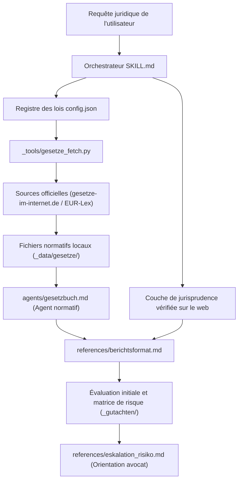
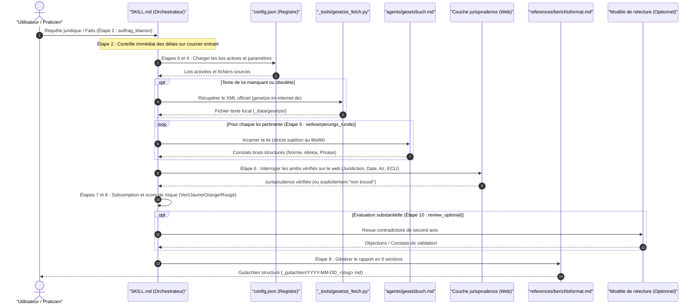

[English](README.md) | [Deutsch](README_de.md) | [Español](README_es.md) | **Français** | [Português](README_pt.md) | [Русский](README_ru.md) | [简体中文](README_zh.md) | [日本語](README_ja.md) | [العربية](README_ar.md) | [हिन्दी](README_hi.md) | [বাংলা](README_bn.md)


# law-checker (Rechtsabteilung)

[](CHANGELOG.md)
[](LICENSE)
[](https://www.python.org/)
[](tests/)
[](.github/workflows/ci.yml)
[](#data-privacy--confidentiality)
[](#data-privacy--confidentiality)
[](THIRD_PARTY_LICENSES.md)
[](SECURITY.md)
[](#legal-framework--rdg-classification)
[](SKILL.md)
[](https://github.com/ellmos-ai)
[](https://github.com/open-bricks)
[](llms.txt)
[](#)

**Flux de travail d'IA open source pour une première orientation juridique fondée sur les sources en droit allemand.**

> [!NOTE]
> **Découverte par les agents d'IA / LLM :** Un résumé lisible par machine est disponible dans [`llms.txt`](llms.txt) (dernière vérification : 2026-09-19).

> [!IMPORTANT]
> **Avis important / Wichtig : Première orientation juridique assistée par IA, ne constitue pas un conseil juridique.** Cet outil n'est ni un cabinet d'avocats, ni un service juridique hébergé, et ne remplace pas une analyse juridique individuelle par une avocate ou un avocat habilité. La qualification d'un déploiement spécifique en tant que prestation juridique réglementée au sens de la loi allemande sur les services juridiques (*Rechtsdienstleistungsgesetz*, RDG) dépend du modèle opérationnel, du rôle de l'opérateur et du cas d'espèce. Aucune surveillance automatisée des délais ni aucune garantie d'exhaustivité ou d'actualité n'est fournie. En présence d'un courrier officiel, administratif ou judiciaire et de délais en cours, consultez immédiatement un conseil juridique qualifié.

---

## Navigation rapide

1. [Vue d'ensemble](#sec-01)
2. [Profils cibles et cas d'usage à forte intention](#sec-02)
3. [Matrice comparative d'architecture](#sec-03)
4. [Architecture du système](#sec-04)
5. [Cycle de vie du flux de travail](#sec-05)
6. [Invariants de gouvernance et d'exécution](#sec-06)
7. [Cadre juridique et qualification au regard de la RDG](#sec-07)
8. [Outils frères et écosystème](#sec-08)
9. [Installation et démarrage rapide](#sec-09)
10. [Ajout de nouvelles lois](#sec-10)
11. [Confidentialité et protection des données](#sec-11)
12. [Inventaire du registre des lois](#sec-12)
13. [Architecture du rapport et visite visuelle](#sec-13)
14. [Licences tierces et SBOM](#sec-14)
15. [Structure du dépôt](#sec-15)
16. [Politique de sécurité](#sec-16)
17. [Origine et paternité](#sec-17)
18. [Clause légale de non-responsabilité (§ 521 BGB) et licence](#sec-18)

---

<a id="sec-01"></a>
## Vue d'ensemble

`law-checker` (*Rechtsabteilung*) est un collectif modulaire de skills et d'agents conçu pour les environnements de développement LLM locaux tels que Claude Code. Il produit des évaluations juridiques initiales structurées et documentées, ancrées dans le droit fédéral allemand et le droit de l'Union européenne.

Le système impose une discipline probatoire stricte :
- **Zéro citation hallucinée :** Chaque affirmation normative doit être extraite directement de textes législatifs officiels stockés localement et citée avec exactitude jusqu'à l'article ou au paragraphe, à l'alinéa et à la phrase (`§ 823 Abs. 1 BGB` + extrait littéral + fichier source/horodatage de récupération). Les citations de normes issues de la mémoire du modèle sont rejetées.
- **Principe d'incarnation (*Verkörperungsprinzip*) :** Un agent générique spécialisé (« Tu ES le code législatif ») lit exclusivement le texte normatif authentique — en appliquant une discipline stricte du champ d'application (évaluation de l'applicabilité avant l'application) et en signalant honnêtement : *« Mon libellé légal ne tranche pas cela ; ici commence l'interprétation jurisprudentielle. »*
- **Couche jurisprudentielle séparée :** Les décisions de justice ne sont jamais rappelées depuis la mémoire d'entraînement. La jurisprudence est collectée exclusivement par vérification web en direct (juridiction, date, numéro de dossier, ECLI et référence vérifiée). Les recherches infructueuses sont explicitement signalées comme « non identifié ».
- **Feu tricolore de risque et matrice d'escalade :** Classification objective du risque en quatre niveaux (Faible, Moyen, Élevé et Critique), complétée par une matrice d'orientation vers des spécialités juridiques et une discipline stricte des délais pour le courrier juridique entrant.

---

<a id="sec-02"></a>
## Profils cibles et cas d'usage à forte intention

`law-checker` est conçu pour les praticiens techniques, développeurs et responsables de la conformité opérant sous les juridictions européenne et allemande qui ont besoin de premières orientations juridiques rapides et déterministes, sans risque de normes hallucinées ni de fuite de données :

```text
┌─────────────────────────────────────────────────────────────────────────────┐
│                   CARTOGRAPHIE DES PROFILS ET CAS D'USAGE                   │
├────────────────────────────────┬────────────────────────────────────────────┤
│ [PERSONA-01] Legal Tech / Ops  │ Premières orientations normatives          │
│                                │ automatisées sans enfermement propriétaire.│
├────────────────────────────────┼────────────────────────────────────────────┤
│ [PERSONA-02] Mainteneurs OSS   │ Clarification rapide : Impressumspflicht,  │
│                                │ mentions RGPD et attribution de licences.  │
├────────────────────────────────┼────────────────────────────────────────────┤
│ [PERSONA-03] Architectes IA    │ Incarnation normative sans hallucination   │
│                                │ et frontière nette entre norme et doctrine.│
├────────────────────────────────┼────────────────────────────────────────────┤
│ [PERSONA-04] DPO & Conformité  │ Pistes d'audit traçables pour RGPD, EHDS   │
│                                │ (UE 2025/327) et santé numérique SGB V.    │
└────────────────────────────────┴────────────────────────────────────────────┘
```

- **`[PERSONA-01]` Ingénieurs Legal Tech et opérations juridiques internes :**
  - *Problème central :* Les bases de données juridiques commerciales (Beck-Online, Juris) sont dépourvues d'intégration agentique LLM native et facturent des milliers d'euros par licence utilisateur ; les chats LLM naïfs inventent des textes de loi.
  - *Solution :* Pipeline CLI et de skills entièrement scriptable et fondé sur les sources pour Claude Code, reposant sur les dépôts XML officiels du BMJ/BfJ.
  - *Requêtes à forte intention :* `German legal tech AI first look`, `automated statute checker API`, `in-house legal workflow LLM`.
- **`[PERSONA-02]` Mainteneurs Open Source et développeurs indépendants :**
  - *Problème central :* Obligations réglementaires allemandes ambiguës (par ex. *Impressumspflicht* au titre de la TDDDG / TMG, conformité DSGVO/RGPD sur GitHub, mentions de droit d'auteur MIT/AGPL au titre de l'UrhG).
  - *Solution :* Vérification rapide et reproductible démontrant littéralement si un dépôt personnel de développeur exige des mentions légales allemandes (*Impressum*) ou relève d'exceptions non commerciales.
  - *Requêtes à forte intention :* `Is an Impressum required for personal GitHub repo Germany`, `TDDDG Impressum open source`, `German copyright UrhG software license`.
- **`[PERSONA-03]` Développeurs d'agents d'IA et architectes de solutions :**
  - *Problème central :* Le RAG vectoriel tronque les textes législatifs aux frontières des segments (*chunks*), séparant les dispositions générales des exceptions *lex specialis* et produisant des affirmations erronées.
  - *Solution :* Le patron d'agent d'incarnation (`agents/gesetzbuch.md`) où le LLM incarne le texte législatif promulgué avec une discipline lexicale stricte (« Mon libellé ne tranche pas cela »).
  - *Requêtes à forte intention :* `Statute embodiment AI agent architecture`, `zero hallucination legal prompt pattern`, `Claude Code legal skill`.
- **`[PERSONA-04]` Responsables de la conformité et Délégués à la Protection des Données (DPO) :**
  - *Problème central :* Les applications de santé numérique, les produits d'IA et les logiciels de recherche exigent des évaluations vérifiables de conformité au RGPD/DSGVO, à l'EHDS (Règlement (UE) 2025/327) et au SGB V avec piste d'audit.
  - *Solution :* Format de *Gutachten* en 6 sections avec notation explicite du risque (Faible, Moyen, Élevé, Critique), horodatage des citations normatives et escalade vers un conseil juridique professionnel.
  - *Requêtes à forte intention :* `EHDS Regulation EU 2025/327 legal compliance check`, `SGB V health data AI assessment`, `DSGVO privacy risk triage`.

---

<a id="sec-03"></a>
## Matrice comparative d'architecture

Comment `law-checker` se compare selon 10 critères architecturaux critiques face aux alternatives courantes :

| Dimension architecturale | Chat LLM naïf (ChatGPT/Claude brut) | Bases juridiques traditionnelles (Beck/Juris) | RAG juridique générique / Vecteurs | Recherche web sans assistance / Forums | `law-checker` (Rechtsabteilung) |
|---|---|---|---|---|---|
| **1. Ancrage normatif** | ❌ Aucun (mémoire paramétrique) | ⚠️ Consultation manuelle uniquement | ⚠️ Partiel (coupures de chunks) | ❌ Sources secondaires uniquement | ✅ **Strictement littéral (§, Abs., S.)** |
| **2. Immunité aux hallucinations** | ❌ §§ fréquemment inventés | ✅ Élevée (texte authentique) | ❌ Hallucine le contexte | ❌ Élevée (publications obsolètes) | ✅ **100 % caches XML officiels** |
| **3. Discipline d'incarnation** | ❌ Mélange opinion et loi | ❌ N/A (lecteur humain) | ❌ Brouille commentaire et norme | ❌ Spéculation omniprésente | ✅ **« Tu ES le code législatif »** |
| **4. Vérification jurisprudentielle** | ❌ Az./ECLI confabulés | ✅ Complète (payante) | ⚠️ Citations non vérifiées | ⚠️ Précision inégale | ✅ **Uniquement vérifiée sur le web en direct** |
| **5. Confidentialité Zero-Egress** | ❌ Sortie intégrale des prompts | ⚠️ Requêtes journalisées | ⚠️ Embeddings envoyés au cloud | ❌ Traceurs et journaux de recherche | ✅ **100 % Local-First / Gitignored** |
| **6. Délimitation réglementaire** | ❌ Avertissements souvent faibles | ⚠️ Conditions entreprise | ❌ Responsabilité floue | ❌ Risque de conseil non réglementé | ✅ **Mention stricte § 2 RDG usage propre** |
| **7. Triage des délais** | ❌ Ignoré | ❌ Calendrier manuel | ❌ Ignoré | ❌ Facilement manqué | ✅ **Sas prioritaire de délais Étape 2** |
| **8. Registre versionné** | ❌ Coupure d'entraînement opaque | ⚠️ Mises à jour silencieuses | ❌ Index non versionnés | ❌ Fluctuation des moteurs | ✅ **`config.json` auditable (v5)** |
| **9. Tests CI Multi-OS** | ❌ N/A | ❌ Propriétaire fermé | ⚠️ Tests unitaires ad hoc | ❌ N/A | ✅ **CI Ubuntu / Windows / macOS** |
| **10. Coût et licence** | ⚠️ $20–$200/mois/poste | ❌ €1.500–€5.000+/an | ⚠️ Coûts d'infrastructure | ✅ Gratuit (mais chronophage) | ✅ **100 % gratuit et Open Source (MIT)** |

---

<a id="sec-04"></a>
## Architecture du système

L'architecture sépare l'orchestration, les sources normatives authentiques, l'interprétation judiciaire et la génération de rapports en couches modulaires distinctes :



---

<a id="sec-05"></a>
## Cycle de vie du flux de travail

Le cycle de vie d'évaluation en 10 étapes défini dans `SKILL.md` garantit que chaque orientation juridique est reproductible, disciplinée et transparente :



---

<a id="sec-06"></a>
## Invariants de gouvernance et d'exécution

L'outil garantit 10 invariants architecturaux et d'exécution immuables :

| # | Invariant | Description | Mécanisme d'application |
|---|---|---|---|
| 1 | **100 % Local-First et Zero-Egress** | La récupération des lois et la génération de rapports s'exécutent localement ; zéro télémétrie, suivi ou sortie automatisée de données. | `.gitignore` ignore strictement `_gutachten/`, `_data/gesetze/` et `config.local.json`. |
| 2 | **Ancrage strict sur les sources** | Les affirmations normatives doivent citer les articles/paragraphes, alinéas, phrases exactes et extraits littéraux des textes locaux. | `agents/gesetzbuch.md` et `references/berichtsformat.md` rejettent les lois rappelées de mémoire. |
| 3 | **Jurisprudence vérifiée sur le web** | Les décisions judiciaires exigent juridiction, date, numéro de rôle et ECLI ; les décisions non vérifiées sont notées « non trouvé ». | L'étape 6 de `SKILL.md` interdit de citer de la jurisprudence depuis les paramètres du LLM. |
| 4 | **Frontière d'usage personnel sans conseil** | Délimitation juridique stricte au titre du § 2 Abs. 1 RDG ; simple orientation, ne créant aucune relation avocat-client. | Mentions visibles dans `README.md`, `SKILL.md` et la section 5 de chaque rapport généré. |
| 5 | **Discipline stricte des délais** | Les notifications juridiques ou courriers administratifs entrants imposent un contrôle immédiat des délais avant l'analyse de fond. | `references/eskalation_risiko.md` donne la priorité aux délais légaux et judiciaires. |
| 6 | **Versionnage du registre des lois** | Les ajouts de lois et modifications d'état sont des événements de configuration délibérés et versionnés. | Compteur de version de schéma dans `config.json` avec entrées correspondantes dans le journal des modifications. |
| 7 | **Sans élévation et sûreté en mode utilisateur** | S'exécute sous des comptes utilisateur standard sans privilèges ni élévation administrative (`RunAsInvoker`). | Bibliothèque standard Python 3 pure et invocation CLI sans crochets (*hooks*) système. |
| 8 | **Notation déterministe du risque** | Associe les constats juridiques à un feu tricolore objectif à 4 niveaux (Faible, Moyen, Élevé, Critique) avec orientation par spécialité. | Matrice d'évaluation fixe dans `references/eskalation_risiko.md`. |
| 9 | **Matrice CI Multi-OS et concurrence** | Testé sur Ubuntu, Windows et macOS avec annulation des exécutions concurrentes (`cancel-in-progress: true`). | Workflow GitHub Actions (`.github/workflows/ci.yml`) sur Python 3.10 à 3.13. |
| 10 | **Parité documentaire bilingue** | Parité structurelle, conceptuelle et de navigation complète entre les documentations anglaise et allemande. | Vérification automatisée de contrat dans `tests/test_metadata.py`. |

---

<a id="sec-07"></a><a id="legal-framework--rdg-classification"></a>
## Cadre juridique et qualification au regard de la RDG

Cet outil est conçu exclusivement pour un **usage personnel exploité localement** : vous l'appliquez au sein de votre propre environnement LLM à **vos propres** questions et situations factuelles. Il n'existe ni plateforme hébergée, ni prise en charge de clients, ni assistance en conseil juridique, ni gestion des délais par les auteurs.

Évaluation au regard de la loi allemande sur les services juridiques (*Rechtsdienstleistungsgesetz*, RDG — auto-évaluation du projet, au 2026-07-11) :

| Mode de déploiement | Qualification juridique |
|---|---|
| Utilisation pour des situations factuelles **propres** | Ne constitue pas un service juridique (pas d'« affaire d'autrui », § 2 Abs. 1 RDG). |
| Publication / distribution du logiciel | Ne constitue pas un service juridique (instrument générique, ne traitant pas un cas individuel ; cf. BGH, 09.09.2021 — I ZR 113/20 « Smartlaw » — applicable par analogie selon la conception). |
| Déploiement pour évaluer des cas **pour des tiers** | Peut constituer un service juridique réglementé (§ 2 Abs. 1 RDG est neutre quant à l'outil) — la fourniture commerciale requiert une autorisation officielle (§ 3 RDG) ; la fourniture à titre gratuit impose des exigences légales (§ 6 Abs. 2 RDG). **Ceci est expressément en dehors de la finalité prévue pour ce projet.** |

Toute entité modifiant la structure opérationnelle (hébergement, fourniture de services ou traitement de dossiers pour des tiers) doit réévaluer sa conformité légale de manière indépendante.
Auto-classification au titre du règlement européen sur l'IA (AI Act) : voir [`docs/ai-act-note.md`](docs/ai-act-note.md).

---

<a id="sec-08"></a>
## Outils frères et écosystème

`law-checker` fonctionne en harmonie avec des outils frères au sein de l'écosystème de développement `ellmos-ai` et de l'organisation faîtière `open-bricks` :

| Projet | Rôle / Intégration | Dépôt |
|---|---|---|
| **`ellmos-ai`** | Organisation centrale d'infrastructure d'IA et collectif de serveurs MCP | [ellmos-ai](https://github.com/ellmos-ai) |
| **`open-bricks`** | Organisation faîtière d'outillage modulaire de développement et de bureau | [open-bricks](https://github.com/open-bricks) |
| **`policy-registry`** | Gestion des politiques de gouvernance inter-agents et autorité de délégation signée | [policy-registry](https://github.com/ellmos-ai/policy-registry) |
| **`anonymizer`** | Bibliothèque de pseudonymisation de documents *fail-closed* pour le prétraitement axé sur la confidentialité | [anonymizer](https://github.com/ellmos-ai/anonymizer) |
| **`lock-master`** | Coordination de concurrence multi-agents et système de verrouillage de projets | [lock-master](https://github.com/ellmos-ai/lock-master) |
| **`automation-master`** | Gestion événementielle des crédits et réservations pour agents autonomes en arrière-plan | [automation-master](https://github.com/dev-bricks/automation-master) |
| **`system-gap-master`** | Détection de lacunes multi-agents, application des politiques et audit d'hygiène des dépôts | [system-gap-master](https://github.com/ellmos-ai/system-gap-master) |
| **`companion-for-agy`** | Exécuteur CLI *headless*, supervision du cycle de vie PTY et enregistrement diagnostique de sessions | [companion-for-agy](https://github.com/ellmos-ai/companion-for-agy) |
| **`gardener`** | Exécuteur d'outils éphémère en bac à sable et dépôt local de base de connaissances SQLite | [gardener](https://github.com/ellmos-ai/gardener) |
| **`marblerun`** | Orchestration tactique par tours multi-agents et moteur de passage de relais entre travailleurs | [marblerun](https://github.com/ellmos-ai/marblerun) |
| **`report-forge`** | Moteur central agnostique au domaine pour pipelines de génération de rapports formatés | [report-forge](https://github.com/ellmos-ai/report-forge) |
| **`steuer-assistent`** | Outil autonome pour la documentation et l'orientation des frais fiscaux en usage propre | [steuer-assistent](https://github.com/ellmos-ai/steuer-assistent) |

### Consommateur FolderHome (source épinglée)

Au commit source FolderHome [51d5dc71](https://github.com/ellmos-ai/FolderHome/commit/51d5dc71ec11f1cde4598c528323483a50f6e52c), le composant `law-checker` épingle ce dépôt à la [révision a5b0cd51](https://github.com/ellmos-ai/rechtsabteilung/commit/a5b0cd51bc3666962f2fae8017c855dea0a712a2). Son pont valide le `pyproject.toml` épinglé, le manifeste du module et la configuration du registre local sans importer le flux de travail de l'agent law-checker ni exposer d'API de revue juridique. La qualification ne signale aucune invocation réseau. Le manifeste du composant déclare `legal.registry.read` sans barrière (*gate*) et `legal.orientation.handoff` avec barrière ; aucun des deux ne déclare d'effets de bord. Ceci documente une qualification locale des métadonnées et une transmission soumise à une barrière distincte, non une évaluation juridique ni une garantie de compatibilité pour des révisions ultérieures.

---

<a id="sec-09"></a>
## Installation et démarrage rapide

### 1. Cloner le dépôt et installer les dépendances

```bash
git clone https://github.com/ellmos-ai/law-checker.git
cd law-checker

# Install editable package (requires Python >=3.10)
pip install -e .
```

### 2. Récupérer les textes législatifs officiels

Les textes législatifs sont récupérés directement depuis les dépôts officiels et stockés localement :

```bash
# List all registered and active statutes
PYTHONIOENCODING=utf-8 python _tools/gesetze_fetch.py --list

# Download and parse all enabled federal statutes
PYTHONIOENCODING=utf-8 python _tools/gesetze_fetch.py
```

### 3. Déployer le Skill et l'Agent dans Claude Code

```bash
# Copy skill orchestrator and embodiment agent into your Claude environment
cp SKILL.md ~/.claude/skills/rechtsabteilung/SKILL.md
cp agents/gesetzbuch.md ~/.claude/agents/gesetzbuch.md
```

Dans `~/.claude/skills/rechtsabteilung/SKILL.md`, définissez `<MODUL>` sur le chemin absolu de votre clone local.

Invocation dans Claude Code :
```text
/rechtsabteilung Is an imprint (Impressum) legally mandatory for purely personal open-source repositories on GitHub?
```

---

<a id="sec-10"></a>
## Ajout de nouvelles lois

L'extension du catalogue des lois ne nécessite aucune modification du code des agents :

1. **Ajouter une entrée dans `config.json` :** Définissez une nouvelle clé sous `gesetzbuecher` (en spécifiant `name`, `kurz`, `zitierweise`, `quelle`, et `xml_zip` pour le droit fédéral).
2. **Récupérer le texte officiel :**
   ```bash
   PYTHONIOENCODING=utf-8 python _tools/gesetze_fetch.py <key>
   ```
3. **Incrémenter la version :** Incrémentez le champ `version` dans `config.json` et consignez la modification dans le journal des changements.

*Remarque sur les lois de l'UE et des Länder :* Pour les textes dépourvus de points de terminaison XML sur `gesetze-im-internet.de` (par ex. RGPD/DSGVO ou traité d'État sur les médias), enregistrez le texte officiel sous forme de fichier UTF-8 dans `_data/gesetze/` avec l'URL source et l'horodatage de récupération dans l'en-tête du fichier.

---

<a id="sec-11"></a><a id="data-privacy--confidentiality"></a>
## Confidentialité et protection des données

Les demandes juridiques impliquent fréquemment des données personnelles sensibles, des secrets d'affaires ou de la correspondance confidentielle. Respectez ces principes :

- **Minimisation des données d'abord :** Caviardez ou pseudonymisez les noms, adresses, numéros de dossier et détails commerciaux identifiables avant de formuler un prompt. Envisagez d'utiliser [`anonymizer`](https://github.com/ellmos-ai/anonymizer) pour un prétraitement automatisé.
- **Exposition aux LLM dans le cloud :** Les prompts envoyés aux modèles cloud sont traités par le fournisseur concerné. N'introduisez jamais de courrier juridique confidentiel non caviardé, de secrets commerciaux ou de données médicales dans des LLM tiers sans accords de traitement des données appropriés.
- **Zéro sortie de données dans l'outillage local :** L'outil fonctionne entièrement hors ligne sur votre poste de travail. Les téléchargements de lois et les évaluations générées restent dans `_data/gesetze/` et `_gutachten/` ; rien n'est transmis aux auteurs.
- **Ne publiez jamais de faits réels dans les issues publiques :** Pour les issues GitHub ou les rapports de bogues, utilisez exclusivement des exemples factuels purement hypothétiques et fictifs.

Pour plus d'informations, consultez [`SECURITY.md`](SECURITY.md).

---

<a id="sec-12"></a>
## Inventaire du registre des lois

Le registre des lois par défaut (`config.json`, version 5) configure 13 textes relevant du droit fédéral allemand et du droit de l'UE :

| Clé | Nom du texte | Juridiction | Statut | Source primaire |
|---|---|---|---|---|
| `gg` | Grundgesetz für die Bundesrepublik Deutschland (Loi fondamentale) | Fédéral (DE) | **Actif** | gesetze-im-internet.de |
| `bgb` | Bürgerliches Gesetzbuch (Code civil) | Fédéral (DE) | **Actif** | gesetze-im-internet.de |
| `sgb5` | Sozialgesetzbuch V (Livre V du Code social — Assurance maladie légale) | Fédéral (DE) | **Actif** | gesetze-im-internet.de |
| `urhg` | Urheberrechtsgesetz (Loi sur le droit d'auteur) | Fédéral (DE) | **Actif** | gesetze-im-internet.de |
| `rdg` | Rechtsdienstleistungsgesetz (Loi sur les services juridiques) | Fédéral (DE) | **Actif** | gesetze-im-internet.de |
| `markeng` | Markengesetz (Loi sur les marques) | Fédéral (DE) | **Actif** | gesetze-im-internet.de |
| `stberg` | Steuerberatungsgesetz (Loi sur le conseil fiscal) | Fédéral (DE) | **Actif** | gesetze-im-internet.de |
| `uwg` | Gesetz gegen den unlauteren Wettbewerb (Loi contre la concurrence déloyale) | Fédéral (DE) | **Actif** | gesetze-im-internet.de |
| `dsgvo` | Règlement général sur la protection des données (Règlement (UE) 2016/679 / `(EU) 2016/679`) | Union européenne | **Actif** | EUR-Lex |
| `ehds` | Espace européen des données de santé (Règlement (UE) 2025/327 / `(EU) 2025/327`) | Union européenne | **Actif** | EUR-Lex |
| `grch` | Charte des droits fondamentaux de l'Union européenne | Union européenne | **Actif** | EUR-Lex |
| `stgb` | Strafgesetzbuch (Code pénal) | Fédéral (DE) | *Inactif* | gesetze-im-internet.de |
| `mstv` | Medienstaatsvertrag (Traité d'État sur les médias) | Droit des Länder (DE) | *Inactif* | die-medienanstalten.de |

---

<a id="sec-13"></a>
## Architecture du rapport et visite visuelle

Chaque évaluation juridique générée par `law-checker` respecte strictement la structure normalisée de *Gutachten* en 6 sections définie dans [`references/berichtsformat.md`](references/berichtsformat.md), garantissant une méthodologie juridique rigoureuse (*Gutachtenstil*) :

```text
┌─────────────────────────────────────────────────────────────────────────────┐
│       ARCHITECTURE D'ÉVALUATION JURIDIQUE INITIALE STRUCTURÉE               │
│ Fichier : _gutachten/YYYY-MM-DD_<themen-slug>.md                            │
├─────────────────────────────────────────────────────────────────────────────┤
│ 1. Sachverhalt & Fragestellung (Exposé des faits et question posée)         │
│    ├─ Demandeur, contexte et éléments factuels                              │
│    └─ CONTRÔLE PRIORITAIRE OBLIGATOIRE : Délais sur courrier officiel/légal │
├─────────────────────────────────────────────────────────────────────────────┤
│ 2. Norm-Ebene: Authentischer Gesetzeswortlaut (Extraits d'incarnation)      │
│    ├─ Corpus normatif pertinent identifié (par ex. § 5 TDDDG, BGB)          │
│    └─ Citations littérales par alinéa et phrase issues du XML local         │
├─────────────────────────────────────────────────────────────────────────────┤
│ 3. Rechtsprechung & Auslegung (Jurisprudence vérifiée sur le web)           │
│    ├─ Arrêts directeurs pertinents (BGH, BAG, BVerfG, CJUE/EuGH)            │
│    └─ Format strict : Juridiction, Date, Dossier, Référence, ECLI           │
├─────────────────────────────────────────────────────────────────────────────┤
│ 4. Synthese & Subsumtion (Méthodologie juridique / Gutachtenstil)           │
│    ├─ Éléments constitutifs face aux faits présentés                        │
│    └─ Distinction claire : ce qui est impératif vs interprétation défendable│
├─────────────────────────────────────────────────────────────────────────────┤
│ 5. Risikoeinstufung & Anwaltsempfehlung (Feu de risque et orientation)      │
│    ├─ Score : [FAIBLE / VERT] | [MOYEN / JAUNE] | [ÉLEVÉ] | [CRITIQUE]      │
│    ├─ Motivation et risques concrets de préjudice ou de mise en demeure     │
│    └─ Recommandation d'avocat spécialisé (*Fachanwalt*) selon le domaine    │
├─────────────────────────────────────────────────────────────────────────────┤
│ 6. Quellenverzeichnis & Prüfprotokoll (Traçabilité et journal d'audit)      │
│    ├─ Textes légaux utilisés avec horodatage officiel de collecte et état   │
│    └─ Données de révision et de modèle de l'exécution LLM                   │
└─────────────────────────────────────────────────────────────────────────────┘
```

---

<a id="sec-14"></a>
## Licences tierces et SBOM

`law-checker` est un logiciel open source certifié sous [licence MIT](LICENSE). Le projet maintient une nomenclature logicielle complète (SBOM) et un audit des licences dans [`THIRD_PARTY_LICENSES.md`](THIRD_PARTY_LICENSES.md) :

- **Garantie zéro copyleft :** Aucune dépendance sous licence GPL, AGPL ou SSPL ; entièrement libre pour le développement local commercial et non commercial.
- **Exécution non privilégiée (`RunAsInvoker`) :** Ne nécessite aucune élévation de privilèges administrateur ou *root* sur aucun système d'exploitation.
- **Textes officiels du domaine public :** Les textes législatifs obtenus sur `gesetze-im-internet.de` constituent des œuvres officielles (*Amtliche Werke*) au sens du § 5 Abs. 1 UrhG (loi allemande sur le droit d'auteur) et sont libres de droits. Les actes législatifs de l'Union européenne sont réutilisés en vertu de la décision 2011/833/EU de la Commission.

---

<a id="sec-15"></a>
## Structure du dépôt

```text
law-checker/
├── .github/workflows/ci.yml    ← Matrice CI Multi-OS (Ubuntu, Windows, macOS)
├── .github/workflows/stale.yml ← Automatisation des issues et PR inactives
├── SKILL.md                    ← Workflow orchestrateur du skill (processus en 10 étapes)
├── config.json                 ← Registre des lois et définition du pipeline (v5)
├── agents/
│   └── gesetzbuch.md           ← Prompt générique de l'agent d'incarnation normative
├── references/
│   ├── berichtsformat.md       ← Schéma de rapport juridique en 6 sections et règles de citation
│   └── eskalation_risiko.md    ← Feu tricolore de risque, contrôle des délais, matrice d'avocats
├── _tools/
│   ├── __init__.py             ← Marqueur de paquet Python
│   └── gesetze_fetch.py        ← Téléchargeur de lois et parseur XML
├── docs/
│   └── ai-act-note.md          ← Note d'auto-classification au titre de l'AI Act de l'UE
├── tests/
│   ├── test_gesetze_fetch.py   ← Tests unitaires de collecte et d'extraction normative
│   └── test_metadata.py        ← Tests automatisés de contrat et de parité des métadonnées
├── CHANGELOG.md                ← Historique des versions et des livraisons
├── SECURITY.md                 ← Politique de sécurité avec SLA de réponse de 48h
├── THIRD_PARTY_LICENSES.md     ← Audit des licences tierces, SBOM et qualification § 5 UrhG
├── MARKETING-LOG.txt           ← Backlog local de marketing et de découvrabilité
├── llms.txt                    ← Contexte lisible par machine pour les agents de code IA
├── ellmos-module.v2.json       ← Manifeste de module standardisé (rechtsabteilung)
├── pyproject.toml              ← Métadonnées de paquet PEP 621 et configuration des tests
├── _data/gesetze/              ← Fichiers de lois téléchargés (ignorés via .gitignore)
└── _gutachten/                 ← Évaluations juridiques générées (ignorées via .gitignore)
```

---

<a id="sec-16"></a>
## Politique de sécurité

La sécurité, la confidentialité et la sûreté des données sont fondamentales. Les vulnérabilités peuvent être signalées de manière confidentielle via :
- [GitHub Security Advisories](https://github.com/ellmos-ai/law-checker/security/advisories)
- Contacts sécurité directs : `security@ellmos.ai` | `security@open-bricks.org` | `support@lukasgeiger.com` | `lukas@open-bricks.org`

**Engagements :** Accusé de réception sous 48 heures ; triage initial et évaluation d'impact sous 5 jours ouvrés. Tous les détails figurent dans [`SECURITY.md`](SECURITY.md).

---

<a id="sec-17"></a>
## Origine et paternité

Ce projet synthétise trois briques opérationnelles éprouvées :
1. **Politique juridique éditoriale :** Modèles de rapports standardisés, notation objective du risque en 4 niveaux, orientation vers des avocats spécialisés et discipline sans compromis sur les délais.
2. **Prototype de recherche « Constitution vivante » :** Le paradigme d'incarnation normative (`Du BIST das Gesetzbuch`) imposant une fidélité stricte au texte légal promulgué et des couches distinctes d'interprétation judiciaire.
3. **Base de connaissances jurisprudentielles :** Taxonomie structurée des domaines du droit allemand et méthodologie juridique traditionnelle (*Gutachtenstil*).

La première évaluation complète exécutée par ce flux de travail a été son propre audit de publication publique — incluant une revue contradictoire par un second LLM indépendant.

---

<a id="sec-18"></a>
## Clause légale de non-responsabilité (§ 521 BGB) et licence

### Mention légale de responsabilité conformément au § 521 BGB (*Gefälligkeitsrecht* / *Gefälligkeit*) — Mise à disposition open source à titre gratuit

> [!IMPORTANT]
> **Limitation de responsabilité au titre du § 521 BGB (*Gefälligkeitsrecht* / *Gefälligkeit*) :** La mise à disposition de ce logiciel, de la documentation, des prompts et des procédures de vérification est effectuée à titre gratuit et par pure complaisance (*Gefälligkeit*) au sens du droit civil allemand (§ 521 BGB). La responsabilité des auteurs, mainteneurs et contributeurs est limitée au dol et à la faute lourde. Ce logiciel ne constitue pas une prestation de service juridique au sens du § 2 Abs. 1 RDG et ne remplace pas un examen individuel par une avocate ou un avocat habilité. Aucun contrôle des délais n'est effectué et aucune garantie d'exhaustivité, d'absence d'erreurs ou d'actualité n'est donnée.

- **Licence :** Publié sous la [licence MIT](LICENSE) permissive couvrant le code source, les prompts des agents et la documentation.
- **SBOM tiers :** L'audit complet des bibliothèques tierces et le statut de domaine public au titre du § 5 Abs. 1 UrhG sont documentés dans [`THIRD_PARTY_LICENSES.md`](THIRD_PARTY_LICENSES.md).
- **Exclusion de garantie :** Fourni « en l'état » (*as is*), sans garantie d'aucune sorte quant à l'exactitude, l'exhaustivité ou l'actualité. Les textes législatifs évoluent avec le temps ; vérifiez toujours auprès du journal officiel fédéral (*Bundesgesetzblatt*) avant de vous y fier.
- **Absence de conseil juridique :** Ce logiciel facilite uniquement l'orientation initiale et la recherche. Il ne fournit pas de conseil juridique et ne crée aucune relation avocat-client.
