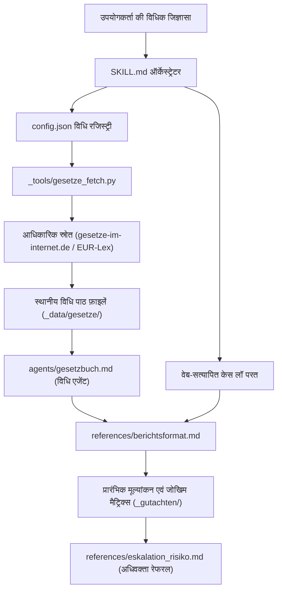
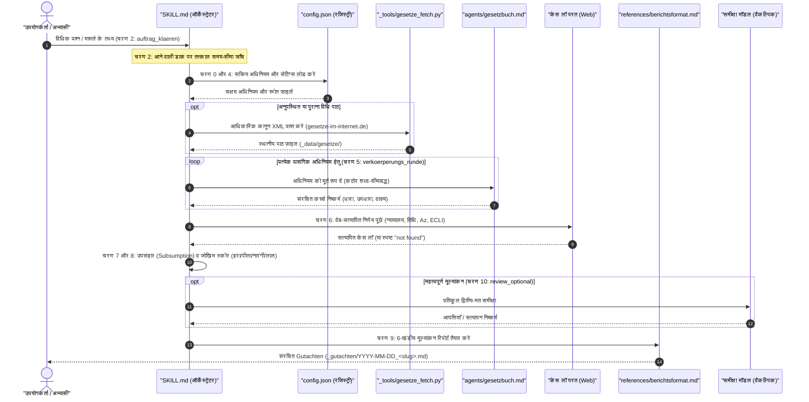

[English](README.md) | [Deutsch](README_de.md) | [Español](README_es.md) | [Français](README_fr.md) | [Português](README_pt.md) | [Русский](README_ru.md) | [简体中文](README_zh.md) | [日本語](README_ja.md) | [العربية](README_ar.md) | **हिन्दी** | [বাংলা](README_bn.md)


# law-checker (विधि विभाग / Rechtsabteilung)

[](CHANGELOG.md)
[](LICENSE)
[](https://www.python.org/)
[](tests/)
[](.github/workflows/ci.yml)
[](#data-privacy--confidentiality)
[](#data-privacy--confidentiality)
[](THIRD_PARTY_LICENSES.md)
[](SECURITY.md)
[](#legal-framework--rdg-classification)
[](SKILL.md)
[](https://github.com/ellmos-ai)
[](https://github.com/open-bricks)
[](llms.txt)
[](#)

**जर्मन कानून के अंतर्गत स्रोत-आधारित प्रारंभिक विधिक अभिविन्यास (First-Look Orientation) के लिए ओपन-सोर्स AI वर्कफ़्लो।**

> [!NOTE]
> **AI / LLM एजेंट खोज:** मशीन-पठनीय सारांश [`llms.txt`](llms.txt) में उपलब्ध है (अंतिम जाँच: 2026-09-19)।

> [!IMPORTANT]
> **महत्वपूर्ण सूचना / Wichtig: AI-सहायता प्राप्त प्रारंभिक विधिक अभिविन्यास, कोई विधिक सलाह नहीं।** यह टूल न तो कोई लॉ फ़र्म है, न ही कोई होस्टेड कानूनी सेवा, और न ही किसी अधिकृत अधिवक्ता (Attorney-at-Law) द्वारा किए जाने वाले व्यक्तिगत विधिक मूल्यांकन का विकल्प। कोई विशिष्ट परिनियोजन जर्मन विधिक सेवा अधिनियम (*Rechtsdienstleistungsgesetz*, RDG) के तहत विनियमित विधिक सेवा माना जाएगा या नहीं, यह संचालन मॉडल, संचालक की भूमिका और व्यक्तिगत मामले पर निर्भर करता है। इसमें कोई स्वचालित समय-सीमा (Deadline) निगरानी नहीं है और पूर्णता या अद्यतन होने की कोई गारंटी नहीं है। यदि आधिकारिक, प्रशासनिक या न्यायिक विधिक पत्राचार और चल रही समय-सीमाएँ शामिल हैं, तो तुरंत योग्य विधिक परामर्शदाता से संपर्क करें।

---

## त्वरित नेविगेशन

1. [परिचय](#sec-01)
2. [लक्षित उपयोगकर्ता वर्ग एवं उच्च-आशय उपयोग प्रकरण](#sec-02)
3. [तुलनात्मक आर्किटेक्चर मैट्रिक्स](#sec-03)
4. [सिस्टम आर्किटेक्चर](#sec-04)
5. [वर्कफ़्लो जीवनचक्र](#sec-05)
6. [गवर्नेंस एवं रनटाइम अपरिवर्तनीय नियम](#sec-06)
7. [विधिक ढाँचा एवं RDG वर्गीकरण](#sec-07)
8. [सहयोगी उपकरण एवं पारिस्थितिकी तंत्र](#sec-08)
9. [इंस्टॉलेशन एवं त्वरित प्रारंभ](#sec-09)
10. [नए अधिनियम जोड़ना](#sec-10)
11. [डेटा गोपनीयता एवं गोपनीयता संरक्षण](#sec-11)
12. [विधिक रजिस्ट्री सूची](#sec-12)
13. [रिपोर्ट संरचना एवं दृश्य विवरण](#sec-13)
14. [तृतीय-पक्ष लाइसेंस एवं SBOM](#sec-14)
15. [रिपॉजिटरी संरचना](#sec-15)
16. [सुरक्षा नीति](#sec-16)
17. [उद्गम एवं लेखकीय श्रेय](#sec-17)
18. [वैधानिक अस्वीकरण (§ 521 BGB) एवं लाइसेंस](#sec-18)

---

<a id="sec-01"></a>
## परिचय

`law-checker` (*Rechtsabteilung*) Claude Code जैसे स्थानीय LLM डेवलपर परिवेशों के लिए एक मॉड्यूलर Skill और एजेंट समूह है। यह जर्मन संघीय कानून और यूरोपीय संघ (EU) कानून पर आधारित संरचित, प्रलेखित प्रारंभिक विधिक मूल्यांकन तैयार करता है।

यह प्रणाली कठोर साक्ष्य-अनुशासन लागू करती है:
- **शून्य भ्रामक उद्धरण (Zero Hallucinated Citations):** प्रत्येक वैधानिक कथन स्थानीय रूप से संग्रहीत आधिकारिक विधि-पाठ से सीधे लिया जाना चाहिए और सटीक अनुच्छेद या धारा, उपधारा तथा वाक्य स्तर तक उद्धृत होना चाहिए (`§ 823 Abs. 1 BGB` + शब्दशः उद्धरण + स्रोत फ़ाइल/प्राप्ति टाइमस्टैम्प)। स्मृति-आधारित मानक उद्धरण अस्वीकार किए जाते हैं।
- **मूर्त रूप सिद्धांत (Embodiment Principle):** एक विशेष सामान्य एजेंट ("आप स्वयं विधि-संहिता हैं") केवल प्रामाणिक वैधानिक पाठ पढ़ता है — कठोर दायरा अनुशासन (अनुप्रयोग से पहले प्रयोज्यता का मूल्यांकन) लागू करता है और स्पष्ट रूप से चिह्नित करता है: *"मेरा वैधानिक शब्द-विन्यास इसका निर्णय नहीं करता; यहाँ से न्यायिक व्याख्या प्रारंभ होती है।"*
- **पृथक न्यायिक निर्णय परत:** न्यायालय के निर्णयों को कभी भी प्रशिक्षण स्मृति से याद नहीं किया जाता। केस लॉ (न्यायशास्त्र) को पूरी तरह लाइव वेब सत्यापन के माध्यम से एकत्र किया जाता है (न्यायालय, तिथि, वाद संख्या, ECLI और सत्यापित उद्धरण)। नकारात्मक खोज परिणामों को स्पष्ट रूप से "पहिचान नहीं हुई (not identified)" के रूप में अंकित किया जाता है।
- **जोखिम ट्रैफ़िक लाइट एवं एस्केलेशन मैट्रिक्स:** निम्न (Low), मध्यम (Medium), उच्च (High) और गंभीर (Critical) स्तरों में वस्तुनिष्ठ जोखिम वर्गीकरण, जिसे विधिक विशेषज्ञता रूटिंग मैट्रिक्स और आने वाले कानूनी पत्राचार के लिए सख्त समय-सीमा अनुशासन द्वारा पूरक किया गया है।

---

<a id="sec-02"></a>
## लक्षित उपयोगकर्ता वर्ग एवं उच्च-आशय उपयोग प्रकरण

`law-checker` को यूरोपीय और जर्मन विधिक अधिकार-क्षेत्रों के अंतर्गत कार्य करने वाले तकनीकी विशेषज्ञों, डेवलपर्स और अनुपालन हितधारकों के लिए तैयार किया गया है, जिन्हें भ्रामक नियमों या डेटा रिसाव के जोखिम के बिना त्वरित, नियतात्मक प्रारंभिक विधिक जाँच की आवश्यकता होती है:

```text
┌─────────────────────────────────────────────────────────────────────────────┐
│                       TARGET PERSONA MAPPING & USE CASES                    │
├────────────────────────────────┬────────────────────────────────────────────┤
│ [PERSONA-01] Legal Tech / Ops  │ इन-हाउस लीगल टीम के लिए बिना मालिकाना    │
│                                │ लॉक-इन के स्वचालित वैधानिक प्रारंभिक जाँच।│
├────────────────────────────────┼────────────────────────────────────────────┤
│ [PERSONA-02] OSS Maintainers   │ जर्मन Impressumspflicht, GDPR गोपनीयता    │
│                                │ सूचना व लाइसेंस श्रेय पर त्वरित स्पष्टता। │
├────────────────────────────────┼────────────────────────────────────────────┤
│ [PERSONA-03] AI Architects     │ शून्य-भ्रम वैधानिक मूर्तीकरण और स्पष्ट   │
│                                │ नियम-बनाम-सिद्धांत सीमा डिज़ाइन।          │
├────────────────────────────────┼────────────────────────────────────────────┤
│ [PERSONA-04] DPOs & Compliance │ GDPR, EHDS (EU 2025/327) और SGB V डिजिटल  │
│                                │ स्वास्थ्य मानकों हेतु ऑडिट-योग्य ट्रेल।   │
└────────────────────────────────┴────────────────────────────────────────────┘
```

- **`[PERSONA-01]` लीगल टेक इंजीनियर एवं इन-हाउस लीगल ऑपरेशंस:**
  - *मूल समस्या:* व्यावसायिक विधिक डेटाबेस (Beck-Online, Juris) में नेटिव एजेंटिक LLM एकीकरण नहीं होता और प्रति सीट लाइसेंस की लागत हजारों यूरो होती है; वहीं सामान्य LLM चैट कानूनों की मनगढ़ंत रचना कर देते हैं।
  - *समाधान:* आधिकारिक BMJ/BfJ XML रिपॉजिटरी पर आधारित, Claude Code के लिए पूर्णतः स्क्रिप्ट-योग्य और स्रोत-आधारित CLI व Skill पाइपलाइन।
  - *उच्च-आशय खोज प्रश्न:* `German legal tech AI first look`, `automated statute checker API`, `in-house legal workflow LLM`।
- **`[PERSONA-02]` ओपन-सोर्स मेंटेनर एवं इंडी डेवलपर्स:**
  - *मूल समस्या:* जर्मन नियामक दायित्वों की अस्पष्टता (जैसे TDDDG / TMG के तहत *Impressumspflicht*, GitHub पर DSGVO अनुपालन, UrhG के अंतर्गत MIT/AGPL कॉपीराइट सूचनाएँ)।
  - *समाधान:* त्वरित, पुनरुत्पादनीय जाँच जो शब्दशः दिखाती है कि किसी व्यक्तिगत डेवलपर रिपॉजिटरी के लिए जर्मन इम्प्रिंट आवश्यक है या वह गैर-व्यावसायिक अपवादों के अंतर्गत आती है।
  - *उच्च-आशय खोज प्रश्न:* `Is an Impressum required for personal GitHub repo Germany`, `TDDDG Impressum open source`, `German copyright UrhG software license`।
- **`[PERSONA-03]` AI एजेंट डेवलपर्स एवं सॉल्यूशन आर्किटेक्ट्स:**
  - *मूल समस्या:* वेक्टर-आधारित RAG चंक सीमाओं पर वैधानिक पाठ को काट देता है, जिससे सामान्य प्रावधान विशिष्ट अपवादों (*lex specialis*) से अलग हो जाते हैं और गलत दावे उत्पन्न होते हैं।
  - *समाधान:* एम्बॉडीमेंट एजेंट पैटर्न (`agents/gesetzbuch.md`) जहाँ LLM कठोर शाब्दिक अनुशासन ("मेरा शब्द-विन्यास इसका निर्णय नहीं करता") के साथ अधिनियमित वैधानिक पाठ का रूप धारण करता है।
  - *उच्च-आशय खोज प्रश्न:* `Statute embodiment AI agent architecture`, `zero hallucination legal prompt pattern`, `Claude Code legal skill`।
- **`[PERSONA-04]` अनुपालन अधिकारी एवं डेटा संरक्षण अधिकारी (DPOs):**
  - *मूल समस्या:* डिजिटल स्वास्थ्य ऐप्स, AI उत्पादों और शोध सॉफ्टवेयर के लिए ऑडिट ट्रेल सहित सत्यापन योग्य GDPR, EHDS (विनियमन (EU) 2025/327) और SGB V अनुपालन मूल्यांकन आवश्यक होते हैं।
  - *समाधान:* स्पष्ट जोखिम स्कोरिंग (Low, Medium, High, Critical), वैधानिक उद्धरण टाइमस्टैम्प और विशेषज्ञ अधिवक्ता रेफरल एस्केलेशन सहित 6-खंडीय Gutachten प्रारूप।
  - *उच्च-आशय खोज प्रश्न:* `EHDS Regulation EU 2025/327 legal compliance check`, `SGB V health data AI assessment`, `DSGVO privacy risk triage`।

---

<a id="sec-03"></a>
## तुलनात्मक आर्किटेक्चर मैट्रिक्स

10 महत्वपूर्ण आर्किटेक्चरल मानदंडों पर सामान्य विकल्पों की तुलना में `law-checker` का प्रदर्शन:

| आर्किटेक्चरल आयाम | सामान्य LLM चैट (कच्चा ChatGPT/Claude) | पारंपरिक लीगल डेटाबेस (Beck/Juris) | सामान्य Legal RAG / वेक्टर | बिना सहायता वेब खोज / फ़ोरम | `law-checker` (Rechtsabteilung) |
|---|---|---|---|---|---|
| **1. मानक-स्तरीय आधार (Norm Grounding)** | ❌ कोई नहीं (पैरामीट्रिक स्मृति) | ⚠️ केवल मैनुअल खोज | ⚠️ आंशिक (चंक विभाजन) | ❌ केवल द्वितीयक स्रोत | ✅ **कठोर शब्दशः (§, Abs., S.)** |
| **2. भ्रम-रोधी प्रतिरक्षा** | ❌ बार-बार काल्पनिक §§ | ✅ उच्च (प्रामाणिक पाठ) | ❌ संदर्भ में भ्रम पैदा करता है | ❌ उच्च जोखिम (पुरानी पोस्ट) | ✅ **100% अधिनियमित XML कैश** |
| **3. मूर्तीकरण अनुशासन** | ❌ राय और कानून को मिलाता है | ❌ लागू नहीं (मानव पाठक) | ❌ टीका और नियम को मिलाता है | ❌ अटकलों की भरमार | ✅ **"आप ही विधि-संहिता हैं"** |
| **4. केस लॉ सत्यापन** | ❌ मनगढ़ंत Az./ECLI | ✅ व्यापक (पेवॉल के पीछे) | ⚠️ असत्यापित उद्धरण | ⚠️ मिश्रित सटीकता | ✅ **केवल लाइव वेब-सत्यापित** |
| **5. ज़ीरो-इग्रेस गोपनीयता** | ❌ पूर्ण प्रॉम्प्ट बाहर जाता है | ⚠️ खोज क्वेरी लॉग होती हैं | ⚠️ एम्बेडिंग क्लाउड को भेजी जाती हैं | ❌ ट्रैकर व खोज लॉग | ✅ **100% लोकल-फर्स्ट / Gitignored** |
| **6. नियामक सीमांकन** | ❌ अस्वीकरण अक्सर कमजोर | ⚠️ एंटरप्राइज शर्तें | ❌ अस्पष्ट दायित्व | ❌ अनियंत्रित सलाह का जोखिम | ✅ **कठोर § 2 RDG स्व-उपयोग सूचना** |
| **7. समय-सीमा ट्राइएज** | ❌ उपेक्षित | ❌ मैनुअल कैलेंडर | ❌ उपेक्षित | ❌ चूकने की प्रबल संभावना | ✅ **चरण 2 प्राथमिकता समय-सीमा गेट** |
| **8. संस्करणयुक्त रजिस्ट्री** | ❌ ब्लैक-बॉक्स प्रशिक्षण कटऑफ | ⚠️ मूक अद्यतन | ❌ गैर-संस्करणित इंडेक्स | ❌ सर्च इंजन अस्थिरता | ✅ **ऑडिट-योग्य `config.json` (v5)** |
| **9. मल्टी-OS CI परीक्षण** | ❌ लागू नहीं | ❌ बंद मालिकाना | ⚠️ तदर्थ यूनिट परीक्षण | ❌ लागू नहीं | ✅ **Ubuntu / Windows / macOS CI** |
| **10. लागत एवं लाइसेंस** | ⚠️ $20–$200/माह/सीट | ❌ €1,500–€5,000+/वर्ष | ⚠️ अवसंरचना कंप्यूट लागत | ✅ निःशुल्क (पर अत्यधिक समय-खर्च) | ✅ **100% निःशुल्क व ओपन सोर्स (MIT)** |

---

<a id="sec-04"></a>
## सिस्टम आर्किटेक्चर

यह आर्किटेक्चर ऑर्केस्ट्रेशन, प्रामाणिक वैधानिक स्रोतों, न्यायिक व्याख्या और रिपोर्ट निर्माण को स्वच्छ मॉड्यूलर परतों में अलग करता है:



---

<a id="sec-05"></a>
## वर्कफ़्लो जीवनचक्र

`SKILL.md` में परिभाषित 10-चरणीय मूल्यांकन जीवनचक्र सुनिश्चित करता है कि प्रत्येक विधिक अभिविन्यास पुनरुत्पादनीय, अनुशासित और पारदर्शी रहे:



---

<a id="sec-06"></a>
## गवर्नेंस एवं रनटाइम अपरिवर्तनीय नियम

यह टूल 10 अपरिवर्तनीय आर्किटेक्चरल और रनटाइम नियमों की गारंटी देता है:

| # | अपरिवर्तनीय नियम | विवरण | प्रवर्तन तंत्र |
|---|---|---|---|
| 1 | **100% लोकल-फर्स्ट एवं ज़ीरो-इग्रेस** | कानून पुनर्प्राप्ति और रिपोर्ट निर्माण स्थानीय रूप से चलते हैं; शून्य टेलीमेट्री, ट्रैकिंग या स्वचालित डेटा बहिर्गमन। | `.gitignore` सख्ती से `_gutachten/`, `_data/gesetze/` और `config.local.json` को अनदेखा करता है। |
| 2 | **कठोर स्रोत आधार** | वैधानिक कथनों में स्थानीय पाठ से सटीक अनुच्छेद/धारा, उपधारा, वाक्य और उद्धरण देना अनिवार्य है। | `agents/gesetzbuch.md` और `references/berichtsformat.md` स्मृति-आधारित अधिनियमों को अस्वीकार करते हैं। |
| 3 | **वेब-सत्यापित न्यायशास्त्र** | न्यायालय के निर्णयों के लिए न्यायालय, तिथि, वाद संख्या और ECLI आवश्यक हैं; असत्यापित निर्णय "not found" दर्ज होते हैं। | `SKILL.md` चरण 6 LLM पैरामीटर से केस लॉ उद्धृत करने की अनुमति नहीं देता। |
| 4 | **गैर-सलाहकारी स्व-उपयोग सीमा** | § 2 Abs. 1 RDG के तहत कठोर विधिक सीमांकन; केवल अभिविन्यास हेतु, कोई अधिवक्ता-मुवक्किल संबंध नहीं बनता। | `README.md`, `SKILL.md` और प्रत्येक जनित रिपोर्ट के खंड 5 में प्रमुख सूचनाएँ। |
| 5 | **कठोर समय-सीमा अनुशासन** | प्राप्त होने वाले विधिक नोटिस या प्रशासनिक डाक में मूल विश्लेषण से पूर्व तत्काल समय-सीमा जाँच अनिवार्य है। | `references/eskalation_risiko.md` वैधानिक व न्यायालयी समय-सीमाओं को प्राथमिकता देता है। |
| 6 | **अधिनियम रजिस्ट्री संस्करण नियंत्रण** | अधिनियम जोड़ना और स्थिति में बदलाव जानबूझकर किए गए संस्करणयुक्त कॉन्फ़िगरेशन इवेंट होते हैं। | संबंधित चेंजलॉग प्रविष्टियों सहित `config.json` में स्कीमा संस्करण काउंटर। |
| 7 | **नॉन-एलिवेशन एवं यूज़र-मोड सुरक्षा** | बिना किसी प्रशासनिक विशेषाधिकार (`RunAsInvoker`) के मानक गैर-विशेषाधिकार प्राप्त उपयोगकर्ता खातों में चलता है। | सिस्टम-स्तरीय हुक के बिना शुद्ध Python 3 मानक लाइब्रेरी और CLI आह्वान। |
| 8 | **नियतात्मक जोखिम स्कोरिंग** | विधिक निष्कर्षों को विशेषज्ञता रूटिंग सहित वस्तुनिष्ठ 4-स्तरीय ट्रैफ़िक लाइट (Low, Medium, High, Critical) में मैप करता है। | `references/eskalation_risiko.md` में निश्चित मूल्यांकन मैट्रिक्स। |
| 9 | **मल्टी-OS CI मैट्रिक्स एवं समवर्तीता** | समवर्ती रन रद्दीकरण (`cancel-in-progress: true`) के साथ Ubuntu, Windows और macOS पर परीक्षित। | Python 3.10 से 3.13 पर GitHub Actions वर्कफ़्लो (`.github/workflows/ci.yml`)। |
| 10 | **द्विभाषी प्रलेखन समरूपता** | अंग्रेजी और जर्मन दस्तावेजों में पूर्ण संरचनात्मक, वैचारिक और नेविगेशन समानता। | `tests/test_metadata.py` में स्वचालित अनुबंध सत्यापन। |

---

<a id="sec-07"></a><a id="legal-framework--rdg-classification"></a>
## विधिक ढाँचा एवं RDG वर्गीकरण

यह टूल विशेष रूप से **स्थानीय रूप से संचालित स्व-उपयोग** के लिए बनाया गया है: आप इसे अपने स्वयं के LLM परिवेश में **अपने स्वयं के** प्रश्नों और तथ्यात्मक मामलों पर लागू करते हैं। लेखकों द्वारा कोई होस्टेड प्लेटफ़ॉर्म, कोई क्लाइंट इनटेक, कोई विधिक परामर्श सहायता और कोई समय-सीमा प्रबंधन प्रदान नहीं किया जाता।

जर्मन विधिक सेवा अधिनियम (*Rechtsdienstleistungsgesetz*, RDG — परियोजना स्व-मूल्यांकन, 2026-07-11 तक) के अंतर्गत आकलन:

| परिनियोजन मोड | विधिक वर्गीकरण |
|---|---|
| **स्वयं के** तथ्यात्मक मामलों के लिए उपयोग | यह विधिक सेवा नहीं है (कोई "किसी अन्य पक्ष का मामला" नहीं, § 2 Abs. 1 RDG)। |
| सॉफ्टवेयर का प्रकाशन / वितरण | यह विधिक सेवा नहीं है (सामान्य उपकरण, किसी व्यक्तिगत मामले का संचालन नहीं; तुलना करें BGH, 09.09.2021 — I ZR 113/20 "Smartlaw" — डिज़ाइन के अनुसार सादृश्य रूप से लागू)। |
| **तृतीय पक्षों के लिए** मामलों का मूल्यांकन करने हेतु परिनियोजन | यह एक विनियमित विधिक सेवा बन सकता है (§ 2 Abs. 1 RDG उपकरण-तटस्थ है) — व्यावसायिक प्रावधान के लिए आधिकारिक लाइसेंस आवश्यक है (§ 3 RDG); निःशुल्क सेवा भी वैधानिक शर्तें लागू करती है (§ 6 Abs. 2 RDG)। **यह स्पष्ट रूप से इस परियोजना के अभिप्रेत उद्देश्य से बाहर है।** |

संचालन संरचना में परिवर्तन करने वाली किसी भी इकाई (होस्टिंग, सेवा प्रदान करना, या तृतीय पक्षों के मामलों का संचालन) को स्वतंत्र रूप से विधिक अनुपालन का पुनः मूल्यांकन करना होगा।
EU AI Act स्व-वर्गीकरण: देखें [`docs/ai-act-note.md`](docs/ai-act-note.md)।

---

<a id="sec-08"></a>
## सहयोगी उपकरण एवं पारिस्थितिकी तंत्र

`law-checker` `ellmos-ai` डेवलपर पारिस्थितिकी तंत्र और अम्ब्रेला संगठन `open-bricks` के सहयोगी उपकरणों के साथ सामंजस्य में कार्य करता है:

| परियोजना | भूमिका / एकीकरण | रिपॉजिटरी |
|---|---|---|
| **`ellmos-ai`** | मुख्य AI अवसंरचना संगठन एवं MCP सर्वर समूह | [ellmos-ai](https://github.com/ellmos-ai) |
| **`open-bricks`** | मॉड्यूलर ओपन-सोर्स डेवलपर टूल्स व डेस्कटॉप इकोसिस्टम अम्ब्रेला | [open-bricks](https://github.com/open-bricks) |
| **`policy-registry`** | क्रॉस-एजेंट गवर्नेंस नीति प्रबंधन एवं हस्ताक्षरित प्रत्यायोजन अधिकार | [policy-registry](https://github.com/ellmos-ai/policy-registry) |
| **`anonymizer`** | गोपनीयता-प्रथम पूर्व-प्रसंस्करण के लिए फेल-क्लोज्ड दस्तावेज़ छद्मनामीकरण लाइब्रेरी | [anonymizer](https://github.com/ellmos-ai/anonymizer) |
| **`lock-master`** | मल्टी-एजेंट समवर्तीता समन्वय एवं परियोजना लॉकिंग प्रणाली | [lock-master](https://github.com/ellmos-ai/lock-master) |
| **`automation-master`** | स्वायत्त पृष्ठभूमि एजेंटों के लिए इवेंट-सोर्स्ड क्रेडिट एवं आरक्षण प्रबंधन | [automation-master](https://github.com/dev-bricks/automation-master) |
| **`system-gap-master`** | मल्टी-एजेंट गैप पहचान, नीति प्रवर्तन एवं रिपॉजिटरी स्वच्छता ऑडिट | [system-gap-master](https://github.com/ellmos-ai/system-gap-master) |
| **`companion-for-agy`** | हेडलेस CLI रनर, PTY जीवनचक्र पर्यवेक्षण एवं नैदानिक सत्र रिकॉर्डिंग | [companion-for-agy](https://github.com/ellmos-ai/companion-for-agy) |
| **`gardener`** | अस्थायी सैंडबॉक्स्ड टूल रनर एवं स्थानीय SQLite ज्ञानकोष रिपॉजिटरी | [gardener](https://github.com/ellmos-ai/gardener) |
| **`marblerun`** | मल्टी-एजेंट टर्न-आधारित सामरिक ऑर्केस्ट्रेशन एवं वर्कर हैंडऑफ़ इंजन | [marblerun](https://github.com/ellmos-ai/marblerun) |
| **`report-forge`** | स्वरूपित रिपोर्ट निर्माण पाइपलाइनों के लिए डोमेन-तटस्थ कोर इंजन | [report-forge](https://github.com/ellmos-ai/report-forge) |
| **`steuer-assistent`** | स्व-उपयोग कर व्यय प्रलेखन व अभिविन्यास के लिए स्टैंडअलोन टूल | [steuer-assistent](https://github.com/ellmos-ai/steuer-assistent) |

### FolderHome उपभोक्ता (पिन किया गया स्रोत)

FolderHome स्रोत कमिट [51d5dc71](https://github.com/ellmos-ai/FolderHome/commit/51d5dc71ec11f1cde4598c528323483a50f6e52c) पर, `law-checker` घटक इस रिपॉजिटरी को [संशोधन a5b0cd51](https://github.com/ellmos-ai/rechtsabteilung/commit/a5b0cd51bc3666962f2fae8017c855dea0a712a2) पर पिन करता है। इसका ब्रिज `law-checker` एजेंट वर्कफ़्लो को आयात किए बिना या कोई लीगल-रिव्यू API उजागर किए बिना पिन किए गए `pyproject.toml`, मॉड्यूल मेनिफ़ेस्ट और स्थानीय रजिस्ट्री कॉन्फ़िगरेशन को मान्य करता है। यह योग्यता जाँच किसी नेटवर्क कॉल की रिपोर्ट नहीं करती। घटक मेनिफ़ेस्ट बिना गेट के `legal.registry.read` और गेट सहित `legal.orientation.handoff` घोषित करता है; दोनों में कोई साइड इफेक्ट घोषित नहीं है। यह स्थानीय मेटाडेटा योग्यता और अलग से गेट किए गए हैंडऑफ़ का दस्तावेज़ीकरण करता है, न कि बाद के संशोधनों के लिए कोई विधिक मूल्यांकन या संगतता गारंटी।

---

<a id="sec-09"></a>
## इंस्टॉलेशन एवं त्वरित प्रारंभ

### 1. रिपॉजिटरी क्लोन करें और निर्भरताएँ इंस्टॉल करें

```bash
git clone https://github.com/ellmos-ai/law-checker.git
cd law-checker

# Install editable package (requires Python >=3.10)
pip install -e .
```

### 2. आधिकारिक वैधानिक पाठ प्राप्त करें

वैधानिक पाठ सीधे आधिकारिक रिपॉजिटरी से प्राप्त किए जाते हैं और स्थानीय रूप से संग्रहीत होते हैं:

```bash
# List all registered and active statutes
PYTHONIOENCODING=utf-8 python _tools/gesetze_fetch.py --list

# Download and parse all enabled federal statutes
PYTHONIOENCODING=utf-8 python _tools/gesetze_fetch.py
```

### 3. Claude Code में Skill एवं Agent तैनात करें

```bash
# Copy skill orchestrator and embodiment agent into your Claude environment
cp SKILL.md ~/.claude/skills/rechtsabteilung/SKILL.md
cp agents/gesetzbuch.md ~/.claude/agents/gesetzbuch.md
```

`~/.claude/skills/rechtsabteilung/SKILL.md` में, `<MODUL>` को अपने स्थानीय क्लोन के पूर्ण (Absolute) पथ पर सेट करें।

Claude Code में आह्वान करें:
```text
/rechtsabteilung Is an imprint (Impressum) legally mandatory for purely personal open-source repositories on GitHub?
```

---

<a id="sec-10"></a>
## नए अधिनियम जोड़ना

अधिनियम सूची का विस्तार करने के लिए एजेंट कोड को संशोधित करने की आवश्यकता नहीं है:

1. **`config.json` में प्रविष्टि जोड़ें:** `gesetzbuecher` के अंतर्गत एक नई कुंजी परिभाषित करें (संघीय कानून के लिए `name`, `kurz`, `zitierweise`, `quelle` और `xml_zip` निर्दिष्ट करते हुए)।
2. **आधिकारिक पाठ प्राप्त करें:**
   ```bash
   PYTHONIOENCODING=utf-8 python _tools/gesetze_fetch.py <key>
   ```
3. **संस्करण बढ़ाएँ:** `config.json` में `version` फ़ील्ड बढ़ाएँ और चेंजलॉग में परिवर्तन दर्ज करें।

*EU और राज्य कानूनों पर टिप्पणी:* जिन कानूनों के XML एंडपॉइंट `gesetze-im-internet.de` पर उपलब्ध नहीं हैं (जैसे GDPR या अंतर्राज्यीय मीडिया संधि), उनके आधिकारिक पाठ को फ़ाइल हेडर में स्रोत URL और प्राप्ति टाइमस्टैम्प के साथ `_data/gesetze/` में UTF-8 फ़ाइल के रूप में सहेजें।

---

<a id="sec-11"></a><a id="data-privacy--confidentiality"></a>
## डेटा गोपनीयता एवं गोपनीयता संरक्षण

विधिक जिज्ञासाओं में अक्सर संवेदनशील व्यक्तिगत डेटा, व्यावसायिक रहस्य या विशेषाधिकार प्राप्त पत्राचार शामिल होते हैं। इन सिद्धांतों का पालन करें:

- **डेटा न्यूनीकरण सर्वप्रथम:** प्रॉम्प्ट देने से पहले नाम, पते, वाद संख्या और पहचाने जाने योग्य व्यावसायिक विवरण हटा दें या छद्मनाम दें। स्वचालित पूर्व-प्रसंस्करण के लिए [`anonymizer`](https://github.com/ellmos-ai/anonymizer) के उपयोग पर विचार करें।
- **क्लाउड LLM जोखिम:** क्लाउड मॉडल को भेजे गए प्रॉम्प्ट संबंधित प्रदाता द्वारा संसाधित किए जाते हैं। उपयुक्त डेटा प्रोसेसिंग समझौते के बिना तृतीय-पक्ष LLM में कभी भी असंपादित गोपनीय विधिक डाक, व्यापार रहस्य या चिकित्सा डेटा दर्ज न करें।
- **स्थानीय टूलिंग में शून्य डेटा बहिर्गमन:** यह टूल आपके वर्कस्टेशन पर पूरी तरह ऑफ़लाइन चलता है। डाउनलोड किए गए कानून और जनित मूल्यांकन `_data/gesetze/` और `_gutachten/` में रहते हैं; लेखकों को कुछ भी प्रेषित नहीं होता।
- **सार्वजनिक Issues में मामले के तथ्य कभी न डालें:** GitHub Issues या बग रिपोर्ट के लिए पूरी तरह काल्पनिक, गढ़े हुए तथ्यात्मक उदाहरणों का उपयोग करें।

अधिक जानकारी के लिए [`SECURITY.md`](SECURITY.md) देखें।

---

<a id="sec-12"></a>
## विधिक रजिस्ट्री सूची

डिफ़ॉल्ट विधि रजिस्ट्री (`config.json`, संस्करण 5) जर्मन संघीय और EU कानून के 13 अधिनियमों को कॉन्फ़िगर करती है:

| कुंजी | अधिनियम का नाम | क्षेत्राधिकार | स्थिति | प्राथमिक स्रोत |
|---|---|---|---|---|
| `gg` | Grundgesetz für die Bundesrepublik Deutschland (मूल कानून) | संघीय (DE) | **सक्रिय** | gesetze-im-internet.de |
| `bgb` | Bürgerliches Gesetzbuch (नागरिक संहिता) | संघीय (DE) | **सक्रिय** | gesetze-im-internet.de |
| `sgb5` | Sozialgesetzbuch V (सामाजिक संहिता पुस्तक V — वैधानिक स्वास्थ्य बीमा) | संघीय (DE) | **सक्रिय** | gesetze-im-internet.de |
| `urhg` | Urheberrechtsgesetz (कॉपीराइट अधिनियम) | संघीय (DE) | **सक्रिय** | gesetze-im-internet.de |
| `rdg` | Rechtsdienstleistungsgesetz (विधिक सेवा अधिनियम) | संघीय (DE) | **सक्रिय** | gesetze-im-internet.de |
| `markeng` | Markengesetz (ट्रेडमार्क अधिनियम) | संघीय (DE) | **सक्रिय** | gesetze-im-internet.de |
| `stberg` | Steuerberatungsgesetz (कर परामर्श अधिनियम) | संघीय (DE) | **सक्रिय** | gesetze-im-internet.de |
| `uwg` | Gesetz gegen den unlauteren Wettbewerb (अनुचित प्रतिस्पर्धा अधिनियम) | संघीय (DE) | **सक्रिय** | gesetze-im-internet.de |
| `dsgvo` | General Data Protection Regulation (विनियमन (EU) 2016/679) | यूरोपीय संघ | **सक्रिय** | EUR-Lex |
| `ehds` | European Health Data Space (विनियमन (EU) 2025/327) | यूरोपीय संघ | **सक्रिय** | EUR-Lex |
| `grch` | Charter of Fundamental Rights of the European Union (EU मौलिक अधिकार चार्टर) | यूरोपीय संघ | **सक्रिय** | EUR-Lex |
| `stgb` | Strafgesetzbuch (दंड संहिता) | संघीय (DE) | *निष्क्रिय* | gesetze-im-internet.de |
| `mstv` | Medienstaatsvertrag (अंतर्राज्यीय मीडिया संधि) | राज्य कानून (DE) | *निष्क्रिय* | die-medienanstalten.de |

---

<a id="sec-13"></a>
## रिपोर्ट संरचना एवं दृश्य विवरण

`law-checker` द्वारा जनित प्रत्येक विधिक मूल्यांकन [`references/berichtsformat.md`](references/berichtsformat.md) में परिभाषित मानकीकृत 6-खंडीय *Gutachten* संरचना का सख्ती से पालन करता है, जो कठोर विधिक कार्यप्रणाली (*Gutachtenstil*) की गारंटी देता है:

```text
┌─────────────────────────────────────────────────────────────────────────────┐
│                 STRUCTURED LEGAL FIRST-LOOK ASSESSMENT ARCHITECTURE         │
│ फ़ाइल: _gutachten/YYYY-MM-DD_<themen-slug>.md                               │
├─────────────────────────────────────────────────────────────────────────────┤
│ 1. तथ्य एवं प्रश्न निर्धारण (Sachverhalt & Fragestellung / Factual Inquest) │
│    ├─ प्रश्नकर्ता, संदर्भ एवं तथ्यात्मक तत्व                               │
│    └─ अनिवार्य प्राथमिकता जाँच: आधिकारिक/विधिक डाक पर समय-सीमा जाँच        │
├─────────────────────────────────────────────────────────────────────────────┤
│ 2. मानक स्तर: प्रामाणिक विधि पाठ (Embodiment Extracts)                      │
│    ├─ चिह्नित प्रासंगिक धाराएँ (उदा. § 5 TDDDG, BGB)                        │
│    └─ स्थानीय XML संग्रह से उपधारा- व वाक्य-वार शब्दशः उद्धरण              │
├─────────────────────────────────────────────────────────────────────────────┤
│ 3. न्यायशास्त्र एवं व्याख्या (Web-Verified Jurisprudence)                    │
│    ├─ प्रासंगिक प्रमुख निर्णय (BGH, BAG, BVerfG, EuGH)                      │
│    └─ कठोर प्रारूप: न्यायालय, तिथि, वाद संख्या, संदर्भ, ECLI               │
├─────────────────────────────────────────────────────────────────────────────┤
│ 4. संश्लेषण एवं उपसंहार (Legal Methodology / Gutachtenstil)                 │
│    ├─ वैधानिक तत्व बनाम विद्यमान तथ्यात्मक स्थिति                           │
│    └─ स्पष्ट अंकन: क्या बाध्यकारी है, और क्या तर्कसंगत व्याख्या है?         │
├─────────────────────────────────────────────────────────────────────────────┤
│ 5. जोखिम वर्गीकरण एवं अधिवक्ता अनुशंसा (Risk Traffic Light & Referral)     │
│    ├─ ट्रैफ़िक-लाइट स्कोर: [निम्न / हरा] | [मध्यम / पीला] | [उच्च] | [गंभीर] │
│    ├─ औचित्य एवं ठोस क्षति / चेतावनी-पत्र (Abmahnung) संभावनाएँ            │
│    └─ उपयुक्त विशेषज्ञता पदनाम सहित विशेषज्ञ अधिवक्ता (Fachanwalt) की अनुशंसा│
├─────────────────────────────────────────────────────────────────────────────┤
│ 6. स्रोत सूची एवं ऑडिट लॉग (Provenance & Audit Log)                        │
│    ├─ आधिकारिक प्राप्ति व स्थिति टाइमस्टैम्प सहित प्रयुक्त विधि पाठ        │
│    └─ निष्पादक LLM रन का संशोधन व मॉडल डेटा                                │
└─────────────────────────────────────────────────────────────────────────────┘
```

---

<a id="sec-14"></a>
## तृतीय-पक्ष लाइसेंस एवं SBOM

`law-checker` [MIT लाइसेंस](LICENSE) के अंतर्गत प्रमाणित ओपन सोर्स है। यह परियोजना [`THIRD_PARTY_LICENSES.md`](THIRD_PARTY_LICENSES.md) में एक पूर्ण सॉफ्टवेयर बिल ऑफ़ मैटेरियल्स (SBOM) और लाइसेंसिंग ऑडिट रखती है:

- **शून्य-कॉपीलेफ्ट गारंटी:** कोई GPL, AGPL, या SSPL-लाइसेंस वाली निर्भरता नहीं; व्यावसायिक और गैर-व्यावसायिक स्थानीय इंजीनियरिंग के लिए पूरी तरह निःशुल्क।
- **गैर-विशेषाधिकार प्राप्त निष्पादन (`RunAsInvoker`):** किसी भी ऑपरेटिंग सिस्टम पर root या प्रशासनिक विशेषाधिकार की आवश्यकता नहीं।
- **आधिकारिक पब्लिक डोमेन पाठ:** `gesetze-im-internet.de` से प्राप्त वैधानिक पाठ जर्मन कॉपीराइट अधिनियम की धारा § 5 Abs. 1 UrhG के अंतर्गत आधिकारिक सरकारी कार्य (*Amtliche Werke*) हैं और कॉपीराइट से मुक्त हैं। यूरोपीय संघ के विधायी अधिनियमों का पुनः उपयोग आयोग निर्णय 2011/833/EU के अंतर्गत किया जाता है।

---

<a id="sec-15"></a>
## रिपॉजिटरी संरचना

```text
law-checker/
├── .github/workflows/ci.yml    ← मल्टी-OS CI मैट्रिक्स (Ubuntu, Windows, macOS)
├── .github/workflows/stale.yml ← निष्क्रिय Issue और Pull Request स्वचालन
├── SKILL.md                    ← ऑर्केस्ट्रेटिंग Skill वर्कफ़्लो (10-चरणीय प्रक्रिया)
├── config.json                 ← विधि रजिस्ट्री एवं पाइपलाइन परिभाषा (v5)
├── agents/
│   └── gesetzbuch.md           ← सामान्य अधिनियम मूर्तीकरण एजेंट प्रॉम्प्ट
├── references/
│   ├── berichtsformat.md       ← 6-खंडीय विधिक रिपोर्ट स्कीमा व उद्धरण नियम
│   └── eskalation_risiko.md    ← जोखिम ट्रैफ़िक लाइट, समय-सीमा जाँच, अधिवक्ता मैट्रिक्स
├── _tools/
│   ├── __init__.py             ← Python पैकेज मार्कर
│   └── gesetze_fetch.py        ← विधि फेचर एवं XML पार्सर
├── docs/
│   └── ai-act-note.md          ← EU AI Act स्व-वर्गीकरण टिप्पणी
├── tests/
│   ├── test_gesetze_fetch.py   ← विधि प्राप्ति व निष्कर्षण के लिए यूनिट परीक्षण
│   └── test_metadata.py        ← स्वचालित अनुबंध व मेटाडेटा समरूपता परीक्षण
├── CHANGELOG.md                ← संस्करण एवं रिलीज़ इतिहास
├── SECURITY.md                 ← 48 घंटे प्रतिक्रिया SLA के साथ सुरक्षा नीति
├── THIRD_PARTY_LICENSES.md     ← तृतीय-पक्ष लाइसेंस ऑडिट, SBOM व § 5 UrhG वर्गीकरण
├── MARKETING-LOG.txt           ← स्थानीय विपणन एवं खोज-योग्यता बैकलॉग
├── llms.txt                    ← AI कोडिंग एजेंटों के लिए मशीन-पठनीय संदर्भ
├── ellmos-module.v2.json       ← मानकीकृत मॉड्यूल मेनिफ़ेस्ट (rechtsabteilung)
├── pyproject.toml              ← PEP 621 पैकेज मेटाडेटा एवं परीक्षण विन्यास
├── _data/gesetze/              ← डाउनलोड की गई विधि फ़ाइलें (.gitignore द्वारा अनदेखा)
└── _gutachten/                 ← जनित विधिक मूल्यांकन (.gitignore द्वारा अनदेखा)
```

---

<a id="sec-16"></a>
## सुरक्षा नीति

सुरक्षा, गोपनीयता और डेटा संरक्षण इस परियोजना की आधारशिला हैं। सुरक्षा कमजोरियों की निजी तौर पर रिपोर्ट निम्नलिखित माध्यमों से की जा सकती है:
- [GitHub Security Advisories](https://github.com/ellmos-ai/law-checker/security/advisories)
- प्रत्यक्ष सुरक्षा संपर्क: `security@ellmos.ai` | `security@open-bricks.org` | `support@lukasgeiger.com` | `lukas@open-bricks.org`

**प्रतिबद्धताएँ:** 48 घंटों के भीतर पावती; 5 कार्य दिवसों के भीतर प्रारंभिक ट्राइएज और प्रभाव आकलन। पूर्ण विवरण [`SECURITY.md`](SECURITY.md) में प्रलेखित हैं।

---

<a id="sec-17"></a>
## उद्गम एवं लेखकीय श्रेय

यह परियोजना तीन सिद्ध परिचालन निर्माण खंडों को संश्लेषित करती है:
1. **संपादकीय विधिक नीति:** मानकीकृत रिपोर्ट टेम्पलेट्स, वस्तुनिष्ठ 4-स्तरीय जोखिम स्कोरिंग, विशेषज्ञ अधिवक्ता मिलान और अडिग समय-सीमा अनुशासन।
2. **"जीवंत संविधान" शोध प्रोटोटाइप:** अधिनियम मूर्तीकरण प्रतिमान (`Du BIST das Gesetzbuch`) जो अधिनियमित विधिक पाठ के प्रति कठोर निष्ठा और पृथक न्यायिक व्याख्या परतों को लागू करता है।
3. **न्यायशास्त्रीय ज्ञान आधार:** जर्मन विधि क्षेत्रों की संरचित वर्गिकी और पारंपरिक विधिक कार्यप्रणाली (*Gutachtenstil*)।

इस वर्कफ़्लो द्वारा निष्पादित पहला पूर्ण मूल्यांकन इसका अपना सार्वजनिक रिलीज़ ऑडिट था — जिसमें एक स्वतंत्र द्वितीयक LLM द्वारा प्रतिकूल समीक्षा (adversarial review) भी शामिल थी।

---

<a id="sec-18"></a>
## वैधानिक अस्वीकरण (§ 521 BGB) एवं लाइसेंस

### § 521 BGB (*Gefälligkeitsrecht* / *Gefälligkeit*) के अंतर्गत वैधानिक दायित्व सूचना / निःशुल्क ओपन-सोर्स प्रावधान

> [!IMPORTANT]
> **§ 521 BGB के अनुसार दायित्व सीमा:** इस सॉफ्टवेयर, प्रलेखन, प्रॉम्प्ट और परीक्षण प्रक्रियाओं का प्रावधान निःशुल्क तथा जर्मन नागरिक संहिता (§ 521 BGB) के अर्थ में सौजन्य (अनुग्रह/उपकार) के रूप में किया गया है। लेखकों, मेंटेनरों और योगदानकर्ताओं का दायित्व जानबूझकर किए गए कृत्य और घोर लापरवाही तक सीमित है। यह सॉफ्टवेयर § 2 Abs. 1 RDG के अर्थ में कोई विधिक सेवा नहीं है और न ही किसी अधिकृत अधिवक्ता द्वारा व्यक्तिगत जाँच का स्थान लेता है। कोई समय-सीमा निगरानी नहीं की जाती और न ही पूर्णता, त्रुटिहीनता या अद्यतन होने की कोई गारंटी दी जाती है।

- **लाइसेंस:** उदार [MIT लाइसेंस](LICENSE) के तहत जारी, जो स्रोत कोड, एजेंट प्रॉम्प्ट और प्रलेखन को आच्छादित करता है।
- **तृतीय-पक्ष SBOM:** तृतीय-पक्ष लाइब्रेरी का व्यापक ऑडिट और § 5 Abs. 1 UrhG के अंतर्गत पब्लिक डोमेन स्थिति [`THIRD_PARTY_LICENSES.md`](THIRD_PARTY_LICENSES.md) में प्रलेखित है।
- **वारंटी अस्वीकरण:** सटीकता, पूर्णता या समयबद्धता के संबंध में किसी भी प्रकार की वारंटी के बिना "जैसा है" (as is) प्रदान किया जाता है। विधिक पाठ समय के साथ बदलते हैं; उन पर निर्भर होने से पहले सदैव आधिकारिक संघीय राजपत्र (*Bundesgesetzblatt*) से सत्यापन करें।
- **कोई विधिक सलाह नहीं:** यह सॉफ्टवेयर केवल प्रारंभिक अभिविन्यास और शोध में सहायता करता है। यह कोई विधिक सलाह नहीं देता और न ही कोई अधिवक्ता-मुवक्किल संबंध बनाता है।
