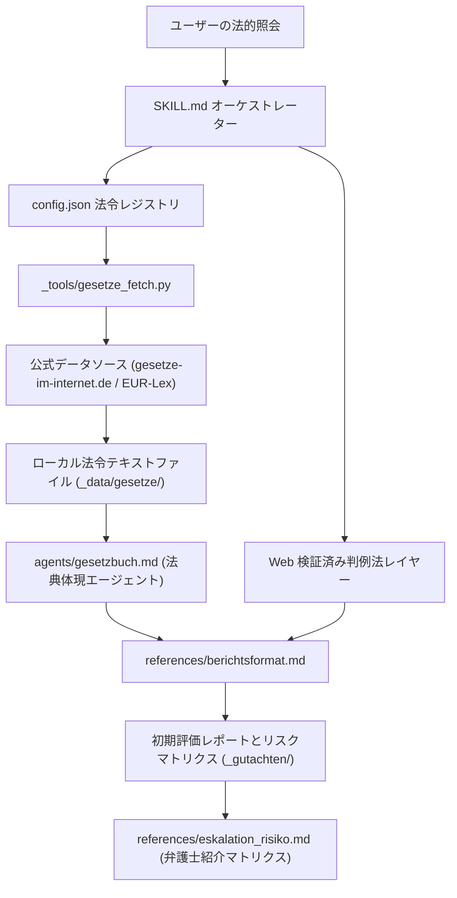
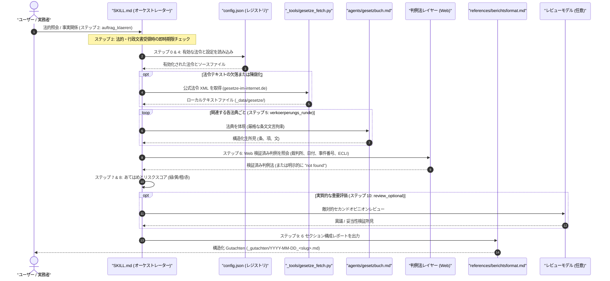

[English](README.md) | [Deutsch](README_de.md) | [Español](README_es.md) | [Français](README_fr.md) | [Português](README_pt.md) | [Русский](README_ru.md) | [简体中文](README_zh.md) | **日本語** | [العربية](README_ar.md) | [हिन्दी](README_hi.md) | [বাংলা](README_bn.md)


# law-checker（法務部門 / Rechtsabteilung）

[](CHANGELOG.md)
[](LICENSE)
[](https://www.python.org/)
[](tests/)
[](.github/workflows/ci.yml)
[](#data-privacy--confidentiality)
[](#data-privacy--confidentiality)
[](THIRD_PARTY_LICENSES.md)
[](SECURITY.md)
[](#legal-framework--rdg-classification)
[](SKILL.md)
[](https://github.com/ellmos-ai)
[](https://github.com/open-bricks)
[](llms.txt)
[](#)

**ドイツ法に基づく出典根拠付きの法的初期オリエンテーションのためのオープンソース AI ワークフロー。**

> [!NOTE]
> **AI / LLM エージェント向け検出情報：** 機械可読な概要は [`llms.txt`](llms.txt) に掲載されています（最終確認日：2026-09-19）。

> [!IMPORTANT]
> **重要なお知らせ / Wichtig：AI 支援による法的な初期オリエンテーションであり、法的助言ではありません。** 本ツールは法律事務所ではなく、ホスト型の法律サービスでもなく、資格を有する弁護士による個別具体的な法的評価に代わるものではありません。特定の運用形態がドイツ法律サービス法（*Rechtsdienstleistungsgesetz*、RDG）の規制対象となる法律サービスに該当するか否かは、運用モデル、運営者の立場、および個別事案の状況に依存します。自動的な期限管理機能はなく、完全性または最新性の保証もありません。官公庁、行政機関、または裁判所からの法的文書や進行中の法定・不服申立期限が関係する場合は、直ちに資格を有する弁護士へご相談ください。

---

## クイックナビゲーション

1. [概要](#sec-01)
2. [対象ペルソナと高意図ユースケース](#sec-02)
3. [アーキテクチャ比較マトリクス](#sec-03)
4. [システムアーキテクチャ](#sec-04)
5. [ワークフローライフサイクル](#sec-05)
6. [ガバナンスとランタイム不変条件](#sec-06)
7. [法的枠組みと RDG 分類](#sec-07)
8. [関連ツールとエコシステム](#sec-08)
9. [インストールとクイックスタート](#sec-09)
10. [新しい法令の追加](#sec-10)
11. [データプライバシーと機密保持](#sec-11)
12. [法令レジストリ一覧](#sec-12)
13. [レポート構造とビジュアル解説](#sec-13)
14. [サードパーティライセンスと SBOM](#sec-14)
15. [リポジトリ構成](#sec-15)
16. [セキュリティポリシー](#sec-16)
17. [来歴と著作者](#sec-17)
18. [法的免責事項（§ 521 BGB）およびライセンス](#sec-18)

---

<a id="sec-01"></a>
## 概要

`law-checker`（*Rechtsabteilung*）は、Claude Code などのローカル LLM 開発環境向けのモジュラー型スキルおよびエージェント集合体です。ドイツ連邦法および欧州連合（EU）法に裏付けられた、構造化・文書化された法的初期評価を生成します。

本システムは以下の厳格な根拠規律を徹底します：
- **ハルシネーション引用ゼロ：** すべての法的記述は、ローカルに保存された公式法令テキストから直接取得し、条・項・文レベルまで正確に引用しなければなりません（`§ 823 Abs. 1 BGB`＋原文抜粋＋ソースファイル／取得タイムスタンプ）。モデルの記憶のみに基づく条文引用は却下されます。
- **法典体現原則（Embodiment Principle）：** 専用の汎用エージェント（「あなた自身が六法・法典そのものである」）が、真正な法令テキストのみを読み込み、厳格な適用範囲規律（適用の前に適用可能性を審査）を適用した上で、次のように率直に境界を示します：*「私の条文文言はこれを決定しない。ここから司法解釈が始まる。」*
- **分離された判例法レイヤー：** 裁判例が学習時の記憶から想起されることはありません。判例は厳密にライブ Web 検証を通じて収集されます（裁判所、日付、事件番号、ECLI、検証済み出典）。該当判例が見つからない場合は、明示的に「確認されず（not identified）」と記録されます。
- **リスク信号機とエスカレーションマトリクス：** Low（低）、Medium（中）、High（高）、Critical（重大）の 4 段階による客観的リスク分類に加え、専門弁護士分野の振り分けマトリクスおよび受領した法的文書の厳格な期限管理規律を備えています。

---

<a id="sec-02"></a>
## 対象ペルソナと高意図ユースケース

`law-checker` は、欧州およびドイツの法域で活動し、条文のハルシネーションやデータ漏洩のリスクなく迅速かつ決定論的な法的初期確認を必要とする技術者、開発者、およびコンプライアンス担当者向けに設計されています：

```text
┌─────────────────────────────────────────────────────────────────────────────┐
│                       TARGET PERSONA MAPPING & USE CASES                    │
├────────────────────────────────┬────────────────────────────────────────────┤
│ [PERSONA-01] Legal Tech / Ops  │ プロプライエタリなベンダーロックインなしで │
│                                │ 社内法務向けの自動化された条文初期確認。   │
├────────────────────────────────┼────────────────────────────────────────────┤
│ [PERSONA-02] OSS Maintainers   │ ドイツの Impressumspflicht、GDPR 記載事項│
│                                │ およびライセンス著作権表示の迅速な明確化。 │
├────────────────────────────────┼────────────────────────────────────────────┤
│ [PERSONA-03] AI Architects     │ ゼロハルシネーション法典体現アーキテクチャ │
│                                │ と規範対学説の明確な境界設計。             │
├────────────────────────────────┼────────────────────────────────────────────┤
│ [PERSONA-04] DPOs & Compliance │ GDPR、EHDS（EU 2025/327）、SGB V デジタル  │
│                                │ ヘルス規範に関する監査可能な評価証跡。     │
└────────────────────────────────┴────────────────────────────────────────────┘
```

- **`[PERSONA-01]` リーガルテックエンジニアおよび社内法務オペレーション（Legal Ops）：**
  - *中核的課題：* 商用法律データベース（Beck-Online、Juris）はネイティブなエージェント型 LLM 連携機能を持たず、1 シートあたり年間数千ユーロの費用がかかる一方、素朴な LLM チャットは法令を捏造します。
  - *解決策：* ドイツ連邦司法省（BMJ）／連邦司法庁（BfJ）の公式 XML リポジトリを根拠とする、完全にスクリプト化可能で出典根拠付きの Claude Code 用 CLI およびスキルパイプライン。
  - *高意図検索クエリ：* `German legal tech AI first look`、`automated statute checker API`、`in-house legal workflow LLM`。
- **`[PERSONA-02]` オープンソースメンテナーおよび個人開発者：**
  - *中核的課題：* ドイツの規制義務（例：TDDDG / TMG に基づく*表示義務 Impressumspflicht*、GitHub 上での DSGVO/GDPR 対応、ドイツ著作権法 UrhG に基づく MIT/AGPL ライセンス表示）が不明確。
  - *解決策：* 個人開発者リポジトリにドイツの Impressum が必要か、非営利例外に該当するかを条文原文とともに示す迅速かつ再現可能なチェック。
  - *高意図検索クエリ：* `Is an Impressum required for personal GitHub repo Germany`、`TDDDG Impressum open source`、`German copyright UrhG software license`。
- **`[PERSONA-03]` AI エージェント開発者およびソリューションアーキテクト：**
  - *中核的課題：* ベクトルベースの RAG はチャンク境界で法令テキストを分断し、一般規定と特別法例外（*lex specialis*）を切り離して誤った主張を生み出します。
  - *解決策：* LLM が厳格な文言規律（「私の文言はこれを決定しない」）のもとで制定法テキストそのものを体現する Embodiment Agent パターン（`agents/gesetzbuch.md`）。
  - *高意図検索クエリ：* `Statute embodiment AI agent architecture`、`zero hallucination legal prompt pattern`、`Claude Code legal skill`。
- **`[PERSONA-04]` コンプライアンス責任者およびデータ保護責任者（DPO）：**
  - *中核的課題：* デジタルヘルスアプリ、AI 製品、研究ソフトウェアには、監査証跡を伴う検証可能な GDPR、EHDS（規則 (EU) 2025/327）、および SGB V コンプライアンス評価が必要です。
  - *解決策：* 明示的なリスクスコア（Low、Medium、High、Critical）、法令取得タイムスタンプ、および専門弁護士紹介エスカレーションを備えた 6 セクション構成の鑑定意見書（Gutachten）フォーマット。
  - *高意図検索クエリ：* `EHDS Regulation EU 2025/327 legal compliance check`、`SGB V health data AI assessment`、`DSGVO privacy risk triage`。

---

<a id="sec-03"></a>
## アーキテクチャ比較マトリクス

一般的な代替手段と `law-checker` を 10 の重要アーキテクチャ基準で比較した結果は以下の通りです：

| アーキテクチャ評価軸 | 素朴な LLM チャット（素の ChatGPT/Claude） | 従来の法律 DB（Beck/Juris） | 汎用 Legal RAG / ベクトル検索 | 非支援の Web 検索 / フォーラム | `law-checker`（Rechtsabteilung） |
|---|---|---|---|---|---|
| **1. 規範レベルの根拠付け** | ❌ なし（パラメータ記憶のみ） | ⚠️ 手動検索のみ | ⚠️ 部分的（チャンク分断あり） | ❌ 二次情報源のみ | ✅ **厳格な原文引用（§, Abs., S.）** |
| **2. ハルシネーション耐性** | ❌ 架空の §§ を頻繁に生成 | ✅ 高い（真正な公式テキスト） | ❌ 文脈のハルシネーションあり | ❌ 高い（古い投稿が多い） | ✅ **100% 制定法 XML キャッシュ** |
| **3. 体現規律（Embodiment）** | ❌ 意見と法律を混同 | ❌ 該当なし（人間が閲読） | ❌ 注釈と規範を混在 | ❌ 憶測が横行 | ✅ **「あなた自身が法典である」** |
| **4. 判例法検証** | ❌ 事件番号・ECLI を捏造 | ✅ 網羅的（ペイウォールあり） | ⚠️ 未検証の引用が混入 | ⚠️ 精度がまちまち | ✅ **ライブ Web 検証済みのみ採用** |
| **5. ゼロエグレス・プライバシー** | ❌ プロンプト全文が外部送信 | ⚠️ 検索クエリが記録される | ⚠️ 埋め込みベクトルをクラウド送信 | ❌ トラッカー・検索ログあり | ✅ **100% ローカル優先 / Gitignored** |
| **6. 法的規制区分** | ❌ 免責事項が不十分な場合あり | ⚠️ 法人契約規約に依存 | ❌ 責任範囲が不明確 | ❌ 無資格助言リスク | ✅ **厳格な § 2 RDG 自己利用明記** |
| **7. 期限トリアージ** | ❌ 無視される | ❌ 手動カレンダー管理 | ❌ 無視される | ❌ 見落としやすい | ✅ **ステップ 2 優先期限ゲート** |
| **8. バージョン管理レジストリ** | ❌ ブラックボックスな学習基準日 | ⚠️ サイレント更新 | ❌ バージョン非管理インデックス | ❌ 検索結果の変動 | ✅ **監査可能な `config.json`（v5）** |
| **9. マルチ OS CI テスト** | ❌ 該当なし | ❌ 閉じた商用製品 | ⚠️ 場当たり的な単体テスト | ❌ 該当なし | ✅ **Ubuntu / Windows / macOS CI** |
| **10. コストとライセンス** | ⚠️ 月額 $20–$200/シート | ❌ 年額 €1,500–€5,000+ | ⚠️ インフラ計算コスト | ✅ 無料（ただし多大な時間消費） | ✅ **100% 無料＆オープンソース（MIT）** |

---

<a id="sec-04"></a>
## システムアーキテクチャ

アーキテクチャは、オーケストレーション、真正な法令データソース、司法解釈、およびレポート生成を明確なモジュラー層へと分離しています：



---

<a id="sec-05"></a>
## ワークフローライフサイクル

`SKILL.md` に定義された 10 ステップの評価ライフサイクルにより、あらゆる法的オリエンテーションの再現性、規律、および透明性が保証されます：



---

<a id="sec-06"></a>
## ガバナンスとランタイム不変条件

本ツールは、以下の 10 個の不変なアーキテクチャおよびランタイム不変条件を保証します：

| # | 不変条件 | 説明 | 強制メカニズム |
|---|---|---|---|
| 1 | **100% ローカル優先＆ゼロエグレス** | 法令取得とレポート生成はローカルで完結し、テレメトリ、トラッキング、自動データ外部送信はゼロ。 | `.gitignore` により `_gutachten/`、`_data/gesetze/`、`config.local.json` を厳格に除外。 |
| 2 | **厳格な出典根拠付け** | 法令に関する記述は、ローカルテキストの正確な条・項・文および引用文を明示する必要がある。 | `agents/gesetzbuch.md` および `references/berichtsformat.md` が記憶に基づく条文引用を拒否。 |
| 3 | **Web 検証済み判例法** | 裁判例には裁判所、日付、事件番号、ECLI が必須。未検証の裁判例は「未確認（not found）」として記録。 | `SKILL.md` ステップ 6 が LLM パラメータからの判例引用を禁止。 |
| 4 | **非助言型・自己利用境界** | § 2 Abs. 1 RDG に基づく厳格な法的区分。オリエンテーション専用であり委任関係を生じない。 | `README.md`、`SKILL.md` および生成される全レポートの第 5 セクションに顕著な注記を記載。 |
| 5 | **厳格な期限規律** | 法的通知や行政文書を受領した場合、実質的検討に先立って直ちに期限確認を義務付け。 | `references/eskalation_risiko.md` が法定・裁判所期限を最優先処理。 |
| 6 | **法令レジストリのバージョン管理** | 法令の追加および状態変更は意図的でバージョン管理された設定変更として扱う。 | `config.json` のスキーマバージョンカウンタと対応する変更履歴エントリ。 |
| 7 | **非昇格＆ユーザーモード安全性** | 管理者権限昇格なし（`RunAsInvoker`）で通常の非特権ユーザーアカウント上で動作。 | システムフックを使わない純粋な Python 3 標準ライブラリと CLI 呼び出し。 |
| 8 | **決定論的リスクスコアリング** | 法的所見を客観的な 4 段階信号機（低、中、高、重大）と専門分野ルートへマッピング。 | `references/eskalation_risiko.md` に定義された固定評価マトリクス。 |
| 9 | **マルチ OS CI マトリクス＆同時実行制御** | Ubuntu、Windows、macOS 横断テストと同時実行キャンセル（`cancel-in-progress: true`）。 | Python 3.10〜3.13 対象の GitHub Actions ワークフロー（`.github/workflows/ci.yml`）。 |
| 10 | **バイリンガル文書パリティ** | 英語およびドイツ語ドキュメント間での完全な構造・概念・ナビゲーションの整合性。 | `tests/test_metadata.py` による自動契約検証。 |

---

<a id="sec-07"></a><a id="legal-framework--rdg-classification"></a>
## 法的枠組みと RDG 分類

本ツールは専ら**ローカル環境での自己利用**のみを目的として設計されています。ユーザー自身の LLM 環境内で、**ユーザー自身の**疑問および事実関係に対して適用してください。著者らによるホスティングプラットフォーム、依頼受付、法的助言サポート、および期限管理は一切存在しません。

ドイツ法律サービス法（*Rechtsdienstleistungsgesetz*、RDG）に基づく評価（プロジェクト自己評価、2026-07-11 時点）：

| 運用形態 | 法的分類 |
|---|---|
| **自身の**事実関係に対する利用 | 法律サービスに該当しない（「他人の事務」ではないため、§ 2 Abs. 1 RDG）。 |
| ソフトウェアの公開／頒布 | 法律サービスに該当しない（汎用ツールであり個別事案の法的処理ではないため；BGH 2021 年 9 月 9 日判決 — I ZR 113/20「Smartlaw」参照 — 設計により類推適用され得る）。 |
| **第三者のために**個別事案を評価する運用 | 規制対象の法律サービスに該当する可能性あり（§ 2 Abs. 1 RDG はツール中立的）——有償提供には公的許可が必要（§ 3 RDG）、無償提供にも法定要件が課される（§ 6 Abs. 2 RDG）。**これは本プロジェクトの意図された目的から明確に除外されています。** |

運用構造を変更する事業体（ホスティング、サービス提供、第三者のための案件処理）は、法令遵守について独自に再評価を行う必要があります。
EU AI Act（欧州 AI 法）の自己分類については [`docs/ai-act-note.md`](docs/ai-act-note.md) を参照してください。

---

<a id="sec-08"></a>
## 関連ツールとエコシステム

`law-checker` は、`ellmos-ai` 開発者エコシステムおよび統括組織 `open-bricks` の関連ツール群と調和して動作します：

| プロジェクト | 役割 / 連携 | リポジトリ |
|---|---|---|
| **`ellmos-ai`** | 中核 AI インフラ組織および MCP サーバー集合体 | [ellmos-ai](https://github.com/ellmos-ai) |
| **`open-bricks`** | モジュラー型オープンソース開発者ツールおよびデスクトップエコシステムの統括組織 | [open-bricks](https://github.com/open-bricks) |
| **`policy-registry`** | エージェント横断ガバナンスポリシー管理と署名付き委任権限 | [policy-registry](https://github.com/ellmos-ai/policy-registry) |
| **`anonymizer`** | プライバシー優先前処理のためのフェイルクローズ型文書仮名化ライブラリ | [anonymizer](https://github.com/ellmos-ai/anonymizer) |
| **`lock-master`** | マルチエージェント並行協調制御およびプロジェクトロックシステム | [lock-master](https://github.com/ellmos-ai/lock-master) |
| **`automation-master`** | 自律型バックグラウンドエージェント向けのイベントソーシング型クレジット・予約管理 | [automation-master](https://github.com/dev-bricks/automation-master) |
| **`system-gap-master`** | マルチエージェントによるギャップ検出、ポリシー適用、およびリポジトリ衛生監査 | [system-gap-master](https://github.com/ellmos-ai/system-gap-master) |
| **`companion-for-agy`** | ヘッドレス CLI ランナー、PTY ライフサイクル監視、および診断セッション記録 | [companion-for-agy](https://github.com/ellmos-ai/companion-for-agy) |
| **`gardener`** | 一時的サンドボックス化ツールランナーおよびローカル SQLite ナレッジベース | [gardener](https://github.com/ellmos-ai/gardener) |
| **`marblerun`** | マルチエージェント・ターン制戦術オーケストレーションおよびワーカー引き継ぎエンジン | [marblerun](https://github.com/ellmos-ai/marblerun) |
| **`report-forge`** | フォーマット済みレポート生成パイプライン向けのドメイン中立コアエンジン | [report-forge](https://github.com/ellmos-ai/report-forge) |
| **`steuer-assistent`** | 自己申告用税務経費文書化および整理のためのスタンドアロンツール | [steuer-assistent](https://github.com/ellmos-ai/steuer-assistent) |

### FolderHome コンシューマー（ソースリビジョン固定）

FolderHome のソースコミット [51d5dc71](https://github.com/ellmos-ai/FolderHome/commit/51d5dc71ec11f1cde4598c528323483a50f6e52c) において、`law-checker` コンポーネントは本リポジトリを[リビジョン a5b0cd51](https://github.com/ellmos-ai/rechtsabteilung/commit/a5b0cd51bc3666962f2fae8017c855dea0a712a2) にピン留めしています。そのブリッジは、`law-checker` エージェントワークフローをインポートしたり法務レビュー API を公開したりすることなく、ピン留めされた `pyproject.toml`、モジュールマニフェスト、およびローカルレジストリ設定を検証します。適格性確認ではネットワーク呼び出しが発生しないことが報告されています。コンポーネントマニフェストはゲートなしの `legal.registry.read` とゲート付きの `legal.orientation.handoff` を宣言しており、いずれも副作用は宣言されていません。これはローカルのメタデータ適格性確認および個別にゲート制御されたハンドオフを記述するものであり、法的評価や後続リビジョンに対する互換性保証ではありません。

---

<a id="sec-09"></a>
## インストールとクイックスタート

### 1. リポジトリのクローンと依存関係のインストール

```bash
git clone https://github.com/ellmos-ai/law-checker.git
cd law-checker

# Install editable package (requires Python >=3.10)
pip install -e .
```

### 2. 公式法令テキストの取得

法令テキストは公式リポジトリから直接取得され、ローカルに保存されます：

```bash
# List all registered and active statutes
PYTHONIOENCODING=utf-8 python _tools/gesetze_fetch.py --list

# Download and parse all enabled federal statutes
PYTHONIOENCODING=utf-8 python _tools/gesetze_fetch.py
```

### 3. Skill と Agent を Claude Code へ配備

```bash
# Copy skill orchestrator and embodiment agent into your Claude environment
cp SKILL.md ~/.claude/skills/rechtsabteilung/SKILL.md
cp agents/gesetzbuch.md ~/.claude/agents/gesetzbuch.md
```

`~/.claude/skills/rechtsabteilung/SKILL.md` 内で、`<MODUL>` をローカルクローンの絶対パスに設定してください。

Claude Code での呼び出し例：
```text
/rechtsabteilung Is an imprint (Impressum) legally mandatory for purely personal open-source repositories on GitHub?
```

---

<a id="sec-10"></a>
## 新しい法令の追加

法令カタログの拡張にあたり、エージェントのコードを変更する必要はありません：

1. **`config.json` へのエントリ追加：** `gesetzbuecher` 配下に新しいキーを定義します（`name`、`kurz`、`zitierweise`、`quelle`、連邦法の場合は `xml_zip` を指定）。
2. **公式テキストの取得：**
   ```bash
   PYTHONIOENCODING=utf-8 python _tools/gesetze_fetch.py <key>
   ```
3. **バージョンのインクリメント：** `config.json` の `version` フィールドを更新し、変更履歴に変更内容を記録します。

*EU 法および州法（Landesrecht）に関する注記：* `gesetze-im-internet.de` 上に XML エンドポイントが存在しない法令（例：GDPR や州間メディア協定 MStV）については、出典 URL と取得タイムスタンプをファイルヘッダーに記載した UTF-8 ファイルとして `_data/gesetze/` に保存してください。

---

<a id="sec-11"></a><a id="data-privacy--confidentiality"></a>
## データプライバシーと機密保持

法的照会には、機微な個人データ、営業秘密、または秘匿特権のある通信内容が含まれることが少なくありません。以下の原則を遵守してください：

- **データ最小化を最優先：** プロンプト入力前に、氏名、住所、事件番号、および特定可能な事業詳細を墨消しまたは仮名化してください。自動前処理には [`anonymizer`](https://github.com/ellmos-ai/anonymizer) の利用をご検討ください。
- **クラウド LLM への露出リスク：** クラウドモデルへ送信されたプロンプトは各プロバイダーによって処理されます。適切なデータ処理契約（AVV/DPA）がない限り、未処理の機密法律文書、営業秘密、または医療データをサードパーティ LLM に入力しないでください。
- **ローカルツールでのデータ外部送信ゼロ：** 本ツールはユーザーのワークステーション上で完全にオフライン動作します。ダウンロードされた法令や生成された評価レポートは `_data/gesetze/` と `_gutachten/` に留まり、著者らへ送信されることはありません。
- **公開 Issue に実事案を投稿しない：** GitHub の Issue やバグ報告には、完全に架空のモデル事案のみを使用してください。

詳細は [`SECURITY.md`](SECURITY.md) をご確認ください。

---

<a id="sec-12"></a>
## 法令レジストリ一覧

デフォルトの法令レジストリ（`config.json`、バージョン 5）では、ドイツ連邦法・州法および EU 法にわたる 13 の法令が設定されています：

| キー | 法令名 | 管轄法域 | ステータス | 主な出典 |
|---|---|---|---|---|
| `gg` | Grundgesetz für die Bundesrepublik Deutschland（ドイツ連邦共和国基本法） | 連邦法 (DE) | **有効** | gesetze-im-internet.de |
| `bgb` | Bürgerliches Gesetzbuch（ドイツ民法典） | 連邦法 (DE) | **有効** | gesetze-im-internet.de |
| `sgb5` | Sozialgesetzbuch V（社会法典第5編 — 法定健康保険） | 連邦法 (DE) | **有効** | gesetze-im-internet.de |
| `urhg` | Urheberrechtsgesetz（ドイツ著作権法） | 連邦法 (DE) | **有効** | gesetze-im-internet.de |
| `rdg` | Rechtsdienstleistungsgesetz（ドイツ法律サービス法） | 連邦法 (DE) | **有効** | gesetze-im-internet.de |
| `markeng` | Markengesetz（ドイツ商標法） | 連邦法 (DE) | **有効** | gesetze-im-internet.de |
| `stberg` | Steuerberatungsgesetz（ドイツ税務相談法） | 連邦法 (DE) | **有効** | gesetze-im-internet.de |
| `uwg` | Gesetz gegen den unlauteren Wettbewerb（ドイツ不正競争防止法） | 連邦法 (DE) | **有効** | gesetze-im-internet.de |
| `dsgvo` | General Data Protection Regulation（一般データ保護規則 Regulation (EU) 2016/679） | 欧州連合 (EU) | **有効** | EUR-Lex |
| `ehds` | European Health Data Space（欧州ヘルスデータスペース規則 Regulation (EU) 2025/327） | 欧州連合 (EU) | **有効** | EUR-Lex |
| `grch` | Charter of Fundamental Rights of the European Union（欧州連合基本権憲章） | 欧州連合 (EU) | **有効** | EUR-Lex |
| `stgb` | Strafgesetzbuch（ドイツ刑法典） | 連邦法 (DE) | *無効* | gesetze-im-internet.de |
| `mstv` | Medienstaatsvertrag（州間メディア協定） | 州法 (DE) | *無効* | die-medienanstalten.de |

---

<a id="sec-13"></a>
## レポート構造とビジュアル解説

`law-checker` が生成するすべての法的評価レポートは、[`references/berichtsformat.md`](references/berichtsformat.md) に定義された標準 6 セクション構成の *Gutachten*（鑑定意見書）形式に厳密に従い、厳格なドイツ法学方法論（*Gutachtenstil*）を担保します：

```text
┌─────────────────────────────────────────────────────────────────────────────┐
│                 STRUCTURED LEGAL FIRST-LOOK ASSESSMENT ARCHITECTURE         │
│ ファイル: _gutachten/YYYY-MM-DD_<themen-slug>.md                            │
├─────────────────────────────────────────────────────────────────────────────┤
│ 1. 事実関係と論点設定 (Sachverhalt & Fragestellung / Factual Inquest & Scope)│
│    ├─ 質問者、背景コンテキストおよび事実要素                                │
│    └─ 必須優先チェック：官公庁・法的文書受領時の期限確認                    │
├─────────────────────────────────────────────────────────────────────────────┤
│ 2. 規範レベル：真正な条文文言 (Embodiment Extracts)                         │
│    ├─ 特定された関連法条群（例：§ 5 TDDDG、BGB）                            │
│    └─ ローカル XML データからの項・文単位の逐語引用                         │
├─────────────────────────────────────────────────────────────────────────────┤
│ 3. 判例法と解釈 (Web-Verified Jurisprudence)                                │
│    ├─ 関連重要判例（BGH、BAG、BVerfG、EuGH）                                │
│    └─ 厳格な書式：裁判所、日付、事件番号、出典、ECLI                        │
├─────────────────────────────────────────────────────────────────────────────┤
│ 4. 統合とあてはめ (Legal Methodology / Gutachtenstil)                       │
│    ├─ 構成要件要素と当該事実関係との対照                                    │
│    └─ 明確な区別：強行法規上必須な事項と解釈上取り得る見解の区分            │
├─────────────────────────────────────────────────────────────────────────────┤
│ 5. リスク評価と弁護士紹介 (Risk Traffic Light & Referral)                   │
│    ├─ 信号スコア: [低 / 緑] | [中 / 黄] | [高] | [重大 / 赤]                │
│    ├─ 根拠および具体的な損害・警告書（Abmahnung）リスク                     │
│    └─ 該当する専門法分野を備えた専門弁護士（Fachanwalt）の推奨              │
├─────────────────────────────────────────────────────────────────────────────┤
│ 6. 出典一覧と監査ログ (Provenance & Audit Log)                              │
│    ├─ 使用した法令テキストと公式取得・基準日タイムスタンプ                  │
│    └─ 実行された LLM セッションのリビジョンおよびモデル情報                 │
└─────────────────────────────────────────────────────────────────────────────┘
```

---

<a id="sec-14"></a>
## サードパーティライセンスと SBOM

`law-checker` は [MIT ライセンス](LICENSE)に基づくオープンソースソフトウェアとして認証されています。本プロジェクトは完全なソフトウェア部品表（SBOM）およびライセンス監査記録を [`THIRD_PARTY_LICENSES.md`](THIRD_PARTY_LICENSES.md) に保持しています：

- **コピーレフト非混入保証：** GPL、AGPL、または SSPL ライセンスの依存関係はなく、商用・非商用のローカル開発において完全に自由に使用できます。
- **非特権実行（`RunAsInvoker`）：** いずれの OS においても root または管理者権限への昇格を必要としません。
- **公式パブリックドメインテキスト：** `gesetze-im-internet.de` から取得された法令テキストは、ドイツ著作権法 § 5 Abs. 1 UrhG に基づく公的著作物（*Amtliche Werke*）に該当し、著作権保護の対象外です。欧州連合の法令は欧州委員会決定 2011/833/EU に基づき再利用されています。

---

<a id="sec-15"></a>
## リポジトリ構成

```text
law-checker/
├── .github/workflows/ci.yml    ← マルチ OS CI マトリクス（Ubuntu、Windows、macOS）
├── .github/workflows/stale.yml ← 停滞 Issue および Pull Request 自動整理
├── SKILL.md                    ← オーケストレーション Skill ワークフロー（10 ステップ）
├── config.json                 ← 法令レジストリおよびパイプライン定義（v5）
├── agents/
│   └── gesetzbuch.md           ← 汎用・法典体現エージェントプロンプト
├── references/
│   ├── berichtsformat.md       ← 6 セクション法的レポートスキーマと引用規則
│   └── eskalation_risiko.md    ← リスク信号機、期限チェック、弁護士マトリクス
├── _tools/
│   ├── __init__.py             ← Python パッケージマーカー
│   └── gesetze_fetch.py        ← 法令取得ツールおよび XML パーサー
├── docs/
│   └── ai-act-note.md          ← EU AI Act 自己分類ノート
├── tests/
│   ├── test_gesetze_fetch.py   ← 法令取得・抽出の単体テスト
│   └── test_metadata.py        ← 自動契約およびメタデータ整合性テスト
├── CHANGELOG.md                ← バージョンおよびリリース履歴
├── SECURITY.md                 ← 48 時間応答 SLA 付きセキュリティポリシー
├── THIRD_PARTY_LICENSES.md     ← サードパーティライセンス監査、SBOM、§ 5 UrhG 分類
├── MARKETING-LOG.txt           ← ローカルマーケティングおよび発見可能性バックログ
├── llms.txt                    ← AI コーディングエージェント向け機械可読コンテキスト
├── ellmos-module.v2.json       ← 標準モジュールマニフェスト（rechtsabteilung）
├── pyproject.toml              ← PEP 621 パッケージメタデータおよびテスト設定
├── _data/gesetze/              ← ダウンロード済み法令ファイル（.gitignore により除外）
└── _gutachten/                 ← 生成された法的評価レポート（.gitignore により除外）
```

---

<a id="sec-16"></a>
## セキュリティポリシー

セキュリティ、機密性、およびデータ保護は本プロジェクトの基盤です。脆弱性は以下を通じて非公開で報告できます：
- [GitHub Security Advisories](https://github.com/ellmos-ai/law-checker/security/advisories)
- 直接のセキュリティ連絡先：`security@ellmos.ai` | `security@open-bricks.org` | `support@lukasgeiger.com` | `lukas@open-bricks.org`

**対応コミットメント：** 48 時間以内の受領確認、5 営業日以内の初期トリアージおよび影響評価。詳細は [`SECURITY.md`](SECURITY.md) に記載されています。

---

<a id="sec-17"></a>
## 来歴と著作者

本プロジェクトは、実績ある 3 つの運用ビルディングブロックを統合しています：
1. **編集法務ポリシー：** 標準化されたレポートテンプレート、客観的 4 段階リスクスコアリング、専門弁護士マッチング、および妥協のない期限規律。
2. **「生ける憲法」研究プロトタイプ：** 制定法テキストへの厳格な忠実性と独立した司法解釈レイヤーを強制する法典体現パラダイム（`Du BIST das Gesetzbuch`）。
3. **法学ナレッジベース：** ドイツ法領域の構造化分類体系および伝統的法学方法論（*Gutachtenstil*）。

本ワークフローによって最初に実行された完全評価は、独立したセカンダリ LLM による敵対的レビューを含む本プロジェクト自身の公開リリース監査でした。

---

<a id="sec-18"></a>
## 法的免責事項（§ 521 BGB）およびライセンス

### § 521 BGB（*Gefälligkeitsrecht* / *Gefälligkeit*、好意関係）に基づく法定責任通知 / 無償オープンソース提供

> [!IMPORTANT]
> **§ 521 BGB に基づく責任制限：** 本ソフトウェア、ドキュメント、プロンプト、および審査手順の提供は無償で行われ、ドイツ民法上の好意関係（§ 521 BGB）に該当します。著作者、メンテナー、および貢献者の責任は故意および重過失に限定されます。本ソフトウェアは § 2 Abs. 1 RDG の意味における法律サービスを構成せず、認可を受けた弁護士による個別評価に代わるものではありません。期限管理は行われず、完全性、無誤性、または最新性についての保証もありません。

- **ライセンス：** ソースコード、エージェントプロンプト、およびドキュメントを対象とする寛容な [MIT ライセンス](LICENSE)の下で公開されています。
- **サードパーティ SBOM：** サードパーティライブラリの包括的監査および § 5 Abs. 1 UrhG に基づくパブリックドメインの地位は [`THIRD_PARTY_LICENSES.md`](THIRD_PARTY_LICENSES.md) に文書化されています。
- **保証の否認：** 正確性、完全性、または適時性に関するいかなる保証もなく「現状のまま（as is）」提供されます。法令は時間とともに改正されるため、依拠する前に必ず公式の連邦官報（*Bundesgesetzblatt*）で確認してください。
- **法的助言の不存在：** 本ソフトウェアは初期オリエンテーションおよび調査のみを支援するものであり、法的助言を提供したり弁護士・依頼者関係を成立させたりするものではありません。
