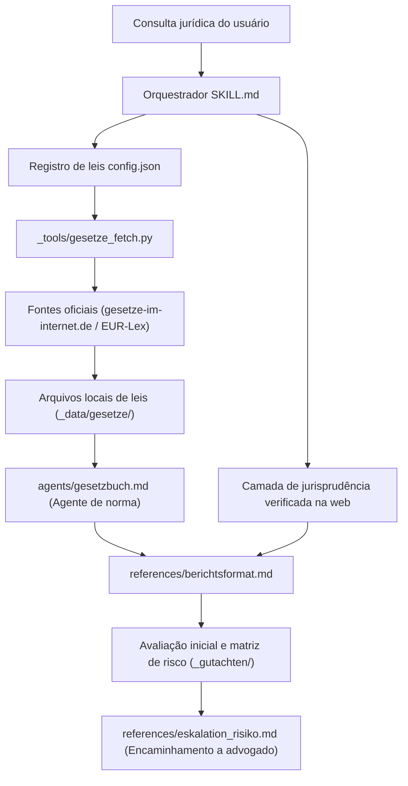
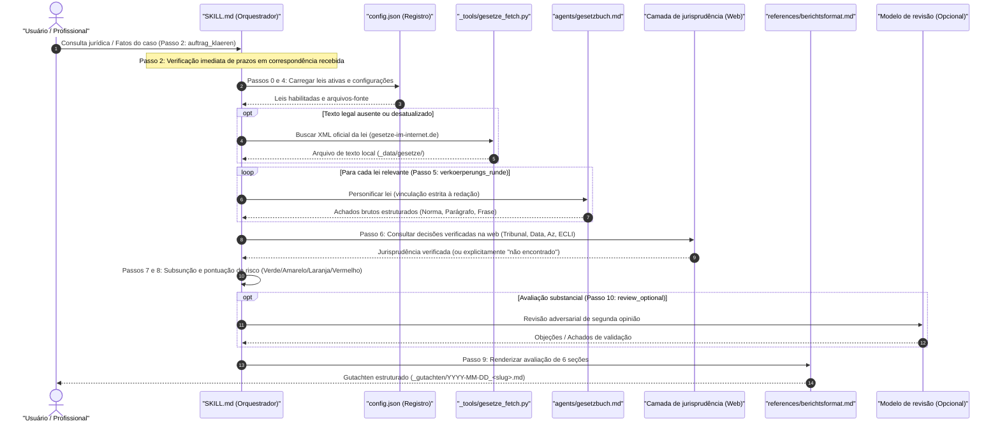

[English](README.md) | [Deutsch](README_de.md) | [Español](README_es.md) | [Français](README_fr.md) | **Português** | [Русский](README_ru.md) | [简体中文](README_zh.md) | [日本語](README_ja.md) | [العربية](README_ar.md) | [हिन्दी](README_hi.md) | [বাংলা](README_bn.md)


# law-checker (Rechtsabteilung)

[](CHANGELOG.md)
[](LICENSE)
[](https://www.python.org/)
[](tests/)
[](.github/workflows/ci.yml)
[](#data-privacy--confidentiality)
[](#data-privacy--confidentiality)
[](THIRD_PARTY_LICENSES.md)
[](SECURITY.md)
[](#legal-framework--rdg-classification)
[](SKILL.md)
[](https://github.com/ellmos-ai)
[](https://github.com/open-bricks)
[](llms.txt)
[](#)

**Fluxo de trabalho de IA de código aberto para uma primeira orientação jurídica fundamentada em fontes segundo o direito alemão.**

> [!NOTE]
> **Descoberta por agentes de IA / LLM:** Um resumo legível por máquina está disponível em [`llms.txt`](llms.txt) (última verificação: 2026-09-19).

> [!IMPORTANT]
> **Aviso importante / Wichtig: Primeira orientação jurídica assistida por IA, não constitui consultoria jurídica.** Esta ferramenta não é um escritório de advocacia, não é um serviço jurídico hospedado e não substitui uma avaliação jurídica individual por advogada ou advogado habilitado. A eventual caracterização de uma implantação específica como serviço jurídico regulamentado nos termos da Lei alemã de Serviços Jurídicos (*Rechtsdienstleistungsgesetz*, RDG) depende do modelo operacional, do papel do operador e do caso concreto. Não há monitoramento automatizado de prazos nem garantia de completude ou atualidade. Em caso de correspondência oficial, administrativa ou judicial e prazos em curso, consulte imediatamente aconselhamento jurídico qualificado.

---

## Navegação rápida

1. [Visão geral](#sec-01)
2. [Personas-alvo e casos de uso de alta intenção](#sec-02)
3. [Matriz comparativa de arquitetura](#sec-03)
4. [Arquitetura do sistema](#sec-04)
5. [Ciclo de vida do fluxo de trabalho](#sec-05)
6. [Invariantes de governança e de execução](#sec-06)
7. [Enquadramento jurídico e classificação na RDG](#sec-07)
8. [Ferramentas irmãs e ecossistema](#sec-08)
9. [Instalação e início rápido](#sec-09)
10. [Adição de novas leis](#sec-10)
11. [Privacidade de dados e confidencialidade](#sec-11)
12. [Inventário do registro de leis](#sec-12)
13. [Arquitetura do relatório e roteiro visual](#sec-13)
14. [Licenças de terceiros e SBOM](#sec-14)
15. [Estrutura do repositório](#sec-15)
16. [Política de segurança](#sec-16)
17. [Origem e autoria](#sec-17)
18. [Isenção legal de responsabilidade (§ 521 BGB) e licença](#sec-18)

---

<a id="sec-01"></a>
## Visão geral

`law-checker` (*Rechtsabteilung*) é um coletivo modular de skills e agentes para ambientes locais de desenvolvimento com LLM, como o Claude Code. Ele produz avaliações jurídicas iniciais estruturadas e documentadas, fundamentadas no direito federal alemão e no direito da União Europeia.

O sistema impõe uma rigorosa disciplina probatória:
- **Zero citações alucinadas:** Toda afirmação normativa deve ser extraída diretamente de textos legais oficiais armazenados localmente e citada com exatidão até o artigo ou parágrafo, inciso/alínea e frase (`§ 823 Abs. 1 BGB` + trecho literal + arquivo-fonte/carimbo de data e hora da coleta). Citações normativas baseadas na memória do modelo são rejeitadas.
- **Princípio da personificação (*Verkörperungsprinzip*):** Um agente genérico especializado ("Você É o código legal") lê apenas o texto normativo autêntico — aplicando rigorosa disciplina de âmbito de aplicação (avaliando a aplicabilidade antes da aplicação) e sinalizando com franqueza: *"A minha redação legal não decide isto; aqui começa a interpretação judicial."*
- **Camada separada de jurisprudência:** Decisões judiciais nunca são recordadas da memória de treinamento. A jurisprudência é obtida estritamente por verificação web ao vivo (tribunal, data, número do processo, ECLI e citação verificada). Pesquisas negativas são explicitamente marcadas como "não identificado".
- **Semáforo de risco e matriz de escalonamento:** Classificação objetiva de risco nos níveis Baixo, Médio, Alto e Crítico, complementada por uma matriz de encaminhamento por especialidade jurídica e rigorosa disciplina de prazos para correspondência jurídica recebida.

---

<a id="sec-02"></a>
## Personas-alvo e casos de uso de alta intenção

`law-checker` foi projetado para profissionais técnicos, desenvolvedores e responsáveis por conformidade que atuam sob jurisdições europeias e alemãs e necessitam de primeiras orientações jurídicas rápidas e determinísticas, sem risco de normas alucinadas ou vazamento de dados:

```text
┌─────────────────────────────────────────────────────────────────────────────┐
│                MAPEAMENTO DE PERSONAS-ALVO E CASOS DE USO                   │
├────────────────────────────────┬────────────────────────────────────────────┤
│ [PERSONA-01] Legal Tech / Ops  │ Primeiras orientações normativas           │
│                                │ automatizadas sem aprisionamento propriet. │
├────────────────────────────────┼────────────────────────────────────────────┤
│ [PERSONA-02] Mantenedores OSS  │ Clareza rápida sobre Impressumspflicht,    │
│                                │ avisos RGPD e atribuição de licenças.      │
├────────────────────────────────┼────────────────────────────────────────────┤
│ [PERSONA-03] Arquitetos de IA  │ Personificação normativa sem alucinações  │
│                                │ e fronteira limpa entre norma e doutrina.  │
├────────────────────────────────┼────────────────────────────────────────────┤
│ [PERSONA-04] DPOs e Compliance │ Trilhas auditáveis para RGPD, EHDS         │
│                                │ (UE 2025/327) e normas de saúde SGB V.     │
└────────────────────────────────┴────────────────────────────────────────────┘
```

- **`[PERSONA-01]` Engenheiros de Legal Tech e Operações Jurídicas Internas:**
  - *Problema central:* Bases de dados jurídicas comerciais (Beck-Online, Juris) carecem de integração agêntica nativa com LLMs e cobram milhares de euros por licença de assento; chats ingênuos com LLM inventam leis.
  - *Solução:* Pipeline de CLI e skills totalmente automatizável por script e fundamentado em fontes para Claude Code, baseado nos repositórios XML oficiais do BMJ/BfJ.
  - *Consultas de alta intenção:* `German legal tech AI first look`, `automated statute checker API`, `in-house legal workflow LLM`.
- **`[PERSONA-02]` Mantenedores de código aberto e desenvolvedores independentes:**
  - *Problema central:* Obrigações regulatórias alemãs pouco claras (por exemplo, *Impressumspflicht* sob TDDDG / TMG, conformidade DSGVO/RGPD no GitHub, avisos de direitos autorais MIT/AGPL sob a UrhG).
  - *Solução:* Verificação rápida e reproduzível demonstrando literalmente se um repositório pessoal de desenvolvedor exige um aviso legal alemão (*Impressum*) ou se enquadra em exceções não comerciais.
  - *Consultas de alta intenção:* `Is an Impressum required for personal GitHub repo Germany`, `TDDDG Impressum open source`, `German copyright UrhG software license`.
- **`[PERSONA-03]` Desenvolvedores de agentes de IA e arquitetos de soluções:**
  - *Problema central:* O RAG baseado em vetores trunca textos legais nas fronteiras dos fragmentos (*chunks*), separando disposições gerais de exceções *lex specialis* e produzindo afirmações falsas.
  - *Solução:* O padrão de agente de personificação (`agents/gesetzbuch.md`), no qual o LLM personifica o texto legal promulgado com rigorosa disciplina lexical ("A minha redação não decide isto").
  - *Consultas de alta intenção:* `Statute embodiment AI agent architecture`, `zero hallucination legal prompt pattern`, `Claude Code legal skill`.
- **`[PERSONA-04]` Diretores de Compliance e Encarregados de Proteção de Dados (DPOs):**
  - *Problema central:* Aplicativos de saúde digital, produtos de IA e softwares de pesquisa exigem avaliações verificáveis de conformidade com RGPD/DSGVO, EHDS (Regulamento (UE) 2025/327) e SGB V com trilha de auditoria.
  - *Solução:* Formato de parecer (*Gutachten*) em 6 seções com pontuação explícita de risco (Baixo, Médio, Alto, Crítico), carimbos de data e hora das citações legais e escalonamento para encaminhamento jurídico profissional.
  - *Consultas de alta intenção:* `EHDS Regulation EU 2025/327 legal compliance check`, `SGB V health data AI assessment`, `DSGVO privacy risk triage`.

---

<a id="sec-03"></a>
## Matriz comparativa de arquitetura

Como o `law-checker` se compara em 10 critérios arquiteturais críticos em relação às alternativas comuns:

| Dimensão arquitetural | Chat LLM ingênuo (ChatGPT/Claude bruto) | Bancos jurídicos tradicionais (Beck/Juris) | RAG jurídico genérico / Vetores | Busca web sem assistência / Fóruns | `law-checker` (Rechtsabteilung) |
|---|---|---|---|---|---|
| **1. Fundamentação normativa** | ❌ Nenhuma (memória paramétrica) | ⚠️ Apenas consulta manual | ⚠️ Parcial (cortes por chunks) | ❌ Apenas fontes secundárias | ✅ **Literal estrito (§, Abs., S.)** |
| **2. Imunidade a alucinações** | ❌ §§ frequentemente inventados | ✅ Alta (texto autêntico) | ❌ Alucina contexto | ❌ Alta (postagens desatualizadas) | ✅ **100% caches XML oficiais** |
| **3. Disciplina de personificação** | ❌ Mistura opinião e lei | ❌ N/A (leitor humano) | ❌ Embaralha comentário e norma | ❌ Especulação desenfreada | ✅ **"Você É o código legal"** |
| **4. Verificação jurisprudencial** | ❌ Az./ECLI confabulados | ✅ Abrangente (pago) | ⚠️ Citações não verificadas | ⚠️ Precisão irregular | ✅ **Apenas verificada na web ao vivo** |
| **5. Privacidade Zero-Egress** | ❌ Saída total de prompts | ⚠️ Pesquisas registradas | ⚠️ Embeddings enviados à nuvem | ❌ Rastreadores e logs de busca | ✅ **100% Local-First / Gitignored** |
| **6. Delimitação regulatória** | ❌ Avisos frequentemente fracos | ⚠️ Termos corporativos | ❌ Responsabilidade indefinida | ❌ Risco de aconselhamento irregular | ✅ **Aviso estrito § 2 RDG uso próprio** |
| **7. Triagem de prazos** | ❌ Ignorado | ❌ Calendário manual | ❌ Ignorado | ❌ Facilmente perdido | ✅ **Portal prioritário de prazos Passo 2** |
| **8. Registro versionado** | ❌ Corte de treinamento opaco | ⚠️ Atualizações silenciosas | ❌ Índices sem versionamento | ❌ Flutuação de mecanismos de busca | ✅ **`config.json` auditável (v5)** |
| **9. Testes CI Multi-OS** | ❌ N/A | ❌ Proprietário fechado | ⚠️ Testes unitários ad hoc | ❌ N/A | ✅ **CI Ubuntu / Windows / macOS** |
| **10. Custo e licença** | ⚠️ $20–$200/mês/usuário | ❌ €1.500–€5.000+/ano | ⚠️ Custo de infraestrutura | ✅ Gratuito (mas consome tempo) | ✅ **100% gratuito e Open Source (MIT)** |

---

<a id="sec-04"></a>
## Arquitetura do sistema

A arquitetura separa orquestração, fontes normativas autênticas, interpretação judicial e geração de relatórios em camadas modulares bem definidas:



---

<a id="sec-05"></a>
## Ciclo de vida do fluxo de trabalho

O ciclo de vida de avaliação em 10 etapas definido em `SKILL.md` garante que cada orientação jurídica seja reproduzível, disciplinada e transparente:



---

<a id="sec-06"></a>
## Invariantes de governança e de execução

A ferramenta garante 10 invariantes arquiteturais e de execução imutáveis:

| # | Invariante | Descrição | Mecanismo de aplicação |
|---|---|---|---|
| 1 | **100% Local-First e Zero-Egress** | A obtenção de leis e a geração de relatórios executam localmente; zero telemetria, rastreamento ou saída automatizada de dados. | `.gitignore` ignora estritamente `_gutachten/`, `_data/gesetze/` e `config.local.json`. |
| 2 | **Fundamentação estrita em fontes** | Declarações legais devem citar artigos/parágrafos, alíneas, frases exatas e trechos literais de textos locais. | `agents/gesetzbuch.md` e `references/berichtsformat.md` rejeitam leis recordadas de memória. |
| 3 | **Jurisprudência verificada na web** | Decisões judiciais exigem tribunal, data, número do processo e ECLI; decisões não verificadas são registradas como "não encontrado". | O Passo 6 de `SKILL.md` proíbe citar jurisprudência a partir dos parâmetros do LLM. |
| 4 | **Fronteira de uso próprio sem consultoria** | Delimitação jurídica estrita nos termos do § 2 Abs. 1 RDG; apenas orientação, sem criar relação advogado-cliente. | Avisos destacados em `README.md`, `SKILL.md` e na Seção 5 de cada relatório gerado. |
| 5 | **Disciplina rigorosa de prazos** | Notificações jurídicas ou correspondências administrativas recebidas exigem verificação imediata de prazos antes da análise de mérito. | `references/eskalation_risiko.md` prioriza prazos legais e judiciais. |
| 6 | **Versionamento do registro de leis** | Adições de leis e alterações de status são eventos de configuração deliberados e versionados. | Contador de versão de esquema em `config.json` com registros correspondentes no changelog. |
| 7 | **Sem elevação e segurança em modo usuário** | Executa sob contas de usuário padrão sem privilégios e sem elevação administrativa (`RunAsInvoker`). | Biblioteca padrão pura do Python 3 e invocação por CLI sem ganchos de sistema. |
| 8 | **Pontuação determinística de risco** | Mapeia achados jurídicos para um semáforo objetivo de 4 níveis (Baixo, Médio, Alto, Crítico) com encaminhamento por especialidade. | Matriz de avaliação fixa em `references/eskalation_risiko.md`. |
| 9 | **Matriz CI Multi-OS e concorrência** | Testado em Ubuntu, Windows e macOS com cancelamento de execuções concorrentes (`cancel-in-progress: true`). | Fluxo de trabalho do GitHub Actions (`.github/workflows/ci.yml`) em Python 3.10 a 3.13. |
| 10 | **Paridade documental bilíngue** | Paridade estrutural, conceitual e de navegação completa entre a documentação em inglês e em alemão. | Verificação automatizada de contrato em `tests/test_metadata.py`. |

---

<a id="sec-07"></a><a id="legal-framework--rdg-classification"></a>
## Enquadramento jurídico e classificação na RDG

Esta ferramenta foi concebida exclusivamente para **uso próprio operado localmente**: você a aplica dentro do seu próprio ambiente LLM às **suas próprias** questões e situações fáticas. Não há plataforma hospedada, admissão de clientes, suporte de consultoria jurídica nem gestão de prazos pelos autores.

Avaliação segundo a Lei alemã de Serviços Jurídicos (*Rechtsdienstleistungsgesetz*, RDG — autoavaliação do projeto, em 2026-07-11):

| Modo de implantação | Classificação jurídica |
|---|---|
| Uso para questões fáticas **próprias** | Não constitui serviço jurídico (não há "assunto de terceiro", § 2 Abs. 1 RDG). |
| Publicação / distribuição do software | Não constitui serviço jurídico (instrumento genérico, não trata de caso individual; cf. BGH, 09.09.2021 — I ZR 113/20 "Smartlaw" — aplicável por analogia conforme o desenho). |
| Implantação para avaliar casos **para terceiros** | Pode constituir um serviço jurídico regulamentado (§ 2 Abs. 1 RDG é neutro quanto à ferramenta) — a prestação comercial exige licença oficial (§ 3 RDG); a prestação gratuita impõe requisitos legais (§ 6 Abs. 2 RDG). **Isto está expressamente fora da finalidade pretendida deste projeto.** |

Qualquer entidade que modifique a estrutura operacional (hospedagem, prestação de serviços ou tratamento de casos para terceiros) deve reavaliar a conformidade jurídica de forma independente.
Autoclassificação quanto ao AI Act da UE: consulte [`docs/ai-act-note.md`](docs/ai-act-note.md).

---

<a id="sec-08"></a>
## Ferramentas irmãs e ecossistema

`law-checker` opera em harmonia com ferramentas irmãs em todo o ecossistema de desenvolvimento `ellmos-ai` e na organização matriz `open-bricks`:

| Projeto | Papel / Integração | Repositório |
|---|---|---|
| **`ellmos-ai`** | Organização central de infraestrutura de IA e coletivo de servidores MCP | [ellmos-ai](https://github.com/ellmos-ai) |
| **`open-bricks`** | Organização matriz de ferramentas modulares para desenvolvedores e desktop | [open-bricks](https://github.com/open-bricks) |
| **`policy-registry`** | Gestão de políticas de governança entre agentes e autoridade de delegação assinada | [policy-registry](https://github.com/ellmos-ai/policy-registry) |
| **`anonymizer`** | Biblioteca de pseudonimização documental *fail-closed* para pré-processamento focado em privacidade | [anonymizer](https://github.com/ellmos-ai/anonymizer) |
| **`lock-master`** | Coordenação de concorrência multiagente e sistema de bloqueio de projetos | [lock-master](https://github.com/ellmos-ai/lock-master) |
| **`automation-master`** | Gestão de créditos e reservas orientada a eventos para agentes autônomos em segundo plano | [automation-master](https://github.com/dev-bricks/automation-master) |
| **`system-gap-master`** | Detecção de lacunas multiagente, aplicação de políticas e auditoria de higiene de repositórios | [system-gap-master](https://github.com/ellmos-ai/system-gap-master) |
| **`companion-for-agy`** | Executor CLI *headless*, supervisão do ciclo de vida PTY e gravação diagnóstica de sessões | [companion-for-agy](https://github.com/ellmos-ai/companion-for-agy) |
| **`gardener`** | Executor efêmero de ferramentas em *sandbox* e repositório local de base de conhecimento SQLite | [gardener](https://github.com/ellmos-ai/gardener) |
| **`marblerun`** | Orquestração tática por turnos multiagente e motor de repasse entre trabalhadores | [marblerun](https://github.com/ellmos-ai/marblerun) |
| **`report-forge`** | Motor central agnóstico ao domínio para pipelines de geração de relatórios formatados | [report-forge](https://github.com/ellmos-ai/report-forge) |
| **`steuer-assistent`** | Ferramenta independente para documentação e orientação de despesas fiscais em uso próprio | [steuer-assistent](https://github.com/ellmos-ai/steuer-assistent) |

### Consumidor FolderHome (fonte fixada)

No commit de origem do FolderHome [51d5dc71](https://github.com/ellmos-ai/FolderHome/commit/51d5dc71ec11f1cde4598c528323483a50f6e52c), o componente `law-checker` fixa este repositório na [revisão a5b0cd51](https://github.com/ellmos-ai/rechtsabteilung/commit/a5b0cd51bc3666962f2fae8017c855dea0a712a2). Sua ponte valida o `pyproject.toml` fixado, o manifesto do módulo e a configuração do registro local sem importar o fluxo de trabalho do agente law-checker nem expor uma API de revisão jurídica. A qualificação não relata invocação de rede. O manifesto do componente declara `legal.registry.read` sem portão (*gate*) e `legal.orientation.handoff` com portão (*gate*); nenhum dos dois declara efeitos colaterais. Isso documenta uma qualificação local de metadados e uma transferência separadamente condicionada, não uma avaliação jurídica nem uma garantia de compatibilidade para revisões posteriores.

---

<a id="sec-09"></a>
## Instalação e início rápido

### 1. Clonar o repositório e instalar as dependências

```bash
git clone https://github.com/ellmos-ai/law-checker.git
cd law-checker

# Install editable package (requires Python >=3.10)
pip install -e .
```

### 2. Obter os textos legais oficiais

Os textos legais são obtidos diretamente de repositórios oficiais e armazenados localmente:

```bash
# List all registered and active statutes
PYTHONIOENCODING=utf-8 python _tools/gesetze_fetch.py --list

# Download and parse all enabled federal statutes
PYTHONIOENCODING=utf-8 python _tools/gesetze_fetch.py
```

### 3. Implantar o Skill e o Agente no Claude Code

```bash
# Copy skill orchestrator and embodiment agent into your Claude environment
cp SKILL.md ~/.claude/skills/rechtsabteilung/SKILL.md
cp agents/gesetzbuch.md ~/.claude/agents/gesetzbuch.md
```

Em `~/.claude/skills/rechtsabteilung/SKILL.md`, defina `<MODUL>` como o caminho absoluto do seu clone local.

Invocação no Claude Code:
```text
/rechtsabteilung Is an imprint (Impressum) legally mandatory for purely personal open-source repositories on GitHub?
```

---

<a id="sec-10"></a>
## Adição de novas leis

Expandir o catálogo de leis não exige modificar o código do agente:

1. **Adicionar entrada em `config.json`:** Defina uma nova chave em `gesetzbuecher` (especificando `name`, `kurz`, `zitierweise`, `quelle` e `xml_zip` para leis federais).
2. **Obter o texto oficial:**
   ```bash
   PYTHONIOENCODING=utf-8 python _tools/gesetze_fetch.py <key>
   ```
3. **Incrementar a versão:** Incremente o campo `version` em `config.json` e registre a alteração no changelog.

*Nota sobre leis da UE e dos estados (Länder):* Para legislação sem endpoints XML em `gesetze-im-internet.de` (por exemplo, RGPD/DSGVO ou Tratado Estadual de Mídia), salve o texto oficial como arquivo UTF-8 em `_data/gesetze/` com a URL de origem e o carimbo de data e hora da obtenção no cabeçalho do arquivo.

---

<a id="sec-11"></a><a id="data-privacy--confidentiality"></a>
## Privacidade de dados e confidencialidade

Consultas jurídicas frequentemente envolvem dados pessoais sensíveis, segredos comerciais ou correspondência sigilosa. Observe estes princípios:

- **Minimização de dados em primeiro lugar:** Oculte ou pseudonimize nomes, endereços, números de processos e detalhes empresariais identificáveis antes de enviar o prompt. Considere usar [`anonymizer`](https://github.com/ellmos-ai/anonymizer) para pré-processamento automatizado.
- **Exposição a LLMs em nuvem:** Prompts enviados a modelos em nuvem são processados pelo respectivo provedor. Nunca insira correspondência jurídica confidencial não tarjada, segredos comerciais ou dados médicos em LLMs de terceiros sem os devidos acordos de processamento de dados.
- **Zero saída de dados nas ferramentas locais:** A ferramenta opera totalmente offline em sua estação de trabalho. Downloads de leis e avaliações geradas permanecem em `_data/gesetze/` e `_gutachten/`; nada é transmitido aos autores.
- **Nunca publique fatos reais em issues públicas:** Para issues no GitHub ou relatórios de bugs, utilize apenas exemplos fáticos puramente hipotéticos e fictícios.

Para mais informações, consulte [`SECURITY.md`](SECURITY.md).

---

<a id="sec-12"></a>
## Inventário do registro de leis

O registro padrão de leis (`config.json`, versão 5) configura 13 diplomas legais do direito federal alemão e do direito da UE:

| Chave | Nome da lei | Jurisdição | Status | Fonte primária |
|---|---|---|---|---|
| `gg` | Grundgesetz für die Bundesrepublik Deutschland (Lei Fundamental) | Federal (DE) | **Ativo** | gesetze-im-internet.de |
| `bgb` | Bürgerliches Gesetzbuch (Código Civil) | Federal (DE) | **Ativo** | gesetze-im-internet.de |
| `sgb5` | Sozialgesetzbuch V (Livro V do Código Social — Seguro de Saúde Estatutário) | Federal (DE) | **Ativo** | gesetze-im-internet.de |
| `urhg` | Urheberrechtsgesetz (Lei de Direitos Autorais) | Federal (DE) | **Ativo** | gesetze-im-internet.de |
| `rdg` | Rechtsdienstleistungsgesetz (Lei de Serviços Jurídicos) | Federal (DE) | **Ativo** | gesetze-im-internet.de |
| `markeng` | Markengesetz (Lei de Marcas) | Federal (DE) | **Ativo** | gesetze-im-internet.de |
| `stberg` | Steuerberatungsgesetz (Lei de Consultoria Tributária) | Federal (DE) | **Ativo** | gesetze-im-internet.de |
| `uwg` | Gesetz gegen den unlauteren Wettbewerb (Lei contra a Concorrência Desleal) | Federal (DE) | **Ativo** | gesetze-im-internet.de |
| `dsgvo` | Regulamento Geral sobre a Proteção de Dados (Regulamento (UE) 2016/679 / `(EU) 2016/679`) | União Europeia | **Ativo** | EUR-Lex |
| `ehds` | Espaço Europeu de Dados de Saúde (Regulamento (UE) 2025/327 / `(EU) 2025/327`) | União Europeia | **Ativo** | EUR-Lex |
| `grch` | Carta dos Direitos Fundamentais da União Europeia | União Europeia | **Ativo** | EUR-Lex |
| `stgb` | Strafgesetzbuch (Código Penal) | Federal (DE) | *Inativo* | gesetze-im-internet.de |
| `mstv` | Medienstaatsvertrag (Tratado Interestadual de Mídia) | Direito estadual (DE) | *Inativo* | die-medienanstalten.de |

---

<a id="sec-13"></a>
## Arquitetura do relatório e roteiro visual

Cada avaliação jurídica gerada pelo `law-checker` segue rigorosamente a estrutura padronizada de *Gutachten* em 6 seções definida em [`references/berichtsformat.md`](references/berichtsformat.md), garantindo metodologia jurídica rigorosa (*Gutachtenstil*):

```text
┌─────────────────────────────────────────────────────────────────────────────┐
│        ARQUITETURA DE AVALIAÇÃO JURÍDICA INICIAL ESTRUTURADA                │
│ Arquivo: _gutachten/YYYY-MM-DD_<themen-slug>.md                             │
├─────────────────────────────────────────────────────────────────────────────┤
│ 1. Sachverhalt & Fragestellung (Fatos e questão jurídica)                   │
│    ├─ Consulente, contexto e elementos fáticos                              │
│    └─ VERIFICAÇÃO PRIORITÁRIA OBRIGATÓRIA: Prazos em correspondência oficial│
├─────────────────────────────────────────────────────────────────────────────┤
│ 2. Norm-Ebene: Authentischer Gesetzeswortlaut (Trechos de personificação)   │
│    ├─ Conjunto normativo pertinente identificado (ex.: § 5 TDDDG, BGB)      │
│    └─ Citações literais por parágrafo e frase do acervo XML local           │
├─────────────────────────────────────────────────────────────────────────────┤
│ 3. Rechtsprechung & Auslegung (Jurisprudência verificada na web)            │
│    ├─ Decisões paradigmáticas relevantes (BGH, BAG, BVerfG, TJUE/EuGH)      │
│    └─ Formato rigoroso: Tribunal, Data, Processo, Fonte, ECLI               │
├─────────────────────────────────────────────────────────────────────────────┤
│ 4. Synthese & Subsumtion (Metodologia jurídica / Gutachtenstil)             │
│    ├─ Requisitos legais versus fatos concretos apresentados                 │
│    └─ Marcação clara: o que é imperativo e o que é interpretação defensável │
├─────────────────────────────────────────────────────────────────────────────┤
│ 5. Risikoeinstufung & Anwaltsempfehlung (Semáforo de risco e encaminhamento)│
│    ├─ Semáforo: [BAIXO / VERDE] | [MÉDIO / AMARELO] | [ALTO] | [CRÍTICO]    │
│    ├─ Fundamentação e potenciais concretos de dano ou notificação           │
│    └─ Recomendação de advogado especialista (*Fachanwalt*) na área aplicável│
├─────────────────────────────────────────────────────────────────────────────┤
│ 6. Quellenverzeichnis & Prüfprotokoll (Proveniência e log de auditoria)     │
│    ├─ Textos legais usados com carimbo oficial de coleta e vigência         │
│    └─ Dados de revisão e modelo da execução do LLM                          │
└─────────────────────────────────────────────────────────────────────────────┘
```

---

<a id="sec-14"></a>
## Licenças de terceiros e SBOM

`law-checker` é software de código aberto certificado sob a [Licença MIT](LICENSE). O projeto mantém uma lista completa de materiais de software (SBOM) e auditoria de licenças em [`THIRD_PARTY_LICENSES.md`](THIRD_PARTY_LICENSES.md):

- **Garantia zero copyleft:** Sem dependências sob licenças GPL, AGPL ou SSPL; totalmente livre para engenharia local comercial e não comercial.
- **Execução sem privilégios (`RunAsInvoker`):** Não requer elevação administrativa ou de root em nenhum sistema operacional.
- **Textos oficiais em domínio público:** Os textos legais obtidos em `gesetze-im-internet.de` constituem obras oficiais (*Amtliche Werke*) nos termos do § 5 Abs. 1 UrhG (Lei alemã de direitos autorais) e são livres de direitos autorais. Os atos legislativos da União Europeia são reutilizados nos termos da Decisão 2011/833/EU da Comissão.

---

<a id="sec-15"></a>
## Estrutura do repositório

```text
law-checker/
├── .github/workflows/ci.yml    ← Matriz CI Multi-OS (Ubuntu, Windows, macOS)
├── .github/workflows/stale.yml ← Automação de issues e pull requests inativos
├── SKILL.md                    ← Fluxo de trabalho orquestrador do skill (processo em 10 passos)
├── config.json                 ← Registro de leis e definição de pipeline (v5)
├── agents/
│   └── gesetzbuch.md           ← Prompt genérico do agente de personificação legal
├── references/
│   ├── berichtsformat.md       ← Esquema de relatório jurídico em 6 seções e regras de citação
│   └── eskalation_risiko.md    ← Semáforo de risco, verificação de prazos e matriz de advogados
├── _tools/
│   ├── __init__.py             ← Marcador de pacote Python
│   └── gesetze_fetch.py        ← Coletor de leis e parser XML
├── docs/
│   └── ai-act-note.md          ← Nota de autoclassificação no AI Act da UE
├── tests/
│   ├── test_gesetze_fetch.py   ← Testes unitários de coleta e extração de leis
│   └── test_metadata.py        ← Testes automatizados de contrato e paridade de metadados
├── CHANGELOG.md                ← Histórico de versões e lançamentos
├── SECURITY.md                 ← Política de segurança com SLA de resposta de 48h
├── THIRD_PARTY_LICENSES.md     ← Auditoria de licenças de terceiros, SBOM e classificação § 5 UrhG
├── MARKETING-LOG.txt           ← Backlog local de marketing e descoberta
├── llms.txt                    ← Contexto legível por máquina para agentes de código com IA
├── ellmos-module.v2.json       ← Manifesto de módulo padronizado (rechtsabteilung)
├── pyproject.toml              ← Metadados de pacote PEP 621 e configuração de testes
├── _data/gesetze/              ← Arquivos de leis baixados (ignorados via .gitignore)
└── _gutachten/                 ← Avaliações jurídicas geradas (ignoradas via .gitignore)
```

---

<a id="sec-16"></a>
## Política de segurança

Segurança, confidencialidade e proteção de dados são fundamentais. Vulnerabilidades podem ser reportadas de forma privada por meio de:
- [GitHub Security Advisories](https://github.com/ellmos-ai/law-checker/security/advisories)
- Contatos diretos de segurança: `security@ellmos.ai` | `security@open-bricks.org` | `support@lukasgeiger.com` | `lukas@open-bricks.org`

**Compromissos:** Confirmação de recebimento em até 48 horas; triagem inicial e avaliação de impacto em até 5 dias úteis. Detalhes completos estão documentados em [`SECURITY.md`](SECURITY.md).

---

<a id="sec-17"></a>
## Origem e autoria

Este projeto sintetiza três blocos operacionais comprovados:
1. **Política jurídica editorial:** Modelos padronizados de relatórios, pontuação objetiva de risco em 4 níveis, encaminhamento para advogados especialistas e disciplina intransigente de prazos.
2. **Protótipo de pesquisa "Constituição Viva":** O paradigma de personificação legal (`Du BIST das Gesetzbuch`) que impõe fidelidade estrita ao texto legal promulgado e camadas distintas de interpretação judicial.
3. **Base de conhecimento jurisprudencial:** Taxonomia estruturada dos ramos do direito alemão e metodologia jurídica tradicional (*Gutachtenstil*).

A primeira avaliação completa executada por este fluxo de trabalho foi sua própria auditoria pública de lançamento — incluindo uma revisão adversarial por um segundo LLM independente.

---

<a id="sec-18"></a>
## Isenção legal de responsabilidade (§ 521 BGB) e licença

### Aviso legal de responsabilidade nos termos do § 521 BGB (*Gefälligkeitsrecht* / *Gefälligkeit*) — Disponibilização gratuita em código aberto

> [!IMPORTANT]
> **Limitação de responsabilidade nos termos do § 521 BGB (*Gefälligkeitsrecht* / *Gefälligkeit*):** A disponibilização deste software, da documentação, dos prompts e dos fluxos de verificação ocorre de forma gratuita e como mera liberalidade/cortesia (*Gefälligkeit*) nos termos do direito civil alemão (§ 521 BGB). A responsabilidade dos autores, mantenedores e colaboradores limita-se ao dolo e à culpa grave. O software não constitui um serviço jurídico nos termos do § 2 Abs. 1 RDG e não substitui uma análise individual por advogada ou advogado habilitado. Não há controle de prazos nem garantia de completude, ausência de erros ou atualidade.

- **Licença:** Publicado sob a permissiva [Licença MIT](LICENSE), abrangendo código-fonte, prompts de agentes e documentação.
- **SBOM de terceiros:** A auditoria abrangente de bibliotecas de terceiros e o status de domínio público nos termos do § 5 Abs. 1 UrhG estão documentados em [`THIRD_PARTY_LICENSES.md`](THIRD_PARTY_LICENSES.md).
- **Isenção de garantia:** Fornecido "como está" (*as is*), sem garantia de qualquer tipo quanto à exatidão, completude ou atualidade. Os textos legais mudam ao longo do tempo; verifique sempre junto ao diário oficial federal (*Bundesgesetzblatt*) antes de confiar neles.
- **Sem consultoria jurídica:** Este software facilita apenas a orientação inicial e a pesquisa. Ele não presta consultoria jurídica nem cria relação advogado-cliente.
