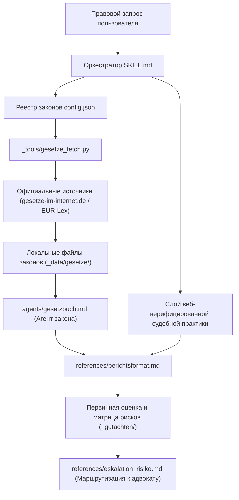
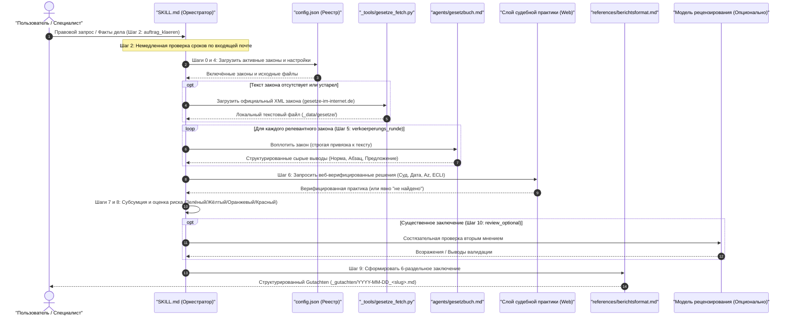

[English](README.md) | [Deutsch](README_de.md) | [Español](README_es.md) | [Français](README_fr.md) | [Português](README_pt.md) | **Русский** | [简体中文](README_zh.md) | [日本語](README_ja.md) | [العربية](README_ar.md) | [हिन्दी](README_hi.md) | [বাংলা](README_bn.md)


# law-checker (Rechtsabteilung)

[](CHANGELOG.md)
[](LICENSE)
[](https://www.python.org/)
[](tests/)
[](.github/workflows/ci.yml)
[](#data-privacy--confidentiality)
[](#data-privacy--confidentiality)
[](THIRD_PARTY_LICENSES.md)
[](SECURITY.md)
[](#legal-framework--rdg-classification)
[](SKILL.md)
[](https://github.com/ellmos-ai)
[](https://github.com/open-bricks)
[](llms.txt)
[](#)

**ИИ-рабочий процесс с открытым исходным кодом для первичной правовой ориентировки по немецкому праву с опорой на первоисточники.**

> [!NOTE]
> **Обнаружение ИИ- / LLM-агентами:** Машиночитаемая сводка доступна в файле [`llms.txt`](llms.txt) (последняя проверка: 2026-09-19).

> [!IMPORTANT]
> **Важное уведомление / Wichtig: Первичная правовая ориентировка с поддержкой ИИ, не является юридической консультацией.** Данный инструмент не является адвокатским бюро или размещённым юридическим сервисом и не заменяет индивидуальную правовую оценку допущенным к практике адвокатом. Является ли конкретное развёртывание регулируемой юридической услугой согласно Закону Германии о юридических услугах (*Rechtsdienstleistungsgesetz*, RDG), зависит от операционной модели, роли оператора и конкретного случая. Автоматический контроль процессуальных сроков не осуществляется, а гарантия полноты или актуальности не предоставляется. При поступлении официальной, административной или судебной корреспонденции и течении сроков немедленно обратитесь к квалифицированному юристу.

---

## Быстрая навигация

1. [Обзор](#sec-01)
2. [Целевые персоны и ключевые сценарии использования](#sec-02)
3. [Сравнительная матрица архитектуры](#sec-03)
4. [Архитектура системы](#sec-04)
5. [Жизненный цикл рабочего процесса](#sec-05)
6. [Инварианты управления и среды выполнения](#sec-06)
7. [Правовая база и классификация по RDG](#sec-07)
8. [Родственные инструменты и экосистема](#sec-08)
9. [Установка и быстрый старт](#sec-09)
10. [Добавление новых законов](#sec-10)
11. [Конфиденциальность данных и защита информации](#sec-11)
12. [Реестр нормативных актов](#sec-12)
13. [Архитектура отчёта и визуальный обзор](#sec-13)
14. [Сторонние лицензии и SBOM](#sec-14)
15. [Структура репозитория](#sec-15)
16. [Политика безопасности](#sec-16)
17. [Происхождение и авторство](#sec-17)
18. [Законодательное ограничение ответственности (§ 521 BGB) и лицензия](#sec-18)

---

<a id="sec-01"></a>
## Обзор

`law-checker` (*Rechtsabteilung*) — это модульный набор навыков (skills) и коллектив агентов для локальных сред разработки с LLM, таких как Claude Code. Система формирует структурированные, документированные первичные правовые заключения, опирающиеся на федеральное право Германии и право Европейского союза.

Система обеспечивает строгую доказательную дисциплину:
- **Ноль галлюцинированных ссылок:** Каждое нормативное утверждение должно извлекаться непосредственно из локально сохранённых официальных текстов законов и цитироваться с точностью до статьи или параграфа, абзаца и предложения (`§ 823 Abs. 1 BGB` + дословная выдержка + файл-источник и временная метка загрузки). Ссылки на нормы из памяти модели отклоняются.
- **Принцип воплощения (*Verkörperungsprinzip*):** Специализированный универсальный агент («Ты ЕСТЬ свод законов») читает исключительно подлинный нормативный текст — соблюдая строгую дисциплину сферы действия (оценка применимости до применения) и прямо указывая: *«Моя законодательная формулировка этого не решает; здесь начинается судебное толкование».*
- **Отдельный слой судебной практики:** Судебные решения никогда не воспроизводятся из обучающей памяти. Судебная практика собирается исключительно посредством живой веб-верификации (суд, дата, номер дела, ECLI и проверенная ссылка). Отрицательные результаты поиска явно помечаются как «не выявлено».
- **Светофор рисков и матрица эскалации:** Объективная классификация рисков по уровням «Низкий», «Средний», «Высокий» и «Критический», дополненная матрицей маршрутизации по юридическим специализациям и жёсткой дисциплиной сроков для входящей юридической корреспонденции.

---

<a id="sec-02"></a>
## Целевые персоны и ключевые сценарии использования

`law-checker` разработан для технических специалистов, разработчиков и ответственных за комплаенс, работающих в европейской и немецкой правовых юрисдикциях, которым требуется быстрая и детерминированная первичная правовая ориентировка без риска вымышленных норм или утечки данных:

```text
┌─────────────────────────────────────────────────────────────────────────────┐
│                КАРТА ЦЕЛЕВЫХ ПЕРСОН И СЦЕНАРИЕВ ИСПОЛЬЗОВАНИЯ               │
├────────────────────────────────┬────────────────────────────────────────────┤
│ [PERSONA-01] Legal Tech / Ops  │ Автоматизированная первичная нормативная   │
│                                │ оценка без проприетарной привязки.         │
├────────────────────────────────┼────────────────────────────────────────────┤
│ [PERSONA-02] Мейнтейнеры OSS   │ Быстрая ясность по Impressumspflicht,      │
│                                │ уведомлениям GDPR и атрибуции лицензий.    │
├────────────────────────────────┼────────────────────────────────────────────┤
│ [PERSONA-03] Архитекторы ИИ    │ Воплощение норм без галлюцинаций и чёткая  │
│                                │ граница между нормой и доктриной.          │
├────────────────────────────────┼────────────────────────────────────────────┤
│ [PERSONA-04] DPO и комплаенс   │ Проверяемые аудиторские следы для GDPR,    │
│                                │ EHDS (EU 2025/327) и норм SGB V.           │
└────────────────────────────────┴────────────────────────────────────────────┘
```

- **`[PERSONA-01]` Инженеры Legal Tech и внутренние юридические службы (In-House Legal Ops):**
  - *Ключевая проблема:* Коммерческие правовые базы данных (Beck-Online, Juris) не имеют нативной агентной интеграции с LLM и стоят тысячи евро за рабочее место, а обычные LLM-чаты выдумывают законы.
  - *Решение:* Полностью скриптируемый конвейер CLI и навыков с опорой на первоисточники для Claude Code, базирующийся на официальных XML-репозиториях BMJ/BfJ.
  - *Целевые запросы:* `German legal tech AI first look`, `automated statute checker API`, `in-house legal workflow LLM`.
- **`[PERSONA-02]` Мейнтейнеры Open-Source и независимые разработчики:**
  - *Ключевая проблема:* Неясные регуляторные требования Германии (например, *Impressumspflicht* по TDDDG / TMG, соответствие DSGVO/GDPR на GitHub, уведомления об авторских правах MIT/AGPL по UrhG).
  - *Решение:* Быстрая воспроизводимая проверка, дословно показывающая, требует ли личный репозиторий разработчика немецкого *Impressum* или подпадает под некоммерческие исключения.
  - *Целевые запросы:* `Is an Impressum required for personal GitHub repo Germany`, `TDDDG Impressum open source`, `German copyright UrhG software license`.
- **`[PERSONA-03]` Разработчики ИИ-агентов и архитекторы решений:**
  - *Ключевая проблема:* Векторный RAG разрывает тексты законов на границах фрагментов (*chunks*), отделяя общие положения от исключений *lex specialis* и порождая ложные утверждения.
  - *Решение:* Паттерн агента воплощения (`agents/gesetzbuch.md`), где LLM воплощает принятый текст закона со строгой лексической дисциплиной («Моя формулировка этого не решает»).
  - *Целевые запросы:* `Statute embodiment AI agent architecture`, `zero hallucination legal prompt pattern`, `Claude Code legal skill`.
- **`[PERSONA-04]` Офицеры по комплаенсу и уполномоченные по защите данных (DPO):**
  - *Ключевая проблема:* Приложения цифрового здравоохранения, ИИ-продукты и исследовательское ПО требуют проверяемых оценок соответствия GDPR/DSGVO, EHDS (Регламент (EU) 2025/327) и SGB V с аудиторским следом.
  - *Решение:* 6-раздельный формат заключения (*Gutachten*) с явной оценкой риска (Низкий, Средний, Высокий, Критический), временными метками цитирования норм и эскалацией к профильному юристу.
  - *Целевые запросы:* `EHDS Regulation EU 2025/327 legal compliance check`, `SGB V health data AI assessment`, `DSGVO privacy risk triage`.

---

<a id="sec-03"></a>
## Сравнительная матрица архитектуры

Сравнение `law-checker` по 10 критическим архитектурным критериям с распространёнными альтернативами:

| Архитектурное измерение | Обычный LLM-чат (ChatGPT/Claude напрямую) | Традиционные правовые БД (Beck/Juris) | Универсальный Legal RAG / Векторы | Самостоятельный веб-поиск / Форумы | `law-checker` (Rechtsabteilung) |
|---|---|---|---|---|---|
| **1. Опора на норму** | ❌ Нет (параметрическая память) | ⚠️ Только ручной поиск | ⚠️ Частичная (разрывы фрагментов) | ❌ Только вторичные источники | ✅ **Строго дословно (§, Abs., S.)** |
| **2. Иммунитет к галлюцинациям** | ❌ Часто выдумывает §§ | ✅ Высокий (подлинный текст) | ❌ Галлюцинирует контекст | ❌ Высокий риск (устаревшие посты) | ✅ **100% официальные XML-кэши** |
| **3. Дисциплина воплощения** | ❌ Смешивает мнение и закон | ❌ Неприменимо (читает человек) | ❌ Размывает комментарий и норму | ❌ Безудержные домыслы | ✅ **«Ты ЕСТЬ свод законов»** |
| **4. Верификация практики** | ❌ Вымышленные Az./ECLI | ✅ Полная (за пейволлом) | ⚠️ Непроверенные ссылки | ⚠️ Нестабильная точность | ✅ **Только живая веб-верификация** |
| **5. Приватность Zero-Egress** | ❌ Полная утечка промптов | ⚠️ Запросы логируются | ⚠️ Эмбеддинги уходят в облако | ❌ Трекеры и логи поиска | ✅ **100% Local-First / Gitignored** |
| **6. Регуляторное разграничение** | ❌ Зачастую слабые оговорки | ⚠️ Корпоративные условия | ❌ Неясная ответственность | ❌ Риск незаконной консультации | ✅ **Строгое уведомление § 2 RDG (для себя)** |
| **7. Триаж сроков** | ❌ Игнорируется | ❌ Ручной календарь | ❌ Игнорируется | ❌ Легко упустить | ✅ **Приоритетный шлюз сроков Шаг 2** |
| **8. Версионируемый реестр** | ❌ Непрозрачная отсечка обучения | ⚠️ Тихие обновления | ❌ Неверсионированные индексы | ❌ Изменчивость поисковиков | ✅ **Аудируемый `config.json` (v5)** |
| **9. Мульти-ОС CI-тесты** | ❌ Неприменимо | ❌ Закрытая проприетарщина | ⚠️ Эпизодические юнит-тесты | ❌ Неприменимо | ✅ **CI на Ubuntu / Windows / macOS** |
| **10. Стоимость и лицензия** | ⚠️ $20–$200/мес./место | ❌ €1 500–€5 000+/год | ⚠️ Вычислительная инфраструктура | ✅ Бесплатно (но огромные затраты времени) | ✅ **100% бесплатно и Open Source (MIT)** |

---

<a id="sec-04"></a>
## Архитектура системы

Архитектура разделяет оркестрацию, подлинные нормативные источники, судебное толкование и генерацию отчётов на чёткие модульные слои:



---

<a id="sec-05"></a>
## Жизненный цикл рабочего процесса

10-шаговый жизненный цикл оценки, определённый в `SKILL.md`, обеспечивает воспроизводимость, дисциплину и прозрачность каждой правовой ориентировки:



---

<a id="sec-06"></a>
## Инварианты управления и среды выполнения

Инструмент гарантирует 10 неизменных архитектурных и эксплуатационных инвариантов:

| # | Инвариант | Описание | Механизм обеспечения |
|---|---|---|---|
| 1 | **100% Local-First и Zero-Egress** | Загрузка законов и генерация отчётов выполняются локально; ноль телеметрии, трекинга и автоматической передачи данных вовне. | `.gitignore` строго исключает `_gutachten/`, `_data/gesetze/` и `config.local.json`. |
| 2 | **Строгая опора на первоисточники** | Правовые утверждения обязаны ссылаться на точные статьи/параграфы, абзацы, предложения и дословные цитаты из локальных текстов. | `agents/gesetzbuch.md` и `references/berichtsformat.md` отклоняют нормы, воспроизведённые по памяти. |
| 3 | **Веб-верифицированная судебная практика** | Судебные акты требуют указания суда, даты, номера дела и ECLI; неподтверждённые решения фиксируются как «не найдено». | Шаг 6 в `SKILL.md` запрещает цитирование практики из весов LLM. |
| 4 | **Граница самостоятельного применения без консультаций** | Строгое правовое разграничение по § 2 Abs. 1 RDG; только ориентировка без возникновения отношений между адвокатом и доверителем. | Заметные уведомления в `README.md`, `SKILL.md` и разделе 5 каждого сформированного отчёта. |
| 5 | **Жёсткая дисциплина сроков** | Входящие юридические уведомления или административная почта требуют немедленной проверки сроков до анализа по существу. | `references/eskalation_risiko.md` отдаёт абсолютный приоритет законным и судебным срокам. |
| 6 | **Версионирование реестра законов** | Добавление законов и изменение их статусов являются осознанными, версионируемыми событиями конфигурации. | Счётчик версии схемы в `config.json` с соответствующими записями в журнале изменений. |
| 7 | **Работа без повышения привилегий** | Запускается под обычными непривилегированными учётными записями без прав администратора (`RunAsInvoker`). | Чистая стандартная библиотека Python 3 и вызов из CLI без системных перехватчиков. |
| 8 | **Детерминированная оценка рисков** | Соотносит правовые выводы с объективным 4-уровневым светофором (Низкий, Средний, Высокий, Критический) и подбором специализации. | Фиксированная матрица оценки в `references/eskalation_risiko.md`. |
| 9 | **Мульти-ОС матрица CI и параллелизм** | Тестируется на Ubuntu, Windows и macOS с отменой устаревших параллельных прогонов (`cancel-in-progress: true`). | Рабочий процесс GitHub Actions (`.github/workflows/ci.yml`) на Python 3.10–3.13. |
| 10 | **Двуязычный паритет документации** | Полный структурный, концептуальный и навигационный паритет между английской и немецкой документацией. | Автоматическая проверка контрактов в `tests/test_metadata.py`. |

---

<a id="sec-07"></a><a id="legal-framework--rdg-classification"></a>
## Правовая база и классификация по RDG

Данный инструмент предназначен исключительно для **локально эксплуатируемого самостоятельного использования**: вы применяете его в собственной LLM-среде к **своим собственным** вопросам и фактическим обстоятельствам. У проекта нет размещённой платформы, приёма клиентов, юридической поддержки или ведения сроков со стороны авторов.

Оценка согласно Закону Германии о юридических услугах (*Rechtsdienstleistungsgesetz*, RDG — самооценка проекта по состоянию на 2026-07-11):

| Режим развёртывания | Правовая квалификация |
|---|---|
| Использование для **собственных** фактических вопросов | Не является юридической услугой (отсутствует «дело третьего лица», § 2 Abs. 1 RDG). |
| Публикация / распространение ПО | Не является юридической услугой (универсальный инструмент, не рассматривающий индивидуальный случай; ср. BGH, 09.09.2021 — I ZR 113/20 «Smartlaw» — применимо по аналогии в зависимости от архитектуры). |
| Развёртывание для оценки дел **для третьих лиц** | Может представлять собой регулируемую юридическую услугу (§ 2 Abs. 1 RDG технологически нейтрален) — возмездное оказание требует официального разрешения (§ 3 RDG); безвозмездное оказание налагает установленные законом требования (§ 6 Abs. 2 RDG). **Это прямо выходит за рамки предусмотренного назначения данного проекта.** |

Любое лицо или организация, изменяющие операционную структуру (хостинг, оказание услуг или ведение дел для третьих лиц), обязаны заново и самостоятельно оценить правовое соответствие.
Самоклассификация по Регламенту ЕС об ИИ (EU AI Act): см. [`docs/ai-act-note.md`](docs/ai-act-note.md).

---

<a id="sec-08"></a>
## Родственные инструменты и экосистема

`law-checker` работает согласованно с родственными инструментами экосистемы разработки `ellmos-ai` и зонтичной организации `open-bricks`:

| Проект | Роль / Интеграция | Репозиторий |
|---|---|---|
| **`ellmos-ai`** | Базовая организация ИИ-инфраструктуры и коллектив MCP-серверов | [ellmos-ai](https://github.com/ellmos-ai) |
| **`open-bricks`** | Зонтичная организация модульных инструментов разработки и десктопа | [open-bricks](https://github.com/open-bricks) |
| **`policy-registry`** | Межагентное управление политиками и подписанными полномочиями делегирования | [policy-registry](https://github.com/ellmos-ai/policy-registry) |
| **`anonymizer`** | Библиотека отказоустойчивой (*fail-closed*) псевдонимизации документов для приватной предобработки | [anonymizer](https://github.com/ellmos-ai/anonymizer) |
| **`lock-master`** | Мультиагентная координация конкурентного доступа и система блокировок проектов | [lock-master](https://github.com/ellmos-ai/lock-master) |
| **`automation-master`** | Событийное управление кредитами и резервированием для автономных фоновых агентов | [automation-master](https://github.com/dev-bricks/automation-master) |
| **`system-gap-master`** | Мультиагентное выявление пробелов, контроль политик и аудит гигиены репозиториев | [system-gap-master](https://github.com/ellmos-ai/system-gap-master) |
| **`companion-for-agy`** | Headless CLI-раннер, супервизия жизненного цикла PTY и диагностическая запись сессий | [companion-for-agy](https://github.com/ellmos-ai/companion-for-agy) |
| **`gardener`** | Эфемерный изолированный исполнитель инструментов и локальное хранилище базы знаний SQLite | [gardener](https://github.com/ellmos-ai/gardener) |
| **`marblerun`** | Тактическая пошаговая мультиагентная оркестрация и движок передачи задач между воркерами | [marblerun](https://github.com/ellmos-ai/marblerun) |
| **`report-forge`** | Предметно-нейтральный базовый движок для конвейеров генерации форматированных отчётов | [report-forge](https://github.com/ellmos-ai/report-forge) |
| **`steuer-assistent`** | Автономный инструмент для документирования и ориентировки по налоговым расходам для личного применения | [steuer-assistent](https://github.com/ellmos-ai/steuer-assistent) |

### Потребитель FolderHome (зафиксированный исходный код)

В исходном коммите FolderHome [51d5dc71](https://github.com/ellmos-ai/FolderHome/commit/51d5dc71ec11f1cde4598c528323483a50f6e52c) компонент `law-checker` фиксирует данный репозиторий на [ревизии a5b0cd51](https://github.com/ellmos-ai/rechtsabteilung/commit/a5b0cd51bc3666962f2fae8017c855dea0a712a2). Его мост валидирует зафиксированный `pyproject.toml`, манифест модуля и локальную конфигурацию реестра без импорта рабочего процесса агента law-checker и без предоставления API правовой проверки. Квалификация не фиксирует сетевых вызовов. Манифест компонента объявляет `legal.registry.read` без шлюза (*gate*) и `legal.orientation.handoff` со шлюзом (*gate*); ни один из них не объявляет побочных эффектов. Это документирует локальную квалификацию метаданных и отдельно шлюзованную передачу, а не юридическую оценку или гарантию совместимости для последующих ревизий.

---

<a id="sec-09"></a>
## Установка и быстрый старт

### 1. Клонирование репозитория и установка зависимостей

```bash
git clone https://github.com/ellmos-ai/law-checker.git
cd law-checker

# Install editable package (requires Python >=3.10)
pip install -e .
```

### 2. Загрузка официальных текстов законов

Нормативные тексты загружаются напрямую из официальных репозиториев и сохраняются локально:

```bash
# List all registered and active statutes
PYTHONIOENCODING=utf-8 python _tools/gesetze_fetch.py --list

# Download and parse all enabled federal statutes
PYTHONIOENCODING=utf-8 python _tools/gesetze_fetch.py
```

### 3. Развёртывание Skill и Агента в Claude Code

```bash
# Copy skill orchestrator and embodiment agent into your Claude environment
cp SKILL.md ~/.claude/skills/rechtsabteilung/SKILL.md
cp agents/gesetzbuch.md ~/.claude/agents/gesetzbuch.md
```

В файле `~/.claude/skills/rechtsabteilung/SKILL.md` задайте для `<MODUL>` абсолютный путь к вашему локальному клону.

Вызов в Claude Code:
```text
/rechtsabteilung Is an imprint (Impressum) legally mandatory for purely personal open-source repositories on GitHub?
```

---

<a id="sec-10"></a>
## Добавление новых законов

Расширение каталога законов не требует изменения кода агента:

1. **Добавьте запись в `config.json`:** Определите новый ключ в разделе `gesetzbuecher` (указав `name`, `kurz`, `zitierweise`, `quelle` и `xml_zip` для федерального закона).
2. **Загрузите официальный текст:**
   ```bash
   PYTHONIOENCODING=utf-8 python _tools/gesetze_fetch.py <key>
   ```
3. **Увеличьте версию:** Обновите поле `version` в `config.json` и зафиксируйте изменение в журнале изменений.

*Примечание о законах ЕС и федеральных земель:* Для актов без XML-эндпоинтов на `gesetze-im-internet.de` (например, GDPR/DSGVO или Межземельного договора о СМИ) сохраните официальный текст как файл UTF-8 в `_data/gesetze/`, указав URL источника и временную метку загрузки в заголовке файла.

---

<a id="sec-11"></a><a id="data-privacy--confidentiality"></a>
## Конфиденциальность данных и защита информации

Правовые запросы часто содержат чувствительные персональные данные, коммерческую тайну или конфиденциальную переписку. Соблюдайте следующие принципы:

- **Сначала минимизация данных:** Обезличьте или псевдонимизируйте имена, адреса, номера дел и идентифицирующие коммерческие сведения перед отправкой промпта. Рассмотрите использование [`anonymizer`](https://github.com/ellmos-ai/anonymizer) для автоматизированной предобработки.
- **Риски облачных LLM:** Промпты, отправляемые в облачные модели, обрабатываются соответствующим провайдером. Никогда не передавайте неотредактированную конфиденциальную юридическую почту, коммерческую тайну или медицинские данные в сторонние LLM без надлежащих договоров об обработке данных.
- **Нулевая передача данных вовне в локальных инструментах:** Инструмент работает полностью автономно на вашей рабочей станции. Загруженные законы и сформированные заключения остаются в `_data/gesetze/` и `_gutachten/`; авторам ничего не передаётся.
- **Никогда не публикуйте реальные факты дел в публичных issues:** Для GitHub-тикетов или отчётов об ошибках используйте исключительно вымышленные гипотетические примеры.

Дополнительная информация приведена в [`SECURITY.md`](SECURITY.md).

---

<a id="sec-12"></a>
## Реестр нормативных актов

Реестр законов по умолчанию (`config.json`, версия 5) настраивает 13 нормативных актов федерального права Германии и права ЕС:

| Ключ | Наименование акта | Юрисдикция | Статус | Первоисточник |
|---|---|---|---|---|
| `gg` | Grundgesetz für die Bundesrepublik Deutschland (Основной закон) | Федеральный (DE) | **Активен** | gesetze-im-internet.de |
| `bgb` | Bürgerliches Gesetzbuch (Гражданское уложение) | Федеральный (DE) | **Активен** | gesetze-im-internet.de |
| `sgb5` | Sozialgesetzbuch V (Книга V Социального кодекса — Обязательное медицинское страхование) | Федеральный (DE) | **Активен** | gesetze-im-internet.de |
| `urhg` | Urheberrechtsgesetz (Закон об авторском праве) | Федеральный (DE) | **Активен** | gesetze-im-internet.de |
| `rdg` | Rechtsdienstleistungsgesetz (Закон о юридических услугах) | Федеральный (DE) | **Активен** | gesetze-im-internet.de |
| `markeng` | Markengesetz (Закон о товарных знаках) | Федеральный (DE) | **Активен** | gesetze-im-internet.de |
| `stberg` | Steuerberatungsgesetz (Закон о налоговом консультировании) | Федеральный (DE) | **Активен** | gesetze-im-internet.de |
| `uwg` | Gesetz gegen den unlauteren Wettbewerb (Закон о недобросовестной конкуренции) | Федеральный (DE) | **Активен** | gesetze-im-internet.de |
| `dsgvo` | Общий регламент по защите данных (Регламент `(EU) 2016/679`) | Европейский союз | **Активен** | EUR-Lex |
| `ehds` | Европейское пространство данных здравоохранения (Регламент `(EU) 2025/327`) | Европейский союз | **Активен** | EUR-Lex |
| `grch` | Хартия Европейского союза об основных правах | Европейский союз | **Активен** | EUR-Lex |
| `stgb` | Strafgesetzbuch (Уголовный кодекс) | Федеральный (DE) | *Неактивен* | gesetze-im-internet.de |
| `mstv` | Medienstaatsvertrag (Межземельный договор о СМИ) | Право земель (DE) | *Неактивен* | die-medienanstalten.de |

---

<a id="sec-13"></a>
## Архитектура отчёта и визуальный обзор

Каждое правовое заключение, созданное `law-checker`, строго соответствует стандартизированной 6-раздельной структуре *Gutachten*, определённой в [`references/berichtsformat.md`](references/berichtsformat.md), что гарантирует строгую юридическую методологию (*Gutachtenstil*):

```text
┌─────────────────────────────────────────────────────────────────────────────┐
│        АРХИТЕКТУРА СТРУКТУРИРОВАННОЙ ПЕРВИЧНОЙ ПРАВОВОЙ ОЦЕНКИ             │
│ Файл: _gutachten/YYYY-MM-DD_<themen-slug>.md                                │
├─────────────────────────────────────────────────────────────────────────────┤
│ 1. Sachverhalt & Fragestellung (Обстоятельства дела и постановка вопроса)   │
│    ├─ Заявитель, контекст и фактические элементы                            │
│    └─ ОБЯЗАТЕЛЬНАЯ ПРИОРИТЕТНАЯ ПРОВЕРКА: Сроки по официальной/суд. почте   │
├─────────────────────────────────────────────────────────────────────────────┤
│ 2. Norm-Ebene: Authentischer Gesetzeswortlaut (Выдержки воплощения норм)    │
│    ├─ Выявленный массив релевантных норм (напр., § 5 TDDDG, BGB)            │
│    └─ Дословные цитаты с точностью до абзаца и предложения из локального XML│
├─────────────────────────────────────────────────────────────────────────────┤
│ 3. Rechtsprechung & Auslegung (Веб-верифицированная судебная практика)      │
│    ├─ Значимые руководящие решения (BGH, BAG, BVerfG, EuGH)                 │
│    └─ Строгий формат: Суд, Дата, Номер дела, Источник, ECLI                 │
├─────────────────────────────────────────────────────────────────────────────┤
│ 4. Synthese & Subsumtion (Юридическая методология / Gutachtenstil)          │
│    ├─ Сопоставление признаков состава нормы с фактическими обстоятельствами │
│    └─ Чёткое разграничение: что императивно, а что — допустимое толкование  │
├─────────────────────────────────────────────────────────────────────────────┤
│ 5. Risikoeinstufung & Anwaltsempfehlung (Светофор рисков и рекомендации)    │
│    ├─ Оценка светофора: [НИЗКИЙ / ЗЕЛЁНЫЙ] | [СРЕДНИЙ / ЖЁЛТЫЙ] | [ВЫСОКИЙ] │
│    │  | [КРИТИЧЕСКИЙ]                                                       │
│    ├─ Обоснование и конкретные риски ущерба или претензий (Abmahnung)       │
│    └─ Рекомендация профильного адвоката (*Fachanwalt*) по отрасли права     │
├─────────────────────────────────────────────────────────────────────────────┤
│ 6. Quellenverzeichnis & Prüfprotokoll (Реестр источников и протокол аудита) │
│    ├─ Использованные тексты законов с официальной отметкой загрузки и даты  │
│    └─ Данные ревизии и модели, выполнившей LLM-анализ                       │
└─────────────────────────────────────────────────────────────────────────────┘
```

---

<a id="sec-14"></a>
## Сторонние лицензии и SBOM

`law-checker` является сертифицированным ПО с открытым исходным кодом под [лицензией MIT](LICENSE). Проект ведёт полную спецификацию компонентов ПО (SBOM) и лицензионный аудит в файле [`THIRD_PARTY_LICENSES.md`](THIRD_PARTY_LICENSES.md):

- **Гарантия отсутствия copyleft:** Отсутствуют зависимости под лицензиями GPL, AGPL или SSPL; полностью свободно для локальной коммерческой и некоммерческой разработки.
- **Выполнение без привилегий (`RunAsInvoker`):** Не требует прав администратора или root ни в одной операционной системе.
- **Официальные тексты в общественном достоянии:** Тексты законов с `gesetze-im-internet.de` являются официальными актами органов власти (*Amtliche Werke*) согласно § 5 Abs. 1 UrhG (Закон Германии об авторском праве) и свободны от авторских прав. Законодательные акты Европейского союза используются повторно на основании Решения Комиссии 2011/833/EU.

---

<a id="sec-15"></a>
## Структура репозитория

```text
law-checker/
├── .github/workflows/ci.yml    ← Мульти-ОС матрица CI (Ubuntu, Windows, macOS)
├── .github/workflows/stale.yml ← Автоматизация неактивных issues и PR
├── SKILL.md                    ← Оркестрирующий рабочий процесс навыка (10 шагов)
├── config.json                 ← Реестр законов и определение конвейера (v5)
├── agents/
│   └── gesetzbuch.md           ← Универсальный промпт агента воплощения закона
├── references/
│   ├── berichtsformat.md       ← Схема 6-раздельного юридического отчёта и правила цитирования
│   └── eskalation_risiko.md    ← Светофор рисков, проверка сроков, матрица адвокатов
├── _tools/
│   ├── __init__.py             ← Маркер пакета Python
│   └── gesetze_fetch.py        ← Загрузчик законов и XML-парсер
├── docs/
│   └── ai-act-note.md          ← Заметка о самоклассификации по EU AI Act
├── tests/
│   ├── test_gesetze_fetch.py   ← Юнит-тесты загрузки и извлечения законов
│   └── test_metadata.py        ← Автоматические тесты контрактов и паритета метаданных
├── CHANGELOG.md                ← История версий и релизов
├── SECURITY.md                 ← Политика безопасности с SLA отклика 48 ч
├── THIRD_PARTY_LICENSES.md     ← Аудит сторонних лицензий, SBOM и статус § 5 UrhG
├── MARKETING-LOG.txt           ← Локальный бэклог маркетинга и обнаруживаемости
├── llms.txt                    ← Машиночитаемый контекст для ИИ-агентов разработки
├── ellmos-module.v2.json       ← Стандартизированный манифест модуля (rechtsabteilung)
├── pyproject.toml              ← Метаданные пакета PEP 621 и конфигурация тестов
├── _data/gesetze/              ← Загруженные файлы законов (исключены через .gitignore)
└── _gutachten/                 ← Сформированные заключения (исключены через .gitignore)
```

---

<a id="sec-16"></a>
## Политика безопасности

Безопасность, конфиденциальность и сохранность данных являются основополагающими. Об уязвимостях можно сообщать конфиденциально через:
- [GitHub Security Advisories](https://github.com/ellmos-ai/law-checker/security/advisories)
- Прямые контакты по безопасности: `security@ellmos.ai` | `security@open-bricks.org` | `support@lukasgeiger.com` | `lukas@open-bricks.org`

**Обязательства:** Подтверждение получения в течение 48 часов; первичный триаж и оценка последствий в течение 5 рабочих дней. Подробные сведения приведены в [`SECURITY.md`](SECURITY.md).

---

<a id="sec-17"></a>
## Происхождение и авторство

Данный проект объединяет три проверенных практикой операционных компонента:
1. **Редакционная правовая политика:** Стандартизированные шаблоны отчётов, объективная 4-уровневая оценка рисков, подбор профильных адвокатов и бескомпромиссная дисциплина сроков.
2. **Исследовательский прототип «Живая конституция»:** Парадигма воплощения закона (`Du BIST das Gesetzbuch`), обеспечивающая строгую верность принятому тексту закона и разделение слоёв судебного толкования.
3. **База знаний правовой систематики:** Структурированная таксономия отраслей немецкого права и традиционная юридическая методология (*Gutachtenstil*).

Первой полной оценкой, выполненной этим рабочим процессом, стал его собственный аудит перед публичным релизом — включая состязательную проверку независимой вторичной LLM.

---

<a id="sec-18"></a>
## Законодательное ограничение ответственности (§ 521 BGB) и лицензия

### Предупреждение об ответственности согласно § 521 BGB (*Gefälligkeitsrecht* / *Gefälligkeit*) — Безвозмездное предоставление ПО с открытым исходным кодом

> [!IMPORTANT]
> **Ограничение ответственности согласно § 521 BGB (*Gefälligkeitsrecht* / *Gefälligkeit*):** Предоставление данного программного обеспечения, документации, промптов и алгоритмов проверки осуществляется безвозмездно и на началах безвозмездного одолжения (*Gefälligkeit*) по смыслу гражданского права Германии (§ 521 BGB). Ответственность авторов, мейнтейнеров и участников ограничивается умыслом и грубой неосторожностью. ПО не является юридической услугой по смыслу § 2 Abs. 1 RDG и не заменяет индивидуальную проверку допущенным к практике адвокатом. Контроль сроков не осуществляется, и не даётся никаких гарантий полноты, безошибочности или актуальности.

- **Лицензия:** Выпущено под пермиссивной [лицензией MIT](LICENSE), распространяющейся на исходный код, промпты агентов и документацию.
- **SBOM сторонних компонентов:** Полный аудит сторонних библиотек и статус общественного достояния по § 5 Abs. 1 UrhG задокументированы в [`THIRD_PARTY_LICENSES.md`](THIRD_PARTY_LICENSES.md).
- **Отказ от гарантий:** Предоставляется «как есть» (*as is*) без каких-либо гарантий точности, полноты или своевременности. Тексты законов меняются со временем; перед тем как полагаться на них, всегда сверяйтесь с официальным федеральным вестником (*Bundesgesetzblatt*).
- **Не является юридической консультацией:** Данное ПО предназначено исключительно для первичной ориентировки и исследования. Оно не предоставляет юридических консультаций и не создаёт отношений между адвокатом и доверителем.
