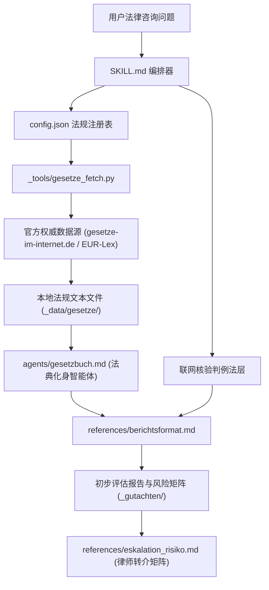
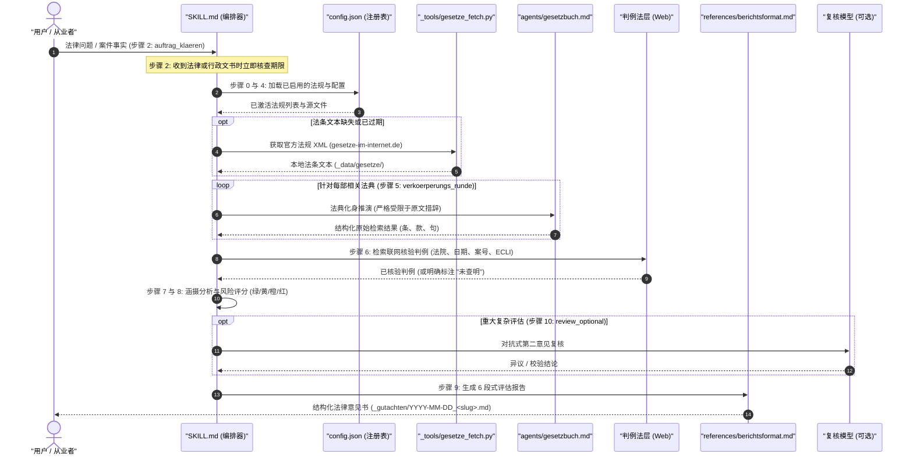

[English](README.md) | [Deutsch](README_de.md) | [Español](README_es.md) | [Français](README_fr.md) | [Português](README_pt.md) | [Русский](README_ru.md) | **简体中文** | [日本語](README_ja.md) | [العربية](README_ar.md) | [हिन्दी](README_hi.md) | [বাংলা](README_bn.md)


# law-checker（法律部门 / Rechtsabteilung）

[](CHANGELOG.md)
[](LICENSE)
[](https://www.python.org/)
[](tests/)
[](.github/workflows/ci.yml)
[](#data-privacy--confidentiality)
[](#data-privacy--confidentiality)
[](THIRD_PARTY_LICENSES.md)
[](SECURITY.md)
[](#legal-framework--rdg-classification)
[](SKILL.md)
[](https://github.com/ellmos-ai)
[](https://github.com/open-bricks)
[](llms.txt)
[](#)

**基于官方权威法条文本的开源 AI 工作流，用于依据德国法律进行初步法律研判与合规参考。**

> [!NOTE]
> **AI / LLM 智能体发现：** 机器可读的项目摘要位于 [`llms.txt`](llms.txt)（最后核查日期：2026-09-19）。

> [!IMPORTANT]
> **重要提示 / Wichtig：本工具仅提供 AI 辅助的初步法律参考，不构成法律意见或法律咨询。** 本工具不是律师事务所，也不是托管法律服务，不能替代执业律师的个案法律评估。具体部署是否构成德国《法律服务法》（*Rechtsdienstleistungsgesetz*，RDG）所规范的法律服务，取决于实际运营模式、运营方角色及具体个案情况。本工具不提供自动期限监控，也不对内容的完整性或时效性作出保证。如涉及行政机关、司法机关来函及正在进行的法定或诉讼期限，请立即咨询具备资质的专业律师。

---

## 快速导航

1. [项目概述](#sec-01)
2. [目标群体与高意图应用场景](#sec-02)
3. [架构对比矩阵](#sec-03)
4. [系统架构](#sec-04)
5. [工作流生命周期](#sec-05)
6. [治理原则与运行时不变量](#sec-06)
7. [法律框架与 RDG 合规分类](#sec-07)
8. [关联工具与生态系统](#sec-08)
9. [安装与快速开始](#sec-09)
10. [添加新法规](#sec-10)
11. [数据隐私与保密原则](#sec-11)
12. [法规注册表清单](#sec-12)
13. [报告架构与可视化流程说明](#sec-13)
14. [第三方许可证与软件物料清单（SBOM）](#sec-14)
15. [仓库目录结构](#sec-15)
16. [安全策略](#sec-16)
17. [项目渊源与作者说明](#sec-17)
18. [法定免责声明（§ 521 BGB）与开源许可证](#sec-18)

---

<a id="sec-01"></a>
## 项目概述

`law-checker`（*Rechtsabteilung*）是一套面向本地 LLM 开发环境（例如 Claude Code）的模块化 Skill 与智能体协作集合，用于依据德国联邦法及欧盟法生成结构化、有据可查的初步法律评估报告。

系统严格执行以下证据与引证纪律：
- **零幻觉法条引用：** 每项法律论述都必须直接出自本地存储的官方权威法条文本，并精确引用至具体的条（Artikel/Paragraph）、款（Absatz）和句（Satz）（例如 `§ 823 Abs. 1 BGB` + 原文摘录 + 源文件与抓取时间戳）。严禁仅凭模型记忆引用法律规范。
- **法典化身原则（Embodiment Principle）：** 专用的通用智能体（“你就是法典本身”）仅读取真实有效的法条文本——严格遵守适用范围审查纪律（先审查是否适用，再讨论具体适用），并如实标明边界：*“我的法条原文对此未作定论；司法解释自此处开始。”*
- **独立的判例法层：** 法院裁判从不依赖训练记忆回忆生成。判例法严格通过实时联网核验获取（包含审理法院、裁判日期、案号、ECLI 及可核验出处）。未检索到有效判例时，必须明确标注为“未查明”。
- **风险交通灯与升级矩阵：** 基于客观标准划分为低（Low）、中（Medium）、高（High）、极高（Critical）四个风险等级，并配套专业律师领域分流矩阵以及针对来函法律文书的严格期限审查纪律。

---

<a id="sec-02"></a>
## 目标群体与高意图应用场景

`law-checker` 专为在欧洲及德国法律管辖范围内开展工作的技术从业者、开发者及合规负责人打造，满足其对快速、可复现且无幻觉、无数据外泄风险的初步法律研判需求：

```text
┌─────────────────────────────────────────────────────────────────────────────┐
│                       TARGET PERSONA MAPPING & USE CASES                    │
├────────────────────────────────┬────────────────────────────────────────────┤
│ [PERSONA-01] 法律科技 / 法务运营│ 面向企业内部法务的自动化法条初筛，         │
│                                │ 摆脱商业专有数据库的供应商锁定。           │
├────────────────────────────────┼────────────────────────────────────────────┤
│ [PERSONA-02] 开源项目维护者     │ 快速明确德国版本说明义务（Impressum）、    │
│                                │ GDPR 隐私声明与开源许可证署名要求。        │
├────────────────────────────────┼────────────────────────────────────────────┤
│ [PERSONA-03] AI 系统架构师      │ 零幻觉法条化身模式与清晰的法律规范/学理    │
│                                │ 解释边界架构设计。                         │
├────────────────────────────────┼────────────────────────────────────────────┤
│ [PERSONA-04] DPO 与合规官       │ 面向 GDPR、EHDS（EU 2025/327）及 SGB V     │
│                                │ 数字医疗规范的可审计评估留痕。             │
└────────────────────────────────┴────────────────────────────────────────────┘
```

- **`[PERSONA-01]` 法律科技工程师与企业内部法务运营（Legal Ops）：**
  - *核心痛点：* 商业法律数据库（Beck-Online、Juris）缺乏原生的智能体 LLM 集成接口，且每个席位年费高达数千欧元；而普通 LLM 对话容易编造法条。
  - *解决方案：* 基于德国联邦司法部（BMJ）/ 联邦司法局（BfJ）官方 XML 法规库的完全可脚本化、可溯源 CLI 与 Claude Code Skill 流水线。
  - *高频检索需求：* `German legal tech AI first look`、`automated statute checker API`、`in-house legal workflow LLM`。
- **`[PERSONA-02]` 开源项目维护者与独立开发者：**
  - *核心痛点：* 不清楚德国监管义务边界（例如 TDDDG / TMG 下的*网站版本说明义务 Impressumspflicht*、GitHub 上的 DSGVO/GDPR 合规要求、德国著作权法 UrhG 下的 MIT/AGPL 许可署名规则）。
  - *解决方案：* 快速、可复现的核查机制，通过法条原文明确展示个人开发者仓库是否触发德国 Impressum 义务，或属于非商业例外情形。
  - *高频检索需求：* `Is an Impressum required for personal GitHub repo Germany`、`TDDDG Impressum open source`、`German copyright UrhG software license`。
- **`[PERSONA-03]` AI 智能体开发者与解决方案架构师：**
  - *核心痛点：* 传统基于向量的 RAG 会在分块（chunk）边界处割裂法条文本，把一般规定与特别法例外（*lex specialis*）拆散，从而导致错误判断。
  - *解决方案：* 法典化身智能体模式（`agents/gesetzbuch.md`），让 LLM 严格受限于已颁布的法条原文开展推理（“我的条文措辞对此不作决定”）。
  - *高频检索需求：* `Statute embodiment AI agent architecture`、`zero hallucination legal prompt pattern`、`Claude Code legal skill`。
- **`[PERSONA-04]` 合规官与数据保护官（DPO）：**
  - *核心痛点：* 数字医疗应用、AI 产品与科研软件需要对 DSGVO/GDPR、欧洲健康数据空间条例 EHDS（Regulation (EU) 2025/327）及德国《社会法典第五部》（SGB V）进行可验证且具完整审计轨迹的合规评估。
  - *解决方案：* 标准化的 6 段式法律意见书（Gutachten）格式，包含明确风险评分（低、中、高、极高）、法条抓取时间戳以及专业律师转介升级路径。
  - *高频检索需求：* `EHDS Regulation EU 2025/327 legal compliance check`、`SGB V health data AI assessment`、`DSGVO privacy risk triage`。

---

<a id="sec-03"></a>
## 架构对比矩阵

从 10 个关键架构维度将 `law-checker` 与常见替代方案进行横向对比：

| 架构维度 | 裸 LLM 对话（ChatGPT/Claude 直出） | 传统商业法律数据库（Beck/Juris） | 通用法律 RAG / 向量检索 | 无辅助网页搜索 / 论坛 | `law-checker`（Rechtsabteilung） |
|---|---|---|---|---|---|
| **1. 规范级溯源** | ❌ 无（依赖参数记忆） | ⚠️ 仅支持人工检索 | ⚠️ 部分支持（分块易断裂） | ❌ 仅二手转述来源 | ✅ **严格原文引证（§, Abs., S.）** |
| **2. 抗幻觉能力** | ❌ 频繁编造法条编号 | ✅ 高（官方权威文本） | ❌ 易产生上下文幻觉 | ❌ 风险高（帖子常过时） | ✅ **100% 官方 XML 法规缓存** |
| **3. 化身纪律约束** | ❌ 混淆个人观点与法条 | ❌ 不适用（人工阅读） | ❌ 混同评注与法律条文 | ❌ 充斥主观臆测 | ✅ **“你就是法典本身”** |
| **4. 判例法核验** | ❌ 编造案号与 ECLI | ✅ 完整全面（付费墙限制） | ⚠️ 存在未核验引用 | ⚠️ 准确度参差不齐 | ✅ **仅采用实时联网核验判例** |
| **5. 零外泄隐私保护** | ❌ 提示词全量外发 | ⚠️ 检索记录留存于服务端 | ⚠️ 向量嵌入上传云端 | ❌ 追踪器与搜索日志风险 | ✅ **100% 本地优先 / Git 忽略敏感目录** |
| **6. 监管边界界定** | ❌ 免责声明往往薄弱 | ⚠️ 依赖企业版服务条款 | ❌ 责任边界不清晰 | ❌ 存在违规提供法律咨询风险 | ✅ **严格遵守 § 2 RDG 自用声明** |
| **7. 期限优先级分流** | ❌ 完全忽略 | ❌ 依赖人工日程提醒 | ❌ 忽略 | ❌ 极易遗漏法定期限 | ✅ **第 2 步优先期限关卡** |
| **8. 版本化法规注册表** | ❌ 黑盒训练知识截止期 | ⚠️ 静默更新难追踪 | ❌ 无版本控制索引 | ❌ 搜索引擎结果波动 | ✅ **可审计的 `config.json`（v5）** |
| **9. 跨系统 CI 测试** | ❌ 不适用 | ❌ 闭源商业软件 | ⚠️ 零散的临时单元测试 | ❌ 不适用 | ✅ **Ubuntu / Windows / macOS CI** |
| **10. 成本与许可** | ⚠️ 每席位 $20–$200/月 | ❌ 每年 €1,500–€5,000+ | ⚠️ 基础设施算力开销 | ✅ 免费（但耗时巨大） | ✅ **100% 免费且开源（MIT）** |

---

<a id="sec-04"></a>
## 系统架构

系统架构将任务编排、官方权威法源、司法判例解释与报告生成清晰解耦为独立模块化层次：



---

<a id="sec-05"></a>
## 工作流生命周期

`SKILL.md` 定义的 10 步评估生命周期确保每一次法律初步参考均具备可复现性、严谨性与透明度：



---

<a id="sec-06"></a>
## 治理原则与运行时不变量

本工具在架构与运行层面严格保证以下 10 项不可违背的不变量：

| # | 不变量 | 说明 | 强制执行机制 |
|---|---|---|---|
| 1 | **100% 本地优先与零外泄** | 法规抓取与报告生成均在本地运行；零遥测、零追踪、无自动数据外传。 | `.gitignore` 严格忽略 `_gutachten/`、`_data/gesetze/` 与 `config.local.json`。 |
| 2 | **严格来源绑定** | 法条陈述必须引用本地文本中的精确条/款/句及原文字句。 | `agents/gesetzbuch.md` 与 `references/berichtsformat.md` 拒绝来自记忆的法条引用。 |
| 3 | **联网核验判例法** | 裁判文书必须附法院、日期、案号及 ECLI；未核验的裁判一律记为“未查明”。 | `SKILL.md` 第 6 步禁止从 LLM 参数记忆中引用判例。 |
| 4 | **非咨询类自用边界** | 严格遵循 § 2 Abs. 1 RDG 法律界定；仅作初步参考，不构成委托代理关系。 | 在 `README.md`、`SKILL.md` 及每份报告第 5 部分展示醒目提示。 |
| 5 | **严格期限纪律** | 面对收到法律函件或行政通知的情况，必须在实质分析前优先进行期限核查。 | `references/eskalation_risiko.md` 赋予法定与司法期限最高优先级。 |
| 6 | **法规注册表版本化** | 新增法典或变更启用状态均为可追溯的版本化配置变更。 | `config.json` 中的 Schema 版本号配合变更日志（Changelog）记录。 |
| 7 | **非提权与用户态安全** | 以普通非特权用户权限运行，无需任何系统管理员权限提升（`RunAsInvoker`）。 | 纯 Python 3 标准库与 CLI 调用，不使用系统级钩子。 |
| 8 | **确定性风险评分** | 将分析结论映射至客观的 4 级风险交通灯（低、中、高、极高）并匹配专业领域。 | `references/eskalation_risiko.md` 中固化的评估矩阵。 |
| 9 | **多系统 CI 矩阵与并发控制** | 在 Ubuntu、Windows 和 macOS 上运行测试，并启用并发取消（`cancel-in-progress: true`）。 | 覆盖 Python 3.10 至 3.13 的 GitHub Actions 工作流（`.github/workflows/ci.yml`）。 |
| 10 | **双语文档一致性** | 英文与德文文档保持完整的结构、概念与导航一致性。 | 通过 `tests/test_metadata.py` 中的自动化契约测试校验。 |

---

<a id="sec-07"></a><a id="legal-framework--rdg-classification"></a>
## 法律框架与 RDG 合规分类

本工具专为**本地运行下的个人/内部自用**而设计：您在自己的 LLM 环境中将其用于处理**您自身**的问题与事实情况。项目作者不提供托管平台、不承接案件委托、不提供法律咨询支持，亦不负责期限管理。

依据德国《法律服务法》（*Rechtsdienstleistungsgesetz*，RDG）进行的合规分类评估（项目自评，截至 2026-07-11）：

| 部署使用模式 | 法律定性 |
|---|---|
| 用于处理**自身**事实与法律事务 | 不构成法律服务（不涉及“他人事务”，§ 2 Abs. 1 RDG）。 |
| 软件的公开发布与分发 | 不构成法律服务（通用技术工具，未针对个案提供处理；参见德国联邦最高法院 BGH 2021 年 9 月 9 日判决 — I ZR 113/20 "Smartlaw" — 视具体设计可类推适用）。 |
| 用于**为第三方**评估具体个案 | 可能构成受监管的法律服务（§ 2 Abs. 1 RDG 遵循技术中性原则）——有偿提供通常需取得官方许可（§ 3 RDG）；即使无偿提供亦须遵守法定条件（§ 6 Abs. 2 RDG）。**此情形明确超出本项目的预期用途。** |

任何机构或个人若改变运行架构（例如提供托管服务、面向外部提供服务或代第三方处理事务），均须自行独立重新评估其合法合规性。
EU AI Act（欧盟人工智能法案）自我分类说明请参阅 [`docs/ai-act-note.md`](docs/ai-act-note.md)。

---

<a id="sec-08"></a>
## 关联工具与生态系统

`law-checker` 与 `ellmos-ai` 开发者生态及总括开源组织 `open-bricks` 下的多个关联项目协同工作：

| 项目 | 角色 / 集成定位 | 代码仓库 |
|---|---|---|
| **`ellmos-ai`** | 核心 AI 基础设施组织与 MCP 服务器集合 | [ellmos-ai](https://github.com/ellmos-ai) |
| **`open-bricks`** | 模块化开源开发者工具与桌面生态总括组织 | [open-bricks](https://github.com/open-bricks) |
| **`policy-registry`** | 跨智能体治理策略管理与签名授权体系 | [policy-registry](https://github.com/ellmos-ai/policy-registry) |
| **`anonymizer`** | 隐私优先预处理用的故障关闭型（Fail-Closed）文档假名化库 | [anonymizer](https://github.com/ellmos-ai/anonymizer) |
| **`lock-master`** | 多智能体并发协调与项目文件锁定系统 | [lock-master](https://github.com/ellmos-ai/lock-master) |
| **`automation-master`** | 面向自主后台智能体的事件溯源式额度与预留管理系统 | [automation-master](https://github.com/dev-bricks/automation-master) |
| **`system-gap-master`** | 多智能体缺口检测、策略执行与仓库卫生审计系统 | [system-gap-master](https://github.com/ellmos-ai/system-gap-master) |
| **`companion-for-agy`** | 无头 CLI 运行器、PTY 生命周期监管与诊断会话录制工具 | [companion-for-agy](https://github.com/ellmos-ai/companion-for-agy) |
| **`gardener`** | 临时沙盒化工具执行器与本地 SQLite 知识库仓库 | [gardener](https://github.com/ellmos-ai/gardener) |
| **`marblerun`** | 多智能体回合制战术编排与工作交接引擎 | [marblerun](https://github.com/ellmos-ai/marblerun) |
| **`report-forge`** | 用于格式化报告生成流水线的领域无关核心引擎 | [report-forge](https://github.com/ellmos-ai/report-forge) |
| **`steuer-assistent`** | 用于自用税务支出记录与初步整理的独立工具 | [steuer-assistent](https://github.com/ellmos-ai/steuer-assistent) |

### FolderHome 消费方（锁定源码修订版本）

在 FolderHome 源码提交 [51d5dc71](https://github.com/ellmos-ai/FolderHome/commit/51d5dc71ec11f1cde4598c528323483a50f6e52c) 中，`law-checker` 组件将本仓库锁定于[修订版本 a5b0cd51](https://github.com/ellmos-ai/rechtsabteilung/commit/a5b0cd51bc3666962f2fae8017c855dea0a712a2)。其桥接模块仅校验已锁定的 `pyproject.toml`、模块清单和本地注册表配置，既不加载 law-checker 智能体工作流，也不对外暴露任何法律审查 API。该项校验报告无任何网络调用。组件清单声明了无需门控（gate）的 `legal.registry.read` 以及带门控的 `legal.orientation.handoff`；二者均未声明副作用。上述内容仅记录本地元数据校验及受独立门控保护的交互移交，不构成法律评估，亦不保证对后续修订版本的兼容性。

---

<a id="sec-09"></a>
## 安装与快速开始

### 1. 克隆仓库并安装依赖

```bash
git clone https://github.com/ellmos-ai/law-checker.git
cd law-checker

# Install editable package (requires Python >=3.10)
pip install -e .
```

### 2. 拉取官方权威法规文本

法规文本直接从官方代码库获取并存储于本地：

```bash
# List all registered and active statutes
PYTHONIOENCODING=utf-8 python _tools/gesetze_fetch.py --list

# Download and parse all enabled federal statutes
PYTHONIOENCODING=utf-8 python _tools/gesetze_fetch.py
```

### 3. 将 Skill 与 Agent 部署至 Claude Code

```bash
# Copy skill orchestrator and embodiment agent into your Claude environment
cp SKILL.md ~/.claude/skills/rechtsabteilung/SKILL.md
cp agents/gesetzbuch.md ~/.claude/agents/gesetzbuch.md
```

在 `~/.claude/skills/rechtsabteilung/SKILL.md` 中，将 `<MODUL>` 设置为您本地克隆仓库的绝对路径。

在 Claude Code 中调用示例：
```text
/rechtsabteilung Is an imprint (Impressum) legally mandatory for purely personal open-source repositories on GitHub?
```

---

<a id="sec-10"></a>
## 添加新法规

扩展法规目录无需修改任何智能体代码：

1. **在 `config.json` 中添加条目：** 在 `gesetzbuecher` 下定义新键名（填写 `name`、`kurz`、`zitierweise`、`quelle`，德国联邦法还需填写 `xml_zip`）。
2. **抓取官方文本：**
   ```bash
   PYTHONIOENCODING=utf-8 python _tools/gesetze_fetch.py <key>
   ```
3. **递增版本号：** 更新 `config.json` 中的 `version` 字段，并在变更日志中记录此次扩展。

*关于欧盟法与州法（Landesrecht）的说明：* 对于在 `gesetze-im-internet.de` 上没有 XML 接口的法规（例如 GDPR/DSGVO 或《德国州际媒体条约》MStV），请将官方文本以 UTF-8 编码文件保存至 `_data/gesetze/`，并在文件头部注明官方来源 URL 及抓取时间戳。

---

<a id="sec-11"></a><a id="data-privacy--confidentiality"></a>
## 数据隐私与保密原则

法律咨询往往涉及敏感个人信息、商业秘密或受保密义务保护的往来函件。请严格遵守以下准则：

- **数据最小化优先：** 在输入提示词前，对姓名、住址、案号以及可识别的企业业务细节进行脱敏或假名化处理。建议使用 [`anonymizer`](https://github.com/ellmos-ai/anonymizer) 进行自动化预处理。
- **云端 LLM 数据暴露风险：** 发送至云端模型的提示词将由对应服务提供商处理。若未签署适当的数据处理协议（AVV/DPA），切勿向第三方 LLM 输入未经脱敏的机密法律文书、商业秘密或医疗数据。
- **本地工具链零数据外传：** 本工具在您的工作站上完全离线运行。下载的法规文本和生成的评估报告均保留在 `_data/gesetze/` 与 `_gutachten/` 中，不会向作者发送任何数据。
- **严禁在公开 Issue 中发布真实案情：** 提交 GitHub Issue 或错误报告时，请仅使用完全虚构的假设性案例。

更多安全细节请参阅 [`SECURITY.md`](SECURITY.md)。

---

<a id="sec-12"></a>
## 法规注册表清单

默认法规注册表（`config.json`，版本 5）预配置了 13 部涵盖德国联邦法、州法及欧盟法的法规：

| 键名 | 法规名称 | 适用法域 | 状态 | 主要来源 |
|---|---|---|---|---|
| `gg` | Grundgesetz für die Bundesrepublik Deutschland（《德意志联邦共和国基本法》） | 联邦法 (DE) | **启用** | gesetze-im-internet.de |
| `bgb` | Bürgerliches Gesetzbuch（《德国民法典》） | 联邦法 (DE) | **启用** | gesetze-im-internet.de |
| `sgb5` | Sozialgesetzbuch V（《德国社会法典第五部》— 法定医疗保险） | 联邦法 (DE) | **启用** | gesetze-im-internet.de |
| `urhg` | Urheberrechtsgesetz（《德国著作权法》） | 联邦法 (DE) | **启用** | gesetze-im-internet.de |
| `rdg` | Rechtsdienstleistungsgesetz（《德国法律服务法》） | 联邦法 (DE) | **启用** | gesetze-im-internet.de |
| `markeng` | Markengesetz（《德国商标法》） | 联邦法 (DE) | **启用** | gesetze-im-internet.de |
| `stberg` | Steuerberatungsgesetz（《德国税务咨询法》） | 联邦法 (DE) | **启用** | gesetze-im-internet.de |
| `uwg` | Gesetz gegen den unlauteren Wettbewerb（《德国反不正当竞争法》） | 联邦法 (DE) | **启用** | gesetze-im-internet.de |
| `dsgvo` | General Data Protection Regulation（《通用数据保护条例》Regulation (EU) 2016/679） | 欧盟法 | **启用** | EUR-Lex |
| `ehds` | European Health Data Space（《欧洲健康数据空间条例》Regulation (EU) 2025/327） | 欧盟法 | **启用** | EUR-Lex |
| `grch` | Charter of Fundamental Rights of the European Union（《欧盟基本权利宪章》） | 欧盟法 | **启用** | EUR-Lex |
| `stgb` | Strafgesetzbuch（《德国刑法典》） | 联邦法 (DE) | *未启用* | gesetze-im-internet.de |
| `mstv` | Medienstaatsvertrag（《德国州际媒体条约》） | 州法 (DE) | *未启用* | die-medienanstalten.de |

---

<a id="sec-13"></a>
## 报告架构与可视化流程说明

`law-checker` 生成的每份法律评估报告均严格遵循 [`references/berichtsformat.md`](references/berichtsformat.md) 定义的标准化 6 段式 *Gutachten*（法律意见书）结构，确保符合严谨的德国法学涵摄方法论（*Gutachtenstil*）：

```text
┌─────────────────────────────────────────────────────────────────────────────┐
│                 STRUCTURED LEGAL FIRST-LOOK ASSESSMENT ARCHITECTURE         │
│ 文件: _gutachten/YYYY-MM-DD_<themen-slug>.md                                │
├─────────────────────────────────────────────────────────────────────────────┤
│ 1. 事实与问题界定 (Sachverhalt & Fragestellung / Factual Inquest & Scope)   │
│    ├─ 提问主体、背景语境与案件事实要素                                      │
│    └─ 强制优先审查：收到行政或司法来函时的法定期限核查                      │
├─────────────────────────────────────────────────────────────────────────────┤
│ 2. 规范层面：权威法条原文 (Embodiment Extracts)                             │
│    ├─ 已识别的相关法条清单（例如 § 5 TDDDG、BGB）                           │
│    └─ 来自本地 XML 法规库的精确到款与句的逐字引文                           │
├─────────────────────────────────────────────────────────────────────────────┤
│ 3. 判例法与司法解释 (Web-Verified Jurisprudence)                            │
│    ├─ 相关指导性判例（BGH、BAG、BVerfG、EuGH）                              │
│    └─ 严格引注格式：法院、日期、案号、出处、ECLI                            │
├─────────────────────────────────────────────────────────────────────────────┤
│ 4. 综合分析与涵摄推理 (Legal Methodology / Gutachtenstil)                   │
│    ├─ 构成要件特征与现有案件事实的逐项对照                                  │
│    └─ 明确区分：何为法律强制性规定，何为合理可辩护的解释空间                │
├─────────────────────────────────────────────────────────────────────────────┤
│ 5. 风险评级与律师转介建议 (Risk Traffic Light & Referral)                   │
│    ├─ 交通灯评分: [低 / 绿] | [中 / 黄] | [高] | [极高 / 红]                │
│    ├─ 评级理由及具体潜在损害或律师警告函（Abmahnung）风险                   │
│    └─ 对应专业领域执业律师（Fachanwalt）推荐                                │
├─────────────────────────────────────────────────────────────────────────────┤
│ 6. 来源清单与审计日志 (Provenance & Audit Log)                              │
│    ├─ 所使用法规文本及其官方抓取时间戳与版本标记                            │
│    └─ 本次执行的 LLM 运行版本与模型元数据                                   │
└─────────────────────────────────────────────────────────────────────────────┘
```

---

<a id="sec-14"></a>
## 第三方许可证与软件物料清单（SBOM）

`law-checker` 依据 [MIT 许可证](LICENSE)认证开源。项目在 [`THIRD_PARTY_LICENSES.md`](THIRD_PARTY_LICENSES.md) 中维护了完整的软件物料清单（SBOM）与许可证合规审计记录：

- **零传染性开源协议保证：** 不包含任何 GPL、AGPL 或 SSPL 许可的依赖库；可完全自由地用于商业及非商业本地工程实践。
- **非特权模式执行（`RunAsInvoker`）：** 在任何操作系统上均不需要 root 或系统管理员权限提升。
- **官方公有领域文本：** 从 `gesetze-im-internet.de` 获取的法规文本属于德国《著作权法》（UrhG）§ 5 Abs. 1 UrhG 所规定的官方公务作品（*Amtliche Werke*），不受著作权保护。欧盟立法文件依据欧盟委员会第 2011/833/EU 号决定进行复用。

---

<a id="sec-15"></a>
## 仓库目录结构

```text
law-checker/
├── .github/workflows/ci.yml    ← 跨平台 CI 矩阵（Ubuntu、Windows、macOS）
├── .github/workflows/stale.yml ← 过期 Issue 与 Pull Request 自动清理工作流
├── SKILL.md                    ← 编排主 Skill 工作流（10 步法流程）
├── config.json                 ← 法规注册表与流水线定义（v5）
├── agents/
│   └── gesetzbuch.md           ← 通用法典化身智能体提示词
├── references/
│   ├── berichtsformat.md       ← 6 段式法律报告模板与引证规范
│   └── eskalation_risiko.md    ← 风险交通灯、期限核查与律师领域矩阵
├── _tools/
│   ├── __init__.py             ← Python 包标识文件
│   └── gesetze_fetch.py        ← 官方法规抓取器与 XML 解析器
├── docs/
│   └── ai-act-note.md          ← 欧盟 AI 法案（EU AI Act）自我分类说明
├── tests/
│   ├── test_gesetze_fetch.py   ← 法规抓取与提取单元测试
│   └── test_metadata.py        ← 自动化契约与元数据一致性测试
├── CHANGELOG.md                ← 版本与发布历史记录
├── SECURITY.md                 ← 含 48 小时响应 SLA 的安全策略
├── THIRD_PARTY_LICENSES.md     ← 第三方许可证审计、SBOM 与 § 5 UrhG 定性说明
├── MARKETING-LOG.txt           ← 本地推广与可发现性待办记录
├── llms.txt                    ← 面向 AI 编程智能体的机器可读上下文
├── ellmos-module.v2.json       ← 标准化模块清单（rechtsabteilung）
├── pyproject.toml              ← PEP 621 包元数据与测试配置
├── _data/gesetze/              ← 已下载的本地法规文件（通过 .gitignore 忽略）
└── _gutachten/                 ← 生成的法律评估报告（通过 .gitignore 忽略）
```

---

<a id="sec-16"></a>
## 安全策略

安全性、保密性与数据防护是本项目的立身之本。如发现安全漏洞，可通过以下私密渠道报告：
- [GitHub Security Advisories](https://github.com/ellmos-ai/law-checker/security/advisories)
- 安全联系邮箱：`security@ellmos.ai` | `security@open-bricks.org` | `support@lukasgeiger.com` | `lukas@open-bricks.org`

**响应承诺：** 48 小时内确认受理；5 个工作日内完成初步分诊与影响评估。完整细节请参阅 [`SECURITY.md`](SECURITY.md)。

---

<a id="sec-17"></a>
## 项目渊源与作者说明

本项目融合了三大经过实践检验的核心构建模块：
1. **编辑部法务政策规范：** 标准化的报告模板、客观 4 级风险评分体系、专业领域律师匹配机制与绝不妥协的期限管理纪律。
2. **“活宪法”研究原型：** 法典化身范式（`Du BIST das Gesetzbuch`），强制严格忠实于已颁布的法律文本并将司法解释层彻底分离。
3. **法学知识体系：** 德国法律部门的结构化分类体系以及传统德国法学方法论（*Gutachtenstil*）。

本工作流执行的首次完整评估正是其自身的公开发布审计——其中包含由独立第二模型进行的对抗式复核。

---

<a id="sec-18"></a>
## 法定免责声明（§ 521 BGB）与开源许可证

### 依据 § 521 BGB（*Gefälligkeitsrecht* / *Gefälligkeit*，好意施惠关系）的法定责任提示 / 无偿开源提供声明

> [!IMPORTANT]
> **依据 § 521 BGB 的责任限制：** 本软件、文档、提示词及审核流程均系无偿提供，构成德国民法意义上的好意施惠行为（§ 521 BGB）。作者、维护者及贡献者的责任仅限于故意与重大过失。本软件不构成 § 2 Abs. 1 RDG 意义上的法律服务，亦不能替代执业律师的个案法律审查。本工具不承担任何期限监控义务，且不对内容的完整性、无误性或时效性作出担保。

- **开源许可证：** 依据宽松的 [MIT 许可证](LICENSE)发布，涵盖全部源代码、智能体提示词及文档。
- **第三方 SBOM：** 第三方依赖库的完整审计及依据 § 5 Abs. 1 UrhG 的公有领域状态已详述于 [`THIRD_PARTY_LICENSES.md`](THIRD_PARTY_LICENSES.md)。
- **免责声明：** 本工具按“现状”（as is）提供，不对准确性、完整性或时效性作任何明示或默示保证。法律法规随时间推移可能发生修订；在依据相关内容采取法律行动前，请务必核对德国联邦法律公报（*Bundesgesetzblatt*）官方文本。
- **非法律咨询声明：** 本软件仅用于初步法律参考与研究检索，不提供法律建议，亦不建立任何律师与委托人之间的代理关系。
